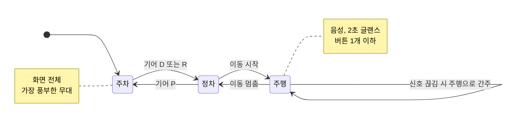

# DESIGN: 경험의 규칙

> 화면을 그리거나 문구·음성을 쓰기 전에 읽는다. 안전 한도는 [SAFETY.md](SAFETY.md)가 우선한다.

## 1. 차 안의 세 순간

"이동"은 실차에선 차속, 에뮬레이터에선 GPX 위치 이동으로 판단한다(Virtual Console에 차속 조작이 없음). 신호 이름과 임계값은 [04 차량 연동](docs/04-vehicle-integration.md) · 한도의 근거는 [SAFETY](SAFETY.md)

| 순간 | 사용자의 주의 | 앱이 쓰는 채널 | 화면 규칙 |
|---|---|---|---|
| **주행 중** | 도로 | 음성(TTS) · 짧은 소리 | 글랜스 한 번에 읽히는 것만, 큰 글자 한 줄, 버튼 ≤ 1 |
| **정차 중** (신호 대기·P단) | 잠깐 비어 있음 | 화면 + 음성 | 전체 화면 가능, 출발하면 즉시 주행 모드로 |
| **주차·대기** | 온전히 비어 있음 | 화면 | 앱의 표현이 가장 풍부해지는 무대 |

## 2. 원칙
1. (작성 예정: 아이디어의 핵심 경험 원칙)
2. 상태가 바뀌면 UI가 먼저 물러난다 (기어 D → 화면 축소, 음성으로 이어감).
3. 한 화면에 한 가지 일.

## 3. 토큰
| 이름 | 값 | 쓰임 |
|---|---|---|
| color.primary | 미정 | 핵심 동작 |
| type.glance | 미정 sp 이상 | 주행 중 한 줄 |
| touch.min | 76 dp (근거 확인) | 차량 터치 최소 크기 |

## 4. 화면 캡처 규칙
모든 스크린샷 캡션에 캡처 조건을 적는다: 에뮬레이터 버전 · API · 해상도 · Virtual Console 값 · 잘라낸 영역. (Pleos 공식 샘플의 방식)

화면 시안: (피그마 링크)
