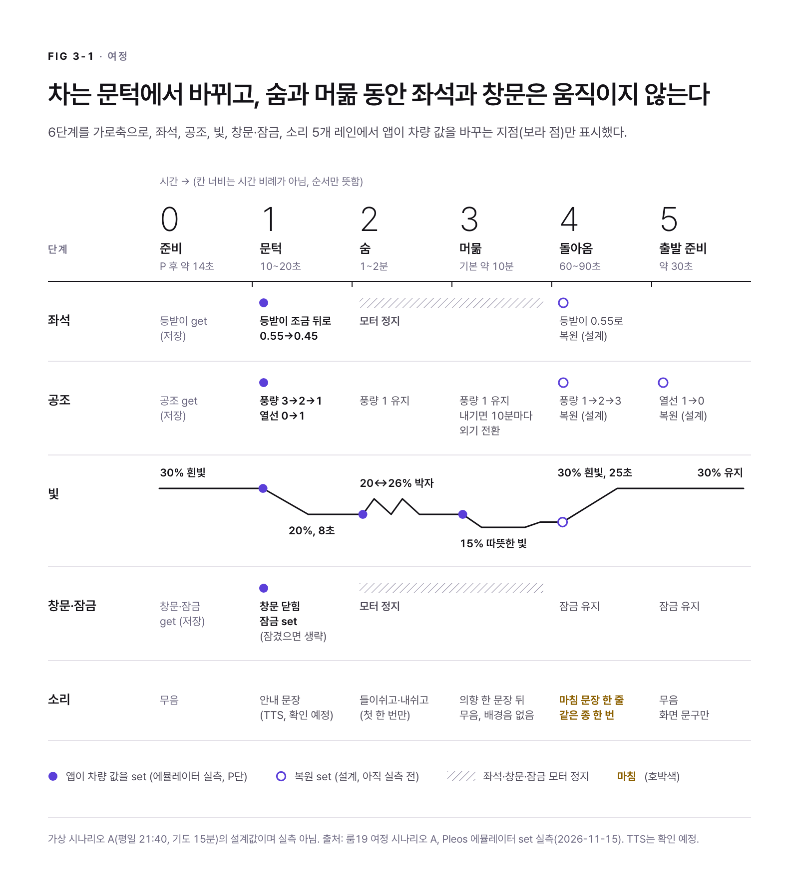
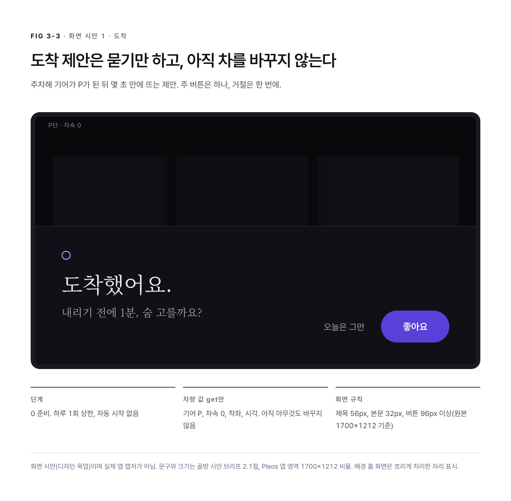
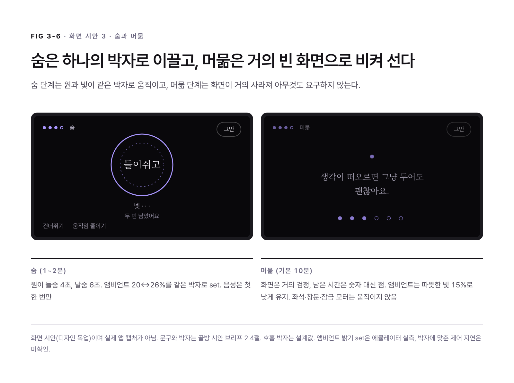
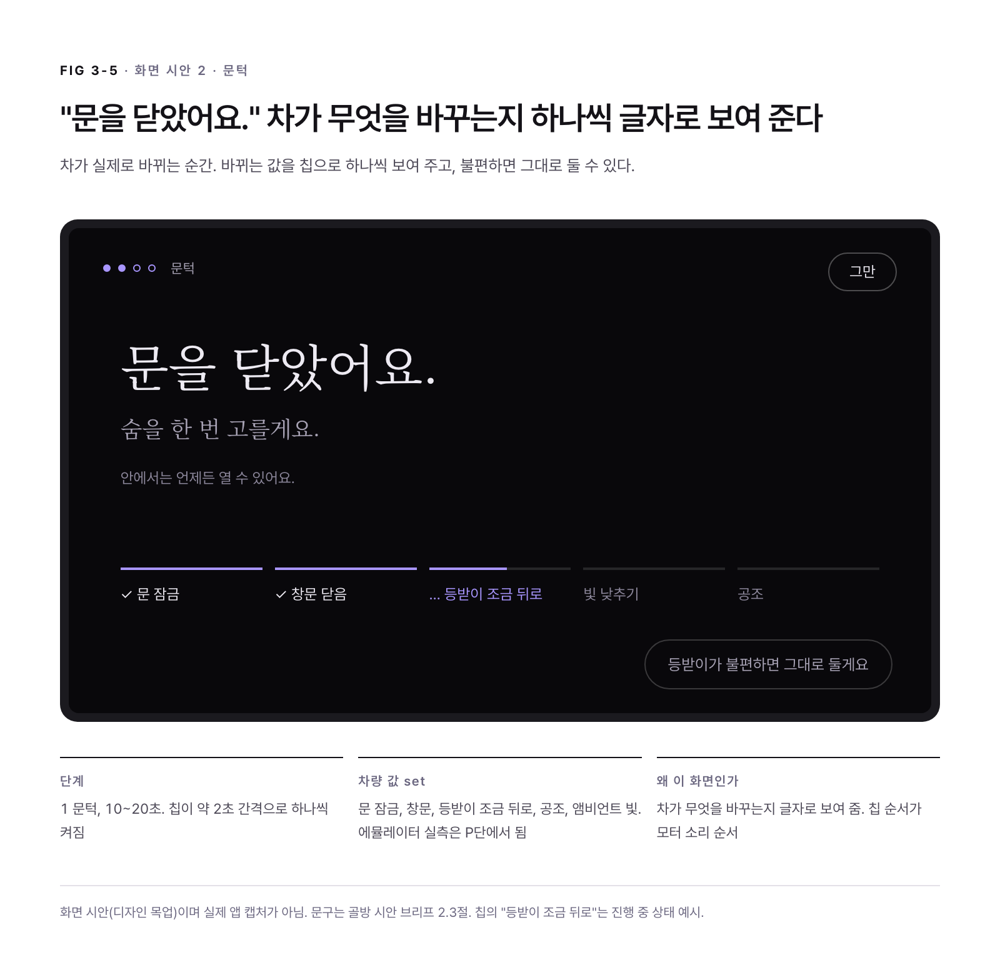
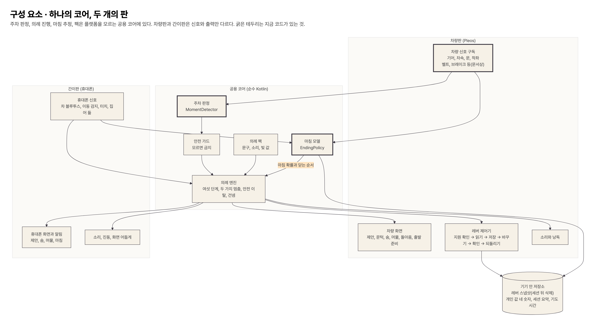
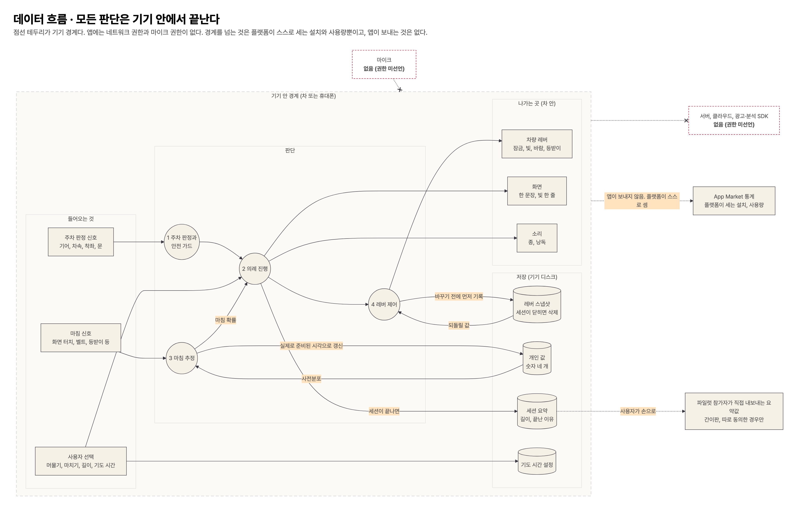
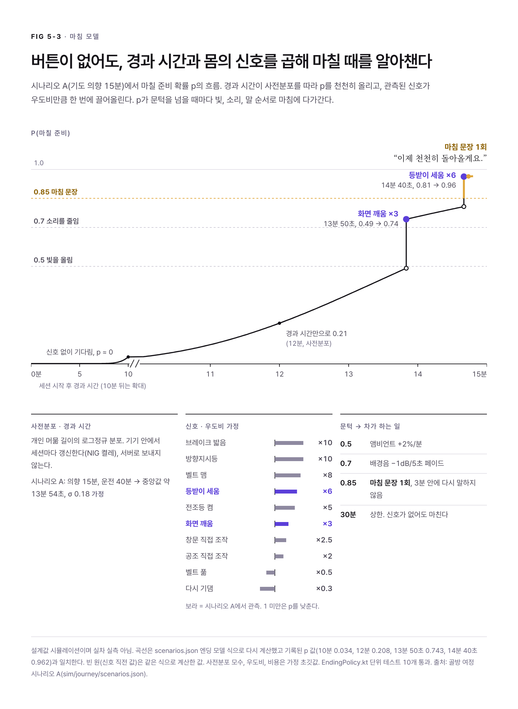
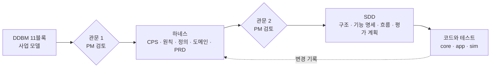

<p align="center">
  
</p>

<h1 align="center">룸19</h1>
<p align="center"><b>주차한 차가 몇 분 동안 나만의 기도실이 된다.</b><br>
<sub>Room 19: a parked car becomes a short prayer room, then quietly turns back into a car.</sub></p>

<p align="center">
  <a href="https://mangsanggwedo-team.github.io/codeyourapp-submission/site/"><strong>소개 페이지</strong></a> ·
  <a href="#실행-방법-how-to-run"><strong>실행 방법</strong></a> ·
  <a href="sim/journey/index.html"><strong>여정 시뮬레이션</strong></a> ·
  <a href="docs/README.md"><strong>문서</strong></a> ·
  <a href="apk/"><strong>APK</strong></a> ·
  <a href="ai/README.md"><strong>AI 협업</strong></a>
</p>

<p align="center">
  
  
  
  <a href=".github/workflows/ci.yml"></a>
</p>

> **심사위원이 3분 안에 볼 것** <sub>(3-minute tour)</sub>
> 1. [여정 시뮬레이션](sim/journey/index.html): 시나리오 A(평일 21:40, 귀가 직전 기도 15분)가 처음부터 끝까지 재생된다
> 2. [차량 제어 실측](docs/04-vehicle-integration.md#제어-실측-2026-11-15): SDK 호출 10개 중 9개가 에뮬레이터에 반영됐다
> 3. [마침 모델](docs/journey/마침_모델.md): 마치기 버튼 없이 끝을 알아채는 방법
> 4. [하네스](docs/harness/): 사업 모델에서 기능 명세까지, 관문을 거친 설계 문서 13편

## 30초 소개 <sub>What it does</sub>

일터에도 집에도 문 닫고 혼자 있을 자리는 드물다. 그런데 주차한 차는 이미 문이 있고, 의자가 있고, 아무도 들어오지 않는 방이다.

룸19는 기어를 P에 둔 순간 한 줄로 묻는다. "잠시 머물다 갈까요." 한 번 누르면 차가 문을 잠그고, 빛을 낮추고, 등받이를 조금 뒤로 기울인다. 그다음에는 아무것도 묻지 않는다. 기도가 끝날 즈음을 차가 알아채 빛부터 천천히 올리고, 다음에 할 일을 짐작해 시작 전 상태로 되돌려 놓는다.

| 들어설 때 | 숨 고르기와 머묾 | 돌아올 때 |
|---|---|---|
| [](docs/assets/proposal/3-3_screen_arrival.png) | [](docs/assets/proposal/3-6_screen_breath_stay.png) | [](docs/assets/proposal/3-5_screen_threshold.png) |
| 주차 후 한 줄, 한 번 누름 | 화면은 거의 검고 차는 조용하다 | 원래 값을 기억해 두었다가 돌려놓는다 |

**하지 않는 것.** 회원가입, 기록 업로드, 서버, 마이크 녹음이 없다. 앱은 네트워크를 쓰지 않고, 모든 판단은 차 안에서 끝난다.

## 여섯 단계 <sub>Six stages</sub>

| 단계 | 시간 | 차가 하는 일 |
|---|---|---|
| 0 준비 | P 후 약 14초 | 시작 전 좌석, 공조, 빛, 창문, 잠금 값을 읽어 저장한다 |
| 1 문턱 | 10~20초 | 창문을 닫고 문을 잠근다(이미 잠겼으면 생략). 등받이를 조금 뒤로 기울인다. 종이 한 번 울린다 |
| 2 숨 | 1~2분 | 빛이 숨 박자로 오르내린다. 안내는 첫 한 번만 |
| 3 머묾 | 기본 약 10분 | 무음. 묻지 않는다. 내기 순환이면 10분마다 외기로 바꾼다 |
| 4 돌아옴 | 60~90초 | 따뜻한 빛, 마침 문장 한 줄, 같은 종 한 번 |
| 5 출발 준비 | 약 30초 | 저장한 값으로 되돌리고 화면 문구만 남긴다 |

- **버튼 없는 마침.** 마치기 버튼도, 끝을 고르는 메뉴도 없다. 시간, 지난 세션 길이, 화면 터치와 좌석 조작 같은 약한 신호로 끝을 짐작하고([EndingPolicy](core/src/main/kotlin/com/mangsang/app/core/EndingPolicy.kt)), 다음 걸음(집에 가는 길, 곧 출발 등)도 맥락으로 짐작한다.
- **멈추고 이어가기.** 전화, 노크, 기어 변경으로 끊기면 그 자리에 멈춰 두었다가 돌아오면 이어간다.
- **등받이는 조금만.** 눕히지도, 곧추세우지도 않는다. 살짝 뒤로 기댄 자세에서 머물고 끝나면 운전 자세로 돌아간다.

## Pleos Vehicle SDK 활용 <sub>How it uses the car</sub>

Pleos Connect 에뮬레이터(v2.1.0, Vehicle SDK 2.3.2)에서 일회용 탐침 앱으로 **set 호출 10개 중 9개가 실제로 반영됐다**(2026-11-15). 문 잠금과 등받이는 **P단에서만** 동작하고, 기어 D에서는 거부(50001)된다.

| 영역 | 호출 | 단계 | 결과 |
|---|---|---|---|
| 공조 | `setHvacTemperature` | 머묾 | 반영 (22.0 → 18.0) |
| 공조 | `setHvacFanSpeed` | 문턱 · 돌아옴 | 반영 (풍량 3 → 6) |
| 공조 | `setHvacRecirculation` | 머묾 | 반영 (내기 켜짐) |
| 좌석 | `setHvacSeatTemperature` | 문턱 | 반영 (열선 0 → 2) |
| 좌석 | `moveSeatBackrestAngle` | 문턱 · 돌아옴 | 반영, P단 전용 |
| 빛 | `setAmbientLightBrightness` | 문턱 ~ 돌아옴 | 반영 (30 → 20%) |
| 빛 | `setAmbientLightBrightnessColor` | 문턱 ~ 돌아옴 | 반영 |
| 창문 | `setWindowPosition` | 문턱 | 반영 (0 → 50 → 0%) |
| 문 | `setDoorLock` | 문턱 | 반영, P단 전용 |
| 좌석 | `setHvacSeatVentilation` | 쓰지 않음 | SDK 성공, 반영 확인 못 함 (예정) |

기어·차속 구독, 기기 안 TTS, 끝에 원래 값으로 되돌리는 복원 호출 전체는 코드와 설계만 있고 에뮬레이터 확인은 **예정**이다. 자세한 표와 증거: [04 차량 연동](docs/04-vehicle-integration.md) · [SDK 활용 표 그림](docs/assets/proposal/5-2_sdk_usage_table.png)

## 설계 한눈에 <sub>Design at a glance</sub>

| 그림 | 한 줄 |
|---|---|
| [](docs/assets/models/05_세션_상태.png) | **세션 상태.** 사용자가 누르는 것은 머물기 한 번이고, 나머지는 차가 여섯 단계로 이끈다. |
| [](docs/assets/models/01_사용자_여정_지도.png) | **사용자 여정.** 귀가 직전 지하주차장의 15분을 사람, 차, 화면 순으로 따라간다. |
| [](docs/assets/models/03_구성_요소.png) | **구성 요소.** 핵심 로직 하나를 차량판과 휴대폰 간이판이 함께 쓴다. |
| [](docs/assets/models/04_데이터_흐름.png) | **데이터 흐름.** 모든 판단은 기기 안에서 끝나고, 앱이 밖으로 보내는 것은 없다. |
| [](docs/assets/models/10_화면_흐름_에뮬레이터.png) | **화면 흐름.** 에뮬레이터 화면 배치 그대로, 홈에서 룸19로 갔다가 다시 홈으로 온다. |
| [](docs/assets/models/06_시퀀스_문턱.png) | **들어설 때.** 원래 값을 먼저 적어 두고, 차를 바꾸고, 확인한 다음에야 종이 울린다. |
| [](docs/assets/models/07_시퀀스_마침.png) | **마칠 때.** 끝을 묻지 않는다. 빛부터 천천히 올리고 말은 한 번만 한다. |
| [](docs/assets/proposal/5-3_ending_model.png) | **마침 모델.** 시간과 약한 신호로 "마칠 준비" 확률을 올린다. |

도메인 모델, 멈춤 시퀀스, 시스템 컨텍스트까지 10장 전체: [docs/harness/models/](docs/harness/models/) · 디자인 컨셉과 화면 명세: [docs/design/](docs/design/)

## 사업 모델 <sub>Business</sub>

[](docs/assets/ddbm_canvas.png)

기도 한 번은 처음부터 끝까지 **무료**다. 먼저 앱 마켓에 올려 실제로 쓰이는지 보이고, 그 근거로 현대자동차와 **기본 탑재 라이선스**를 협의한다. 절기 기도문 같은 **심화 기능만 구독**으로 받는다. 첫 사용자는 매일 기도하는 한국 개신교 운전자이고, 다른 전통과 비종교 모드는 이후의 확장이다. 광고와 데이터 판매는 하지 않는다. 금액과 목표는 모두 팀이 정한 가정값이다. [06 사업](docs/06-business.md) · [사업 모델 원문](docs/harness/01_business-model.md)

## 일하는 방식: DDBM → 하네스 → SDD <sub>Harness workflow</sub>



사업 모델부터 정하고, 그 위에 문제와 원칙, 용어, 도메인 모델, 요구사항을 쌓은 뒤에야 명세와 코드로 간다. 단계 사이에는 사람이 통과시키는 관문이 있다. 설정은 [harness.yaml](docs/harness/harness.yaml), 관문 기록은 [관문 1](docs/harness/GATE1_검토요청.md) · [관문 2](docs/harness/GATE2_검토요청.md), 전체 문서는 [docs/harness/](docs/harness/README.md).

## 실행 방법 <sub>How to run</sub>

> [!IMPORTANT]
> Pleos Connect 에뮬레이터 **v2.1.0** (API 34, 2560x1440)에서 확인했다. 첫 실행은 Cold boot.

```bash
# 1. Android Studio > Device Manager > Automotive > Pleos Connect v2.1.0, Cold boot
# 2. APK 설치 (파일 이름은 apk/README.md 참고)
adb install apk/*.apk
# 3. 기어를 P로 두면 룸19가 한 줄로 묻는다. 차량 상태 바꾸기: bash scripts/vc.sh park | drive 40 | stop
```

- **차 없이 보기:** [여정 시뮬레이션](sim/journey/index.html)을 브라우저로 연다 ([sim/README](sim/README.md)).
- **소개 페이지:** https://mangsanggwedo-team.github.io/codeyourapp-submission/site/
- **코어 테스트:** `./gradlew :core:test` (차 없이 도는 순수 Kotlin)
- 막혔을 때: [05 시연](docs/05-demo.md)

## 저장소 지도 <sub>Repo map</sub>

| 어디 | 무엇 |
|---|---|
| [app/](app/) · [core/](core/) | 차량판 앱, 차 없이 도는 핵심 로직(마침 모델, 순간 판단)과 테스트 |
| [apk/](apk/) | 설치 파일 |
| [sim/](sim/README.md) · [site/](site/index.html) | 웹 여정 시뮬레이션, 소개 페이지 |
| [docs/](docs/README.md) | 01 문제 → 02 해법 → 03 구조 → 04 차량 연동 → 05 시연 → 06 사업 → 07 과정 |
| [docs/harness/](docs/harness/README.md) | 하네스 설계 문서 00~12, 관문 기록, 모델 그림 10장 |
| [docs/design/](docs/design/README.md) | 디자인 컨셉, 화면 기능 명세, 레퍼런스, 시연영상·랜딩 기획 |
| [docs/research/](docs/research/README.md) | 원문 대조 통계, 인용 카드, [APA 참고문헌](docs/research/참고문헌_APA.md) |
| [docs/journey/](docs/journey/여정_초정밀.md) | 초정밀 여정, 베이지안 마침 모델 |
| [ai/](ai/README.md) | AI와 일한 방식: 에이전트, 하네스, 지시 기록, 사람이 뒤집은 제안 |
| [DESIGN](DESIGN.md) · [SAFETY](SAFETY.md) · [STATS](STATS.md) | 경험의 규칙, 운전자 안전, 다시 셀 수 있는 숫자 |

## 만든 사람들 <sub>Team</sub>

**망상궤도.** PM(기획과 결정, 검증), UX/UI 디자인(경험과 화면, 모션), 리서치(사용자와 통계 원문 대조). 이름 대신 역할로 적는다.

## AI 사용 고지 <sub>AI usage disclosure</sub>

초안, 코드, 그림 렌더링, 원문 대조 같은 반복 작업은 AI 에이전트가 했고, 방향과 결정, 최종 검증은 사람이 했다. 사람이 AI 제안을 뒤집은 기록과 지시 기록 요약은 [ai/](ai/README.md)와 [AI 사용 요약](docs/research/AI_사용_요약.md)에 있다. 숫자는 원문을 다시 열어 확인한 것만 쓴다.

## 참고문헌과 라이선스 <sub>References · License</sub>

- 참고문헌: [docs/research/참고문헌_APA.md](docs/research/참고문헌_APA.md)
- 라이선스: [LICENSE](LICENSE) · 제3자 고지: [THIRD-PARTY-NOTICES](THIRD-PARTY-NOTICES.md)

<sub>2026 현대자동차그룹 Pleos 'Code your App' 출품작 · 망상궤도</sub>
