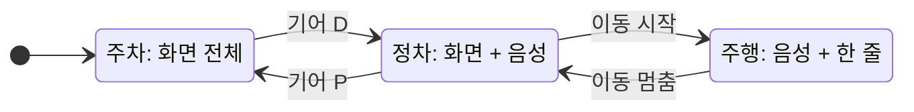

<!-- 배너가 생기면 주석 해제 (다크/라이트 두 장)
<p align="center">
  <picture>
    <source media="(prefers-color-scheme: dark)" srcset="docs/assets/banner-dark.png">
    
  </picture>
</p>
-->

<p align="center">
  <a href="#실행-방법"><strong>실행 방법</strong></a> ·
  <a href="docs/README.md"><strong>문서</strong></a> ·
  <a href="docs/05-demo.md"><strong>시연 시나리오</strong></a> ·
  <a href="apk/"><strong>APK</strong></a> ·
  <a href="ai/README.md"><strong>AI 협업</strong></a>
</p>

<p align="center">
  
  
  <a href=".github/workflows/ci.yml"></a>
</p>

# 앱 이름: 한 줄 소개

**비유 한 줄 (아이디어 확정 후)**

| 앱 이름 | 한 줄 소개 | 테스트 환경 | APK | 실행 |
|---|---|---|---|---|
| 미정 | 미정 | Pleos Connect 에뮬레이터 v2.1.0 (API 34) | [`apk/`](apk/) · Releases | [실행 방법](#실행-방법) |

<!-- 시연 GIF가 생기면 주석 해제
<p align="center"><br>
<sub>Pleos Connect v2.1.0 · API 34 · Virtual Console로 기어 P → D</sub></p>
-->

## 이런 순간을 위해 만들었다
| 지금 차 안에서는 | 이 앱과 함께라면 |
|---|---|
| ❌ (아이디어 확정 후) | ✅ |

문제를 어떻게 찾았나: [01 문제](docs/01-problem.md)

## 심사 기준 대응표
| 심사 항목 | 우리의 답 | 증거 |
|---|---|---|
| **차량 특화성** | 주행·정차·주차 세 순간마다 다르게 동작한다 | [DESIGN 상태도](DESIGN.md) · [04 차량 연동](docs/04-vehicle-integration.md) |
| **창의성** | (아이디어 확정 후) | [01 문제](docs/01-problem.md) · [02 해법](docs/02-solution.md) |
| **기술 활용성** | Pleos SDK 신호가 핵심 기능의 입력이다 | [03 구조](docs/03-architecture.md) · [04 SDK 표](docs/04-vehicle-integration.md) |
| **사업성** | (아이디어 확정 후) | [06 사업](docs/06-business.md) · [ROADMAP](ROADMAP.md) |
| 개발 산출물 | 실행되는 APK, 시연 영상, 추적 가능한 저장소 | [05 시연 · 추적표](docs/05-demo.md#추적표) · [STATS](STATS.md) |

## 어떻게 동작하나

차량 신호가 바뀌면 앱이 먼저 물러난다. 주행 중엔 음성과 2초 안에 읽히는 한 줄만. 신호가 끊기면 주행 중으로 간주한다. 근거: [SAFETY](SAFETY.md) · 구조: [03 구조](docs/03-architecture.md)

## 세 순간의 화면
<!-- 캡처가 생기면 표로: | 주행 | 정차 | 주차 | 캡션에 캡처 조건 (DESIGN 4절) -->
(앱 구현 후 캡처)

## 이 앱이 아닌 것
| | |
|---|---|
| **주행 중 화면을 보게 하는 앱이 아니다.** | 주행 중엔 음성과 2초 글랜스만. [SAFETY](SAFETY.md) |
| (아이디어 확정 후) | 범위를 스스로 자른 이유는 [docs/adr/](docs/adr/) |

## 지금 어디까지
| 상태 | 무엇 |
|---|---|
| 끝남 | 문제 조사, 저장소 설계, 안전 원칙, 구조 설계 |
| 진행 중 | 아이디어 결정 (2026-11-14), 1차 기획서 (2026-11-15) |
| 계획 | 앱 구현, 시연 영상, 2차 PT (2026-12-03) · [ROADMAP](ROADMAP.md) |

---

## 심사위원·개발자용

### 실행 방법
> [!IMPORTANT]
> Pleos Connect 에뮬레이터 **v2.1.0** (API 34)에서 확인했다. 첫 실행은 Cold boot.

```bash
# 1. 에뮬레이터: Device Manager > Automotive > Pleos Connect v2.1.0, Cold boot
# 2. 설치
adb install apk/망상궤도_앱이름_release.apk
# 3. Virtual Console에서 기어를 P → D로 바꾸고 docs/05-demo.md 시나리오대로
```

<details>
<summary>에뮬레이터가 안 뜰 때</summary>

[05 시연 · 막혔을 때](docs/05-demo.md#막혔을-때)
</details>

### 테스트 환경
| 항목 | 값 |
|---|---|
| 에뮬레이터 | Pleos Connect v2.1.0 · Android API 34 |
| 차량 신호 조작 | Virtual Console (기어·도어·착좌·배터리·공조·경고등), 위치는 adb GPX |
| Android Studio · JDK · Kotlin | 앱 골격 생성 후 기입 |

### APK
| 파일 | 위치 |
|---|---|
| `망상궤도_앱이름_release.apk` | [`apk/`](apk/) · GitHub Releases |

### 저장소 지도
| 어디 | 무엇 |
|---|---|
| [docs/](docs/README.md) | 01 문제 → 02 해법 → 03 구조 → 04 차량 연동 → 05 시연 → 06 사업, 결정 기록 |
| [ai/](ai/README.md) | 두 사람이 AI와 일한 방식: 에이전트, 장치, 지시 기록, 사람이 뒤집은 제안 |
| [DESIGN](DESIGN.md) · [SAFETY](SAFETY.md) | 경험의 규칙, 운전자 안전 |
| [STATS](STATS.md) | 다시 셀 수 있는 숫자 |
| [AGENTS.md](AGENTS.md) | AI 도구가 이 저장소를 읽는 입구 |

### 만든 사람들
**망상궤도**: 김주용(PM), 김민주. 결정과 검증은 사람이, 초안과 반복 작업은 AI가 했다. [ai/](ai/README.md)

<sub>2026 현대자동차그룹 Pleos 'Code your App' 출품작 · [LICENSE](LICENSE) · [THIRD-PARTY-NOTICES](THIRD-PARTY-NOTICES.md)</sub>
