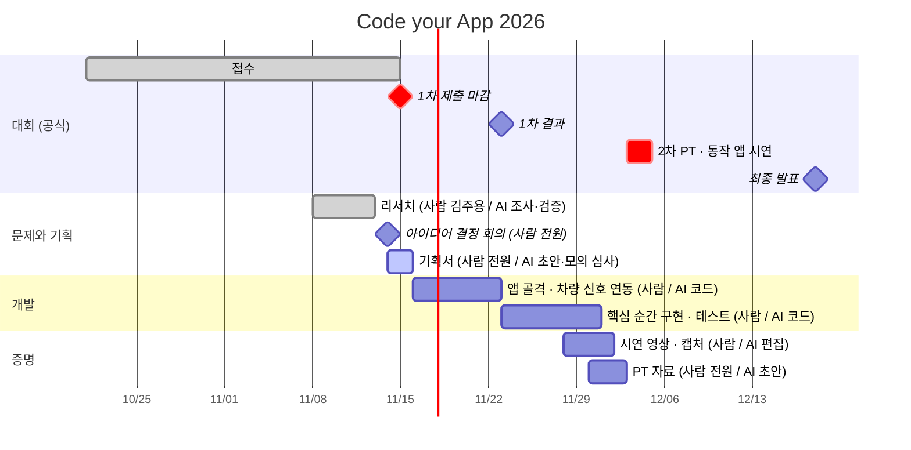

# ROADMAP

공모전 일정이 첫 마일스톤이고, 그 뒤는 Pleos App Market 출시와 지속이다. 사업 근거: [06 사업](docs/06-business.md).

## 일정
막대 이름 뒤 괄호는 담당: 사람 / AI. AI가 맡은 막대도 결정과 검수는 사람이 한다([ai/](ai/README.md)).

출처: [공모전 공식 사이트](https://appdevchallenge.auto-hmg.io/) · 갱신: 2026-11-13 · 개발 이후 막대는 계획

| 날짜 | 공식 일정 | 상태 |
|---|---|---|
| 2026-12-19 ~ 2027-01 | 전시 준비 | 종료일 미확인 |
| 2027-02 | 그룹 행사 전시, 최종 순위 시상 | 날짜 미확인 |

## 공모전 이후
| 단계 | 무엇 | 조건 |
|---|---|---|
| 출시 | Pleos App Market 등록 | 최종 선정 시 |
| 지속 | (아이디어 확정 후) | [06 사업](docs/06-business.md) |

## 하지 않기로 한 것
범위 밖으로 뺀 기능과 이유는 결정 기록에: [docs/adr/](docs/adr/)
