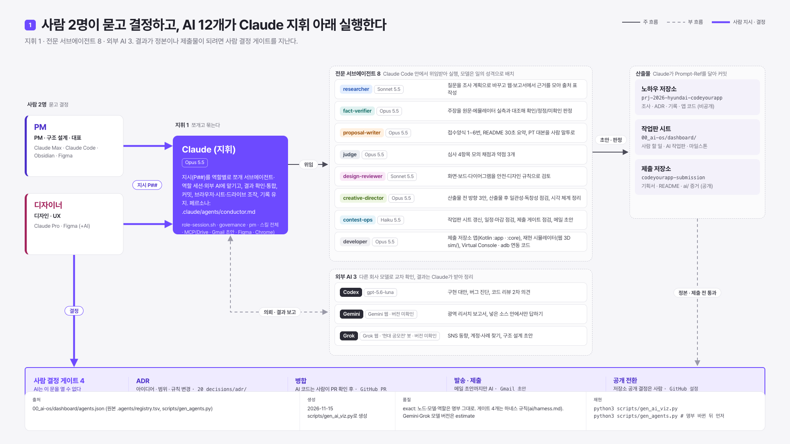
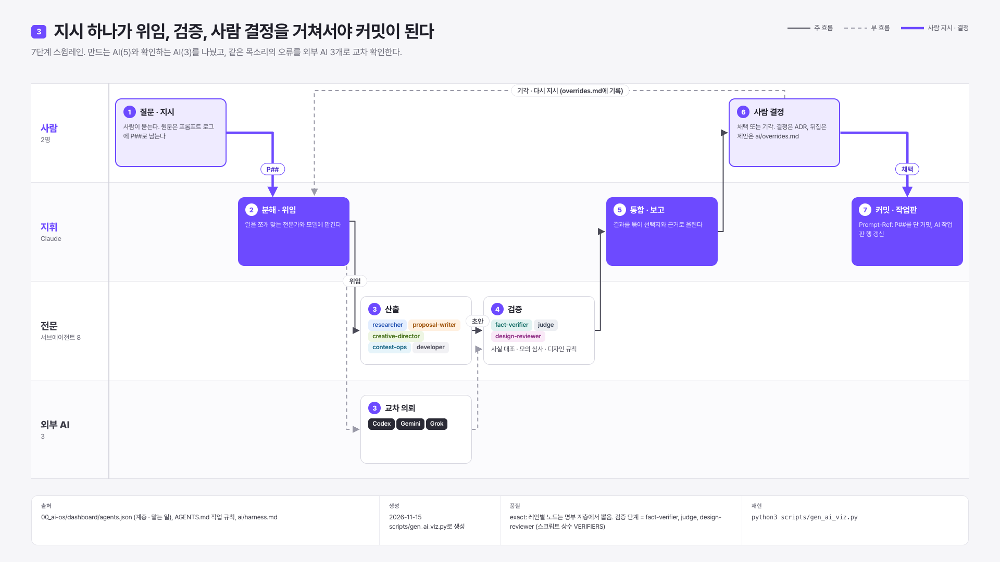
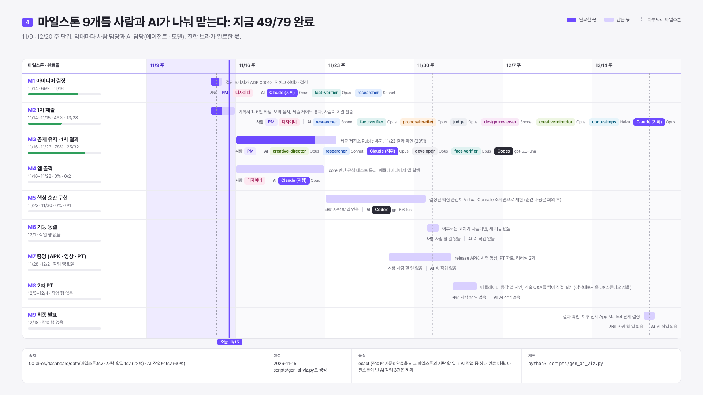

# ai: 두 사람이 AI와 일한 방식

> 결정과 검증은 사람이, 초안과 조사와 반복 작업은 AI가 했다. 이 폴더는 그 경계를 증거로 보여 준다.
>
> 대회는 생성형 AI 보조 도구 사용을 허용하되, 팀이 전체 구조와 로직을 이해하고 직접 설명할 수 있어야 한다고 안내했다(2026-10-28 설명회). 그래서 AI가 쓴 코드도 사람이 실행해 보고 설명할 수 있어야 병합한다.

## 한 장으로

출처: .agents/registry.tsv · 품질 exact (Gemini·Grok 버전은 estimate) · scripts/gen_ai_viz.py로 생성

### 지시 하나가 커밋이 되기까지

출처: .agents/registry.tsv 계층 · 품질 exact · scripts/gen_ai_viz.py로 생성

### 일정과 담당

출처: 작업판 마일스톤 · 사람 할 일 · AI 작업판 · 품질 exact (작업판 기준) · scripts/gen_ai_viz.py로 생성

그림 5장 전체와 캡션은 [visuals.md](visuals.md).

## 자리
| 자리 | 누가 | 맡는 일 | 맡지 않는 일 |
|---|---|---|---|
| 결정 | PM · 디자이너 | 문제와 범위, 디자인 결정, 병합, 제출 | |
| 실행 | Claude Code와 역할별 에이전트 | 코드·문서·도식 초안, 시험 실행 | 결정, 제출, 계정·비밀값 |
| 조사 | Gemini Deep Research · Grok · 조사 에이전트 | 자료 수집, 출처 정리 | 사실 확정 (사람이 원문을 열어 확인) |
| 2차 의견 | Codex CLI | 코드 리뷰, 다른 구현안 | 병합 |

## 숫자
[STATS.md](../STATS.md)의 "AI 협업" 절. 숫자마다 다시 세는 명령이 붙어 있다.

## 이 폴더
| 파일 | 답하는 질문 |
|---|---|
| [agents.md](agents.md) | 어떤 AI를 무엇에 썼고, 누가 검수했나 |
| [harness.md](harness.md) | AI가 선을 넘지 않게 무엇이 막나 |
| [prompts.md](prompts.md) | 어떤 지시가 어떤 변경을 낳았나 |
| [overrides.md](overrides.md) | 사람이 AI 제안을 뒤집은 때와 이유 |
| [visuals.md](visuals.md) | 그림 5장: 운영 지도, 역할 매트릭스, 지휘 흐름, 간트, 기여 |
| [toolchain.md](toolchain.md) | 플러그인·스킬·에이전트·MCP·로컬 도구와 관리 규칙 |
