# ai: 두 사람이 AI와 일한 방식

> 결정과 검증은 사람이, 초안과 조사와 반복 작업은 AI가 했다. 이 폴더는 그 경계를 증거로 보여 준다.

## 한 장으로

```mermaid
flowchart LR
    subgraph H["사람: 결정 · 검증"]
        direction TB
        PM["김주용 (PM)"]
        MJ["김민주"]
    end
    subgraph E["AI 엔진"]
        direction TB
        CC["Claude Code"]
        CX["Codex CLI"]
        GM["Gemini Deep Research"]
        GK["Grok"]
    end
    subgraph A["역할별 에이전트"]
        direction TB
        R["조사 · 사실 검증"]
        W["기획서 초안"]
        D["디자인 검토"]
        J["모의 심사"]
    end
    subgraph O["산출물"]
        direction TB
        DOC["docs · ADR"]
        CODE["app · 테스트"]
        VIS["도식 · 시안"]
    end
    H -- "지시 (P##)" --> E
    E -- 위임 --> A
    A -- "초안 (Prompt-Ref)" --> O
    O == "검토 · 병합 · 제출은 사람만" ==> H
```

출처: [agents.md](agents.md) · 갱신: 2026-11-13

## 자리
| 자리 | 누가 | 맡는 일 | 맡지 않는 일 |
|---|---|---|---|
| 결정 | 김주용 · 김민주 | 문제와 범위, 디자인 결정, 병합, 제출 | |
| 실행 | Claude Code와 역할별 에이전트 | 코드·문서·도식 초안, 시험 실행 | 결정, 제출, 계정·비밀값 |
| 조사 | Gemini Deep Research · Grok · 조사 에이전트 | 자료 수집, 출처 정리 | 사실 확정 (사람이 원문을 열어 확인) |
| 2차 의견 | Codex CLI | 코드 리뷰, 다른 구현안 | 병합 |

## 숫자
[STATS.md](../STATS.md)의 "AI 협업" 절. 숫자마다 다시 세는 명령이 붙어 있다.

## 이 폴더
| 파일 | 답하는 질문 |
|---|---|
| [agents.md](agents.md) | 어떤 AI를 무엇에 썼고, 누가 검수했나 |
| [harness.md](harness.md) | AI가 선을 넘지 않게 무엇이 막나 |
| [prompts.md](prompts.md) | 어떤 지시가 어떤 변경을 낳았나 |
| [overrides.md](overrides.md) | 사람이 AI 제안을 뒤집은 때와 이유 |
| [toolchain.md](toolchain.md) | 플러그인·스킬·에이전트·MCP·로컬 도구와 관리 규칙 |
