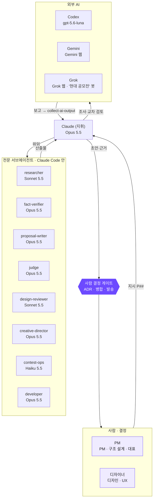

# agents: 우리 AI 팀의 구성

> 이 파일은 `.agents/registry.tsv`(에이전트 명부)와 `.agents/rnr.tsv`에서 `scripts/gen_agents.py`가 만든다. 손으로 고치지 않는다.
> 명부가 정본이다. 에이전트를 더하거나, 모델·역할·도구를 바꿀 때는 명부 한 줄을 고치고 다시 만든다.

## 한눈에: 지휘 체계

사람이 묻고 결정한다. Claude (지휘)가 일을 쪼개 전문 에이전트와 외부 AI에 맡기고, 결과를 묶어 근거와 함께 올린다. 결정, 병합, 발송은 사람만 한다.

## 모델 배치 원칙
- 심사 점수에 바로 걸리는 판단, 글, 검증, 미감은 가장 강한 모델(Opus 5.5)에 맡긴다.
- 넓게 모으기와 규칙 대조는 Sonnet 5.5, 반복 운영은 Haiku 5.5로 속도와 비용을 아낀다.
- 코드는 다른 계열(Codex, GPT)의 눈으로 한 번 더 본다.
- 외부 웹 AI의 버전은 추측하지 않고 화면에서 확인한 것만 적는다.

## 역할 정의
| 이름 | 계층 | 모델 | 모델 근거 | 맡는 일 | 맡지 않는 일 | 산출물 · 결과 위치 | 보고 대상 | 사람 책임자 |
|---|---|---|---|---|---|---|---|---|
| Claude (지휘) | 지휘 | claude-opus-5-5 | 일을 쪼개고 결과를 묶는 판단과 긴 맥락 유지가 핵심이라 가장 강한 추론 모델 | 지시(P##)를 역할별로 쪼개 서브에이전트·역할 세션·외부 AI에 맡기고, 결과 확인·통합, 커밋, 브라우저·시트·드라이브 조작, 기록 유지. 페르소나: .claude/agents/conductor.md | 아이디어 결정, 메일 발송·제출, 계정 가입·비밀번호 | 저장소 전체, 작업판 시트, 이슈 | PM | PM |
| researcher | 전문 | claude-sonnet-5-5 | 넓게 모으고 출처를 표로 정리하는 일이라 속도와 비용 균형이 맞는 모델. 판정은 fact-verifier가 따로 함 | 질문을 조사 계획으로 바꾸고 웹·보고서에서 근거를 모아 출처 표 작성 | 결론 내리기, 사실 최종 판정 | 10_research/ (출처 표) | Claude (지휘) | PM |
| fact-verifier | 전문 | claude-opus-5-5 | 틀린 사실 하나가 심사 신뢰를 깎으므로 대조·반증에 가장 신중한 모델 | 주장을 원문·에뮬레이터 실측과 대조해 확인/정정/미확인 판정 | 새 주장 만들기, 출처 없는 보충 | 판정 표 (해당 문서 옆), 10_research/android-pleos/ | Claude (지휘) | PM |
| proposal-writer | 전문 | claude-opus-5-5 | 기획서 문장이 곧 점수라 글 품질이 가장 좋은 모델 | 접수양식 1~6번, README 30초 요약, PT 대본을 사람 말투로 | 사실 조사, 숫자 지어내기 | 60_submission/proposal/, 제출 저장소 README | Claude (지휘) | PM |
| judge | 전문 | claude-opus-5-5 | 심사위원 3명(UX · Pleos 개발 · 사업)의 관점을 깊게 흉내 내야 해서 강한 추론 모델 | 심사 4항목 모의 채점과 약점 3개 | 산출물 직접 고치기 | 채점표 (decision-timeline 한 줄) | Claude (지휘) | PM |
| design-reviewer | 전문 | claude-sonnet-5-5 | 정해진 규칙(글랜스 2초, 합계 12초, DESIGN.md)과 대조하는 검토라 빠른 모델로 충분 | 화면·보드·다이어그램을 안전·디자인 규칙으로 검토 | 미감 최종 판단 (디자이너), 방향 제안 | 검토 메모 (해당 시안 옆) | Claude (지휘) | 디자이너 |
| creative-director | 전문 | claude-opus-5-5 | 한 아이디어를 여러 표현으로 펼치며 감도를 지키는 판단이라 강한 모델 | 산출물 전 방향 3안, 산출물 후 일관성·독창성 점검, 시각 체계 정리 | 최종 시각 결정 (디자이너), 크레딧 쓰는 생성 | 30_design/, docs/assets/, visual-system.md | Claude (지휘) | 디자이너 |
| contest-ops | 전문 | claude-haiku-5-5 | 작업판 갱신·일정 점검·제출 체크처럼 반복 운영이라 빠르고 싼 모델 | 작업판 시트 갱신, 일정·마감 점검, 제출 게이트 점검, 메일 초안 | 발송·제출·계정 가입 | 작업판 시트, 60_submission/ | Claude (지휘) | PM |
| developer | 전문 | claude-opus-5-5 | 앱·시뮬레이터 코드는 본선 시연 품질에 바로 걸리고 여러 파일을 오가는 긴 작업이라 가장 강한 모델. 2차 검토는 다른 계열(Codex) | 제출 저장소 앱(Kotlin :app · :core), 재현 시뮬레이터(웹 3D sim/), Virtual Console · adb 연동 코드 | 작업판·일정, 기획서 문장, 결정 | 제출 저장소 app/ · core/ · sim/ | Claude (지휘) | PM |
| Codex | 외부 AI | gpt-5.6-luna | Claude와 다른 계열의 눈으로 코드를 교차 검토 (~/.codex/config.toml 확인) | 구현 대안, 버그 진단, 코드 리뷰 2차 의견 | 단독 병합, 기획 판단 | PR 코멘트, 40_app/ 제안 | Claude (지휘) | PM |
| Gemini | 외부 AI | Gemini 웹 (Deep Research · Notebook, 버전은 화면 확인 후 기록) | 수십~수백 출처를 넓게 훑는 보고서와 소스 고정 질의에 강함 | 광역 리서치 보고서, 넣은 소스 안에서만 답하기 | 최종 사실 판정 (fact-verifier가 확인) | 10_research/ (collect-ai-output로 회수) | Claude (지휘) | PM |
| Grok | 외부 AI | Grok 웹 · '현대 공모전' 봇 (버전은 화면 확인 후 기록) | X 실시간 동향과 사례 찾기, 운영 구조 아이디어 | SNS 동향, 계정·사례 찾기, 구조 설계 초안 | 학술 근거, 저장소 쓰기, 결정 승인 | 10_research/references/ (Drive 문서로 회수) | Claude (지휘) | PM |

## 사람과 AI의 몫 (● 주 · ○ 부)
| 단계 | PM | 디자이너 | 주 AI | 보조 AI | 사람 결정 지점 |
|---|---|---|---|---|---|
| 문제 조사 | ○ | ○ | researcher (Sonnet 5.5) | Gemini · Grok | 무엇을 더 조사할지 |
| 사실 확인 | ● |  | fact-verifier (Opus 5.5) | 에뮬레이터 실측 (Claude 지휘) | 확인으로 올릴지 |
| 아이디어 결정 | ● | ● |  | judge (모의 심사) · creative-director (방향 3안) | 아이디어 · 범위 · 안 할 것 (ADR) |
| 기획서 | ● | ○ | proposal-writer (Opus 5.5) | judge · humanize-korean | 최종 문장 · 숫자 |
| 화면 · 시각 | ○ | ● | creative-director (Opus 5.5) | design-reviewer (Sonnet 5.5) · Figma AI | 최종 시안 (디자이너) |
| 앱 코드 | ● |  | Claude (지휘, Opus 5.5) | Codex (gpt-5.6-luna) | 병합 (PR 확인) |
| 시험 · 시연 | ● | ○ | Claude (지휘) | fact-verifier | 시연 시나리오 확정 |
| 모의 심사 | ● | ○ | judge (Opus 5.5) |  | 약점 중 무엇을 고칠지 |
| 제출 · 발송 | ● | ○ | contest-ops (Haiku 5.5, 점검 · 초안만) |  | 발송 · 공개 전환 (사람만) |
| 저장소 · 기록 관리 | ○ |  | Claude (지휘) | contest-ops (작업판) | 규칙 변경 (ADR) |

## 사람
| 이름 | 맡는 일 | 맡지 않는 일 | 도구 · 스킬 |
|---|---|---|---|
| PM | PM · 구조 설계 · 대표. 아이디어와 범위 결정, AI 결과 채택·기각, 발송·제출·공개 전환 | 출처 확인 없이 AI 결과 채택 | Claude Max · Claude Code · Obsidian · Figma |
| 디자이너 | 디자인 · UX. 화면과 시각 토큰의 최종 판단, 사용자 관점 검토 | AI 시안을 확인 없이 최종본으로 쓰기 | Claude Pro · Figma (+AI) |

## 기억
- 각 서브에이전트는 `memory: project`로 `.claude/agent-memory/<이름>/MEMORY.md`를 쓴다. 시작할 때 읽고, 배운 것을 더한다.
- 팀의 하루 기억은 노하우 저장소 `00_ai-os/memory/daily/`, 지금 상태는 `active-context.md`.

## 바뀐 기록
| 이름 | 모델 | 상태 | 바뀐 날 · 근거 |
|---|---|---|---|
| Claude (지휘) | claude-opus-5-5 | 활성 | 2026-11-14 · P85 |
| researcher | claude-sonnet-5-5 | 활성 | 2026-11-14 · P76 |
| fact-verifier | claude-opus-5-5 | 활성 | 2026-11-14 · P76 |
| proposal-writer | claude-opus-5-5 | 활성 | 2026-11-14 · P76 |
| judge | claude-opus-5-5 | 활성 | 2026-11-14 · P76 |
| design-reviewer | claude-sonnet-5-5 | 활성 | 2026-11-14 · P76 |
| creative-director | claude-opus-5-5 | 활성 | 2026-11-14 · P76 |
| contest-ops | claude-haiku-5-5 | 활성 | 2026-11-14 · P76 |
| developer | claude-opus-5-5 | 활성 | 2026-11-14 · P85 (개발 역할을 지휘와 분리) |
| Codex | gpt-5.6-luna | 활성 | 2026-11-14 · P76 |
| Gemini | Gemini 웹 (Deep Research · Notebook, 버전은 화면 확인 후 기록) | 활성 | 2026-11-14 · P76 |
| Grok | Grok 웹 · '현대 공모전' 봇 (버전은 화면 확인 후 기록) | 활성 | 2026-11-14 · P76 |

AI가 만든 이미지·영상에는 "AI 생성"과 도구 이름을 단다.
