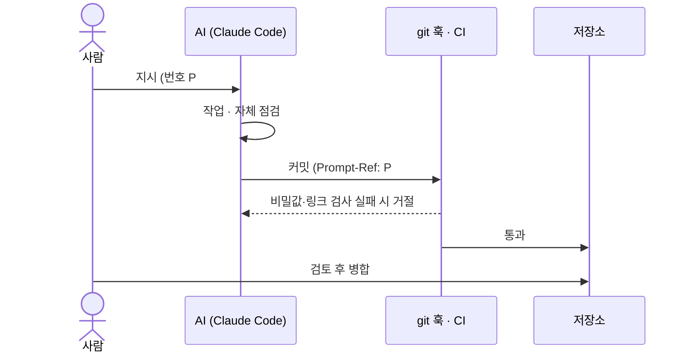

# harness: AI가 선을 넘지 않게 막는 장치

규칙은 문서로만 두지 않고 기계가 지키게 했다.

| 장치 | 무엇을 막거나 남기나 | 어디 |
|---|---|---|
| 입구 파일 | 모든 AI가 같은 규칙으로 시작 | [AGENTS.md](../AGENTS.md) (Claude는 `CLAUDE.md`가 불러옴) |
| 커밋 트레일러 | AI 변경은 `Prompt-Ref: P##`, 사람 변경은 `Human-Only: true` | [CONTRIBUTING](../CONTRIBUTING.md) |
| pre-commit 훅 | 비밀키·토큰·전화번호·양식 원본 커밋 차단 | `.githooks/pre-commit` |
| CI | 문서 링크가 하나라도 깨지면 실패 (앱이 생기면 빌드·테스트도) | `.github/workflows/ci.yml` |
| 사람 게이트 | 결정·병합·제출·계정·비밀값은 사람만 | [ai/README](README.md) |
| 안전 한도 | 주행 중 글랜스 2초·합계 12초를 넘는 기능은 만들지 않음 | [SAFETY](../SAFETY.md) |
| 결정 기록 | 되돌리기 비싼 결정은 사람 이름으로 ADR | [docs/adr](../docs/adr/) |

## 지시에서 커밋까지

