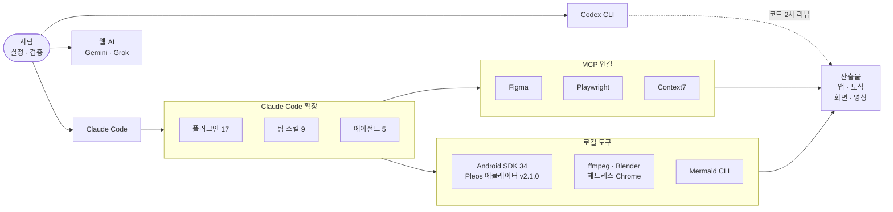

# toolchain: 이 앱을 만든 도구 전부

> 도구는 선언하고 기록한다. 이 저장소를 받은 사람은 같은 도구를 같은 설정으로 쓴다(`.claude/settings.json`). 새 도구가 필요하면 찾고 점검하는 절차가 있다([skill-scout](../.agents/skills/skill-scout/SKILL.md)).

## 한 장으로

갱신: 2026-11-13 · 도구를 쓰면 아래 표의 "쓴 곳"에 한 줄

## 플러그인 (`.claude/settings.json`에 선언, 팀 전원 같은 구성)
| 갈래 | 플러그인 | 이 프로젝트에서 | 쓴 곳 |
|---|---|---|---|
| 일하는 방식 | superpowers | 계획 → 실행 → 검증 절차, 병렬 에이전트 | 저장소 설계 (2026-11-13) |
| 일하는 방식 | mattpocock-skills | 설계를 몰아붙여 묻기, 도메인 모델링 | 앱 설계 때 |
| 일하는 방식 | ponytail | 과설계 차단, 최소 구현 | 이 저장소의 루트 파일 정리 |
| 디자인 | figma | 아이디어 보드·화면 시안·도식 | 아이디어 보드 5장 (2026-11-13) |
| 디자인 | ui-ux-pro-max · taste-skill · frontend-design | 화면 미감, 배너·슬라이드 | 웹 시뮬·키 비주얼 때 |
| 디자인 | example-skills (Anthropic) | 캔버스 디자인, PPT | PT 자료 때 |
| 글 | humanize-korean | 한국어 AI 말투 점검 | 기획서 |
| 조사 | last30days · context7 | 최근 반응, 라이브러리 최신 문서 | 조사, 앱 개발 |
| 개발 | playwright · code-review · code-simplifier · codex | 화면 캡처, 코드 리뷰, 2차 의견 | 앱 개발 |
| 도구 | skill-creator · obsidian | 팀 스킬 제작, 문서 열람 | 팀 스킬 |

필요할 때만 켜는 것(선언만, 기본 꺼짐): harness-engineering(팀 PM 제작), harness, oh-my-claudecode, everything-claude-code(에이전트 71·스킬 314 묶음, 무거워서 필요한 스킬만 찾아 씀).

## 팀 스킬과 에이전트
- 스킬 9개: [.agents/skills/](../.agents/skills/README.md). 앱 골격, 웹 시뮬, 키 비주얼, 모션, 시연 영상, 도식, 스킬 찾기, 모의 심사, 제출 점검.
- 에이전트 5개 (`.claude/agents/`): creative-director(방향 3안·일관성) · design-reviewer(글랜스·안전) · judge(심사 4항목 채점) · fact-verifier(출처 확인) · researcher(조사). 각자의 자리: [agents.md](agents.md).

## 로컬 도구 (2026-11-13 실행 확인)
| 도구 | 버전 · 상태 | 무엇에 |
|---|---|---|
| Pleos Connect 에뮬레이터 | v2.1.0, API 34, 2560x1440, Android Emulator 37.2 | 실행·시연 |
| Virtual Console | HTTP 8088 (`adb forward`) | 차량 신호 조작 자동화 |
| JDK · Gradle | 17 · 래퍼 | 빌드 |
| ffmpeg · Playwright · 헤드리스 Chrome | 9.0 · Python | 영상·캡처 |
| Mermaid CLI | npx | 도식 검증·PNG |
| Blender | Homebrew | 3D 정지 컷 |

## 도구를 다루는 규칙
1. **선언**: 플러그인은 코드를 복사하지 않고 `.claude/settings.json`에 선언만(라이선스·최신성).
2. **찾기**: 필요한 능력은 `python3 -I scripts/find-skill.py <단어>`로 우리 스킬 → 받아 둔 1,300여 개 → Anthropic Directory 3,691개 순서로 찾는다.
3. **점검**: 출처, 하는 일, 위험(네트워크·비밀값·권한), 무게, 라이선스, 겹침을 보고 붙인다.
4. **기록**: 실제로 쓴 날과 결과물을 이 파일 표에. 쓰지 않은 도구를 쓴 것처럼 적지 않는다.
