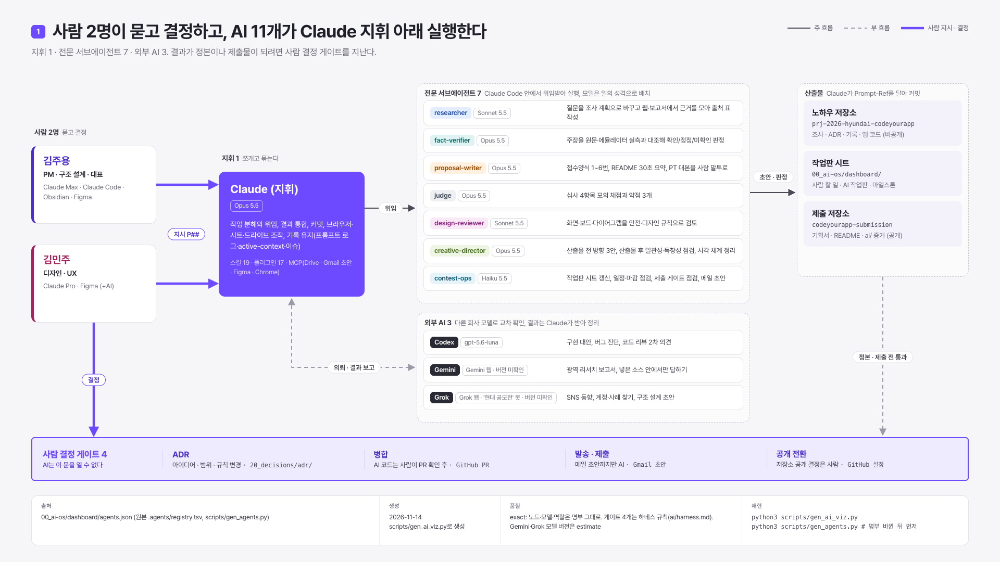
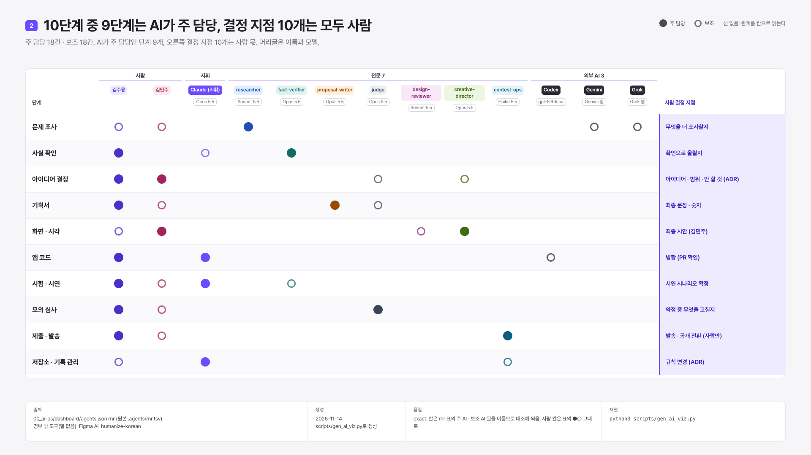
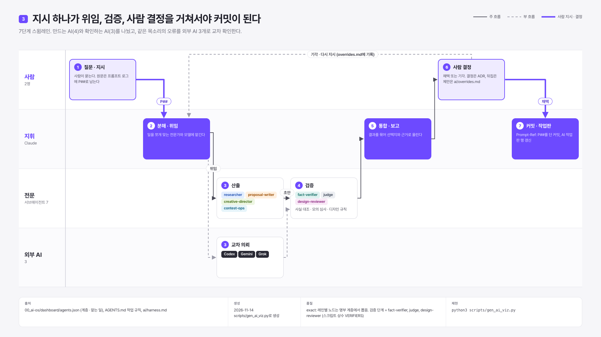
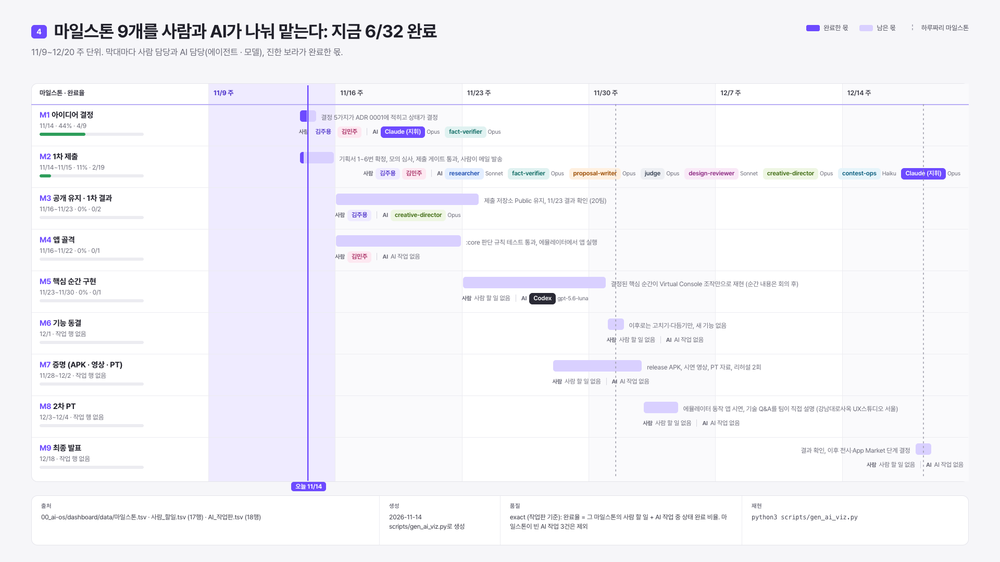
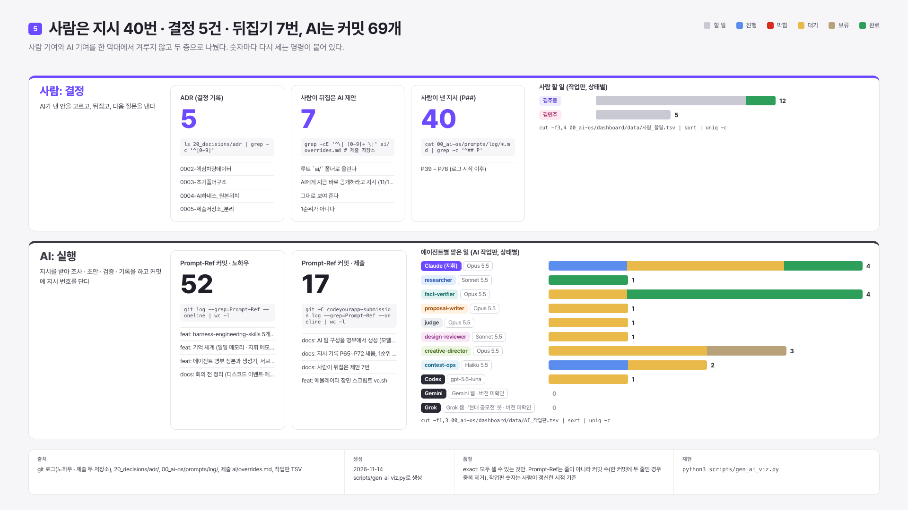

# AI 조직 그림 5장

> 손으로 그린 그림이 아니다. 명부와 작업판, git 로그를 읽어 코드가 그린다. 데이터가 바뀌면 다시 돌려 갱신한다.
>
> 생성: 노하우 저장소에서 `python3 scripts/gen_ai_viz.py` (표준 라이브러리 + 헤드리스 Chrome). 생성일: 2026-11-14. 그림마다 아래쪽 메타 박스에 출처 · 생성일 · 품질 · 재현 명령이 찍혀 있다.

## 1. AI 운영 지도

사람 2명이 지시하고, Claude(지휘, Opus 5.5)가 일을 쪼개 전문 서브에이전트 7개와 외부 AI 3개에 맡긴다. 결과가 정본이나 제출물이 되려면 사람 결정 게이트 4곳(ADR · 병합 · 발송 · 공개 전환)을 지난다.
출처: .agents/registry.tsv · 품질: exact, Gemini · Grok 모델 버전만 estimate (화면 확인 전)

## 2. 역할 · 모델 매트릭스

선 대신 칸으로 읽는다. 행은 단계, 열은 사람 2명과 AI 11개(머리글에 모델). 꽉 찬 점은 주 담당, 빈 점은 보조. 오른쪽 결정 지점은 모두 사람 몫이다.
출처: .agents/rnr.tsv · 품질: exact (주 AI · 보조 AI 열을 이름으로 대조)

## 3. 지휘 흐름

질문(P##)부터 커밋까지 7단계. 만드는 AI와 확인하는 AI(fact-verifier · judge · design-reviewer)를 나눴고, 사람이 기각하면 다시 지시하고 그 이유를 [overrides.md](overrides.md)에 남긴다.
출처: .agents/registry.tsv 계층 · 품질: exact

## 4. 일정과 담당 (간트)

마일스톤 M1~M9를 주 단위로. 막대마다 사람 담당과 AI 담당(에이전트 · 모델), 완료한 몫, 오늘 선.
출처: 작업판 마일스톤 · 사람 할 일 · AI 작업판 · 품질: exact (작업판 갱신 시점 기준, 마일스톤이 빈 AI 작업은 제외)

## 5. 사람 기여와 AI 기여

두 층으로 나눠 겨루지 않는다. 사람 층은 결정(ADR), 뒤집은 AI 제안, 낸 지시 수. AI 층은 지시 번호(Prompt-Ref)를 단 커밋 수와 에이전트별 맡은 일. 숫자마다 다시 세는 명령이 그림 안에 있다.
출처: git 로그(두 저장소), ADR, 프롬프트 로그, overrides.md, AI 작업판 · 품질: exact
