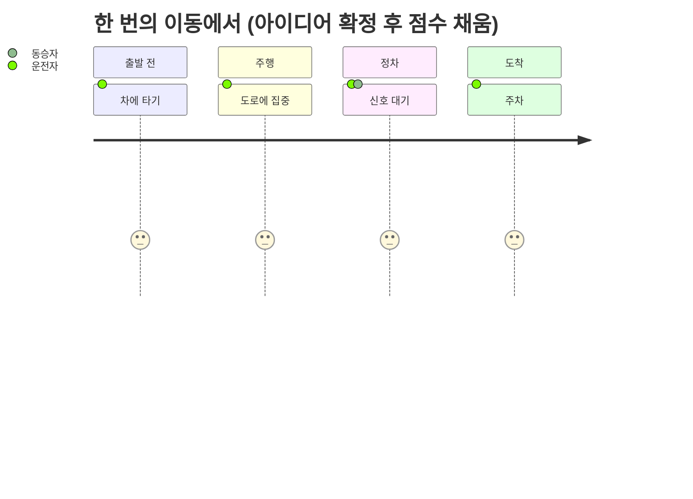

# 01 문제: WHY
> 심사 항목: **창의성** (운전자·동승자 문제 정의가 명확한가)

## 한 문장
(작성 예정: 누가, 차 안 어느 순간에, 무엇 때문에 곤란한가)

## 그 순간

점수 1~5는 조사 근거로 매긴다. 출처는 아래 "근거".

| 누가 | 언제 (주행/정차/주차) | 지금은 어떻게 하나 | 무엇이 불편한가 |
|---|---|---|---|
| 미정 | 미정 | 미정 | 미정 |

## 근거
- 사용자 목소리: (작성 예정: 인용은 출처와 함께, 개인 식별 정보 없이)
- 조사: (작성 예정: 출처 링크)

→ 다음: [02 해법](02-solution.md)
