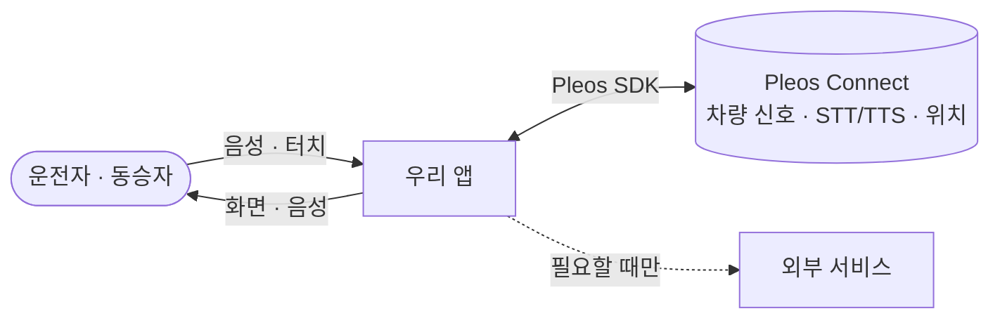
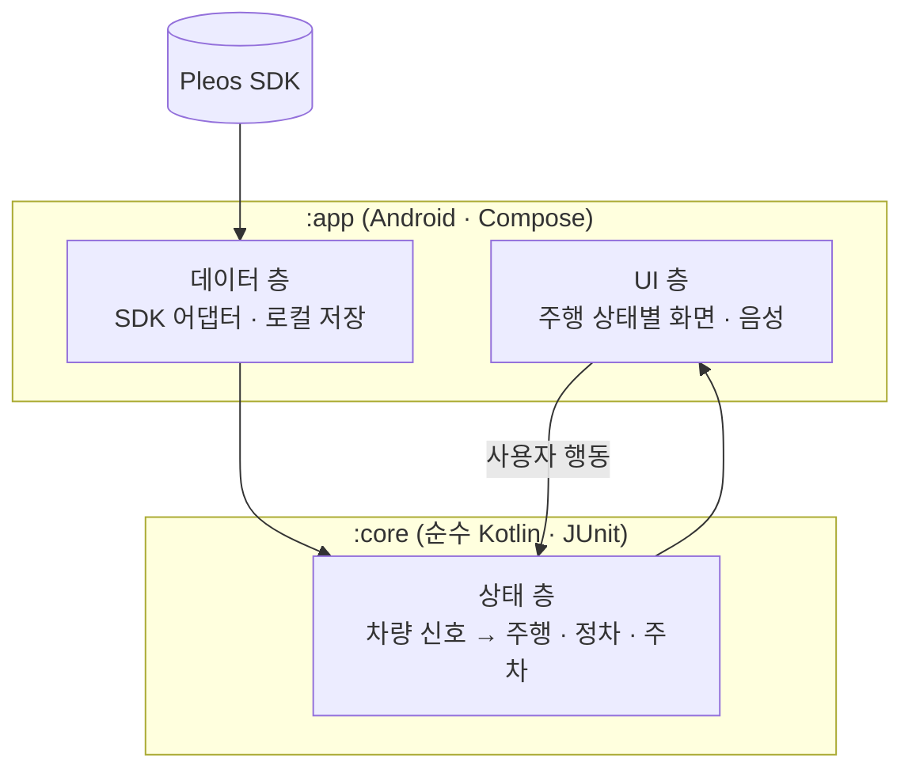

# 03 구조: HOW
> 심사 항목: **기술 활용성**

## Context: 앱과 바깥

## Container: 앱 안

단방향 데이터 흐름(UDF): 차량 신호 → 상태 → UI. 기준: Google [앱 아키텍처 가이드](https://developer.android.com/topic/architecture)

| 층 | 책임 | 위치 |
|---|---|---|
| UI | 주행 상태별 화면·음성 | `app/src/main/.../ui/` |
| 상태 | 차량 신호를 앱 상태로 (판단 규칙 전부) | `core/src/main/.../` |
| 데이터 | SDK 래퍼, 로컬 저장 | `app/src/main/.../data/` |

모듈은 둘: 판단 규칙은 안드로이드 없이 테스트되는 `:core`, 화면과 SDK는 `:app`. 팀이 모의 출품에서 같은 구성으로 테스트 28개를 통과시키고 에뮬레이터 실동작까지 확인한 방식이다.

## 기술 선택
| 무엇 | 선택 | 이유 |
|---|---|---|
| 언어 | Kotlin | Pleos 공식 샘플과 SDK 기준 |
| UI | (아이디어 확정 후) | |

→ 다음: [04 차량 연동](04-vehicle-integration.md)
