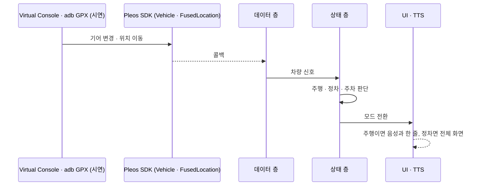

# 04 차량 연동: HOW (차량)
> 심사 항목: **차량 특화성** · **기술 활용성** (SDK를 핵심 기능에 쓰는가)

## 쓰는 차량 신호
| 신호 | Pleos SDK | 언제 읽나 | 앱이 하는 일 | 코드 |
|---|---|---|---|---|
| 기어 | Vehicle `Gear.registerGearSelection` (CAR_DRIVE) | 변화 시 | 주차·정차·주행 판단 | [GearSource.kt](../app/src/main/java/com/mangsang/app/data/GearSource.kt) |
| 차속 | Android Automotive `PERF_VEHICLE_SPEED` (CAR_SPEED) | 변화 시 | 움직임 판단 (0.5 m/s 초과) | [SpeedSource.kt](../app/src/main/java/com/mangsang/app/data/SpeedSource.kt) |
| 판단 규칙 | `:core` MomentDetector | 매 신호 | 신호를 못 받으면 주행으로 간주 | [DriveMoment.kt](../core/src/main/kotlin/com/mangsang/app/core/DriveMoment.kt) · [테스트](../core/src/test/kotlin/com/mangsang/app/core/MomentDetectorTest.kt) |
| 미정 | 미정 | 미정 | 미정 | 미정 |

## 신호가 화면이 되기까지

에뮬레이터: Virtual Console은 HTTP로 63개 기능(기어, 가속·브레이크·조향 → 차속, 도어·창문·조명·공조·좌석·배터리)을 바꾼다. 시연은 스크립트로 재현한다. 차가 움직이면 Pleos가 앱 화면을 가린다(2026-11-14 확인).

## 쓸 수 있는 SDK (공식 공지 기준)
- 공개 문서에 있는 Pleos SDK만 쓴다. Pleos LLM SDK는 제공되지 않는다.
- 차량 마이크 음성을 외부 음성 인식 서비스로 보내지 않는다. 음성은 Pleos STT로.

## 권한
매니페스트 선언 목록: 미정, 공모전 개발에선 Vehicle·NaviHelper·STT·TTS·FusedLocation이 선언만으로 사용 가능(2026-10-28 설명회).

## 지원 여부 확인
기능을 쓰기 전 SDK의 `checkXxxCapabilities` 계열 API로 차량이 지원하는지 확인하고, 없으면 아래 "신호가 없을 때" 동작으로 내려간다(설명회 화면 API policy).

## 신호가 없을 때
| 상황 | 동작 |
|---|---|
| 신호 미수신 | 주행 중으로 간주(안전 기본값) |
| 미정 | 미정 |

→ 다음: [05 시연](05-demo.md)
