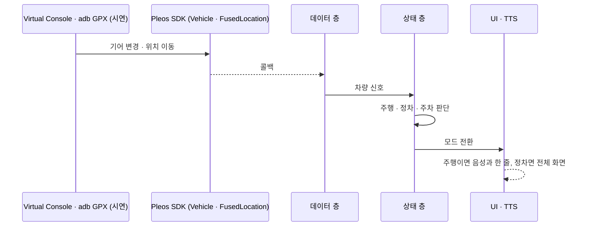

# 04 차량 연동: HOW (차량)
> 심사 항목: **차량 특화성** · **기술 활용성** (SDK를 핵심 기능에 쓰는가)

## 쓰는 차량 신호
| 신호 | Pleos SDK | 언제 읽나 | 앱이 하는 일 | 코드 |
|---|---|---|---|---|
| 기어 | Vehicle `Gear.registerGearSelection` (CAR_DRIVE) | 변화 시 | 주차·정차·주행 판단 | [GearSource.kt](../app/src/main/java/com/mangsang/app/data/GearSource.kt) |
| 차속 | Android Automotive `PERF_VEHICLE_SPEED` (CAR_SPEED) | 변화 시 | 움직임 판단 (0.5 m/s 초과) | [SpeedSource.kt](../app/src/main/java/com/mangsang/app/data/SpeedSource.kt) |
| 판단 규칙 | `:core` MomentDetector | 매 신호 | 신호를 못 받으면 주행으로 간주 | [DriveMoment.kt](../core/src/main/kotlin/com/mangsang/app/core/DriveMoment.kt) · [테스트](../core/src/test/kotlin/com/mangsang/app/core/MomentDetectorTest.kt) |
| 문 잠금 | Vehicle `setDoorLock` (CONTROL_CAR_DOORS) | 문턱 | 이미 잠겼으면 다시 잠그지 않음(철컥 소리가 밖에 신호가 됨). P단에서만 동작, D단 거부(50001) 실측 | [실측 기록](#제어-실측-2026-11-15) |
| 창문 | `setWindowPosition` | 문턱 · 복원 | 운전석 50% → 0 실측. 1cm 남김(환기) | 〃 |
| 등받이 | `moveSeatBackrestAngle` (이동·정지) | 문턱 · 복원 | 문턱에서 조금 뒤로 기대게 하고, 끝나면 운전 자세로 되돌림. 각도 직접 지정 불가 → 이동 시간 제어. P단에서만 | 〃 |
| 앰비언트 | `setAmbientLightBrightness` · `Color` | 숨 · 머묾 · 돌아옴 | 숨에 맞춰 밝기, 마침에 호박색 | 〃 |
| 공조 | `setHvacTemperature` · `FanSpeed` · `Recirculation` | 머묾 | 풍량 낮춤, 내기 10분마다 외기(CO2 누적 방지) | 〃 |
| 열선 | `setHvacSeatTemperature` | 머묾(계절) | 0 → 2 실측 | 〃 |
| 마침 판단 | `:core` EndingPolicy (순수 Kotlin) | 머묾 내내 | 화면 터치, 좌석 조작, 벨트 등 약한 신호 + 개인 세션 길이로 "마칠 준비" 확률 | [EndingPolicy.kt](../core/src/main/kotlin/com/mangsang/app/core/EndingPolicy.kt) · [테스트 10개](../core/src/test/kotlin/com/mangsang/app/core/EndingPolicyTest.kt) · [모델](journey/마침_모델.md) |

## 신호가 화면이 되기까지

에뮬레이터: Virtual Console은 HTTP로 63개 기능(기어, 가속·브레이크·조향 → 차속, 도어·창문·조명·공조·좌석·배터리)을 바꾼다. 시연은 스크립트로 재현한다. 차가 움직이면 Pleos가 앱 화면을 가린다(2026-11-14 확인).

## 쓸 수 있는 SDK (공식 공지 기준)
- 공개 문서에 있는 Pleos SDK만 쓴다. Pleos LLM SDK는 제공되지 않는다.
- 차량 마이크 음성을 외부 음성 인식 서비스로 보내지 않는다. 음성은 Pleos STT로.

## 권한
매니페스트 선언 목록: 미정, 공모전 개발에선 Vehicle·NaviHelper·STT·TTS·FusedLocation이 선언만으로 사용 가능(2026-10-28 설명회).

## 지원 여부 확인
기능을 쓰기 전 SDK의 `checkXxxCapabilities` 계열 API로 차량이 지원하는지 확인하고, 없으면 아래 "신호가 없을 때" 동작으로 내려간다(설명회 화면 API policy).

## 신호가 없을 때
| 상황 | 동작 |
|---|---|
| 신호 미수신 | 주행 중으로 간주(안전 기본값) |
| 미정 | 미정 |

→ 다음: [05 시연](05-demo.md)

## 제어 실측 (2026-11-15)
Pleos Connect 에뮬레이터, Vehicle SDK 2.3.2, 매니페스트에 `pleos.car.permission.CAR_*`·`CONTROL_CAR_*`만 선언한 앱. 설치 때 팝업 없이 권한 허용.

| 레버 | 결과 |
|---|---|
| 공조 온도 22→18℃, 풍량 3→6, 내기순환 | 됨 (하단 공조 바도 바뀜) |
| 운전석 열선 0→2 | 됨 |
| 등받이 | P단에서 됨(앞·뒤 이동과 정지). D단에서는 정차여도 거부(50001) |
| 앰비언트 밝기 30→20, 색 흰색→보라 | 됨 |
| 운전석 창문 50%→0 | 됨 |
| 도어 잠금 | P단에서 됨, D단 거부 |

설계 규칙: 모드는 P단에서만 켠다. 영역(zone)은 capability에서 `ROW_1_LEFT`가 든 것을 고른다. 등받이 현재 각도 읽기는 믿을 수 없어 이동 시간으로 제어한다.
