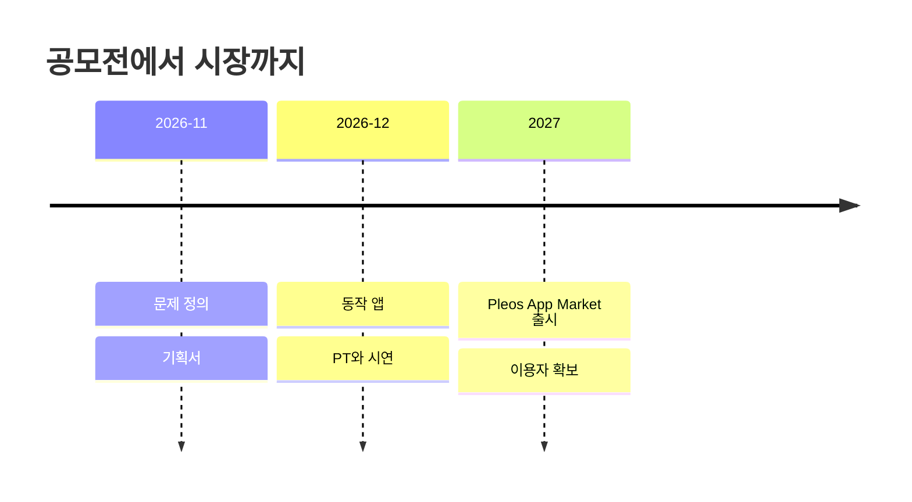

# 06 사업: NEXT
> 심사 항목: **사업성** (타깃 · 확보 · 지속)

| 질문 | 답 | 근거 |
|---|---|---|
| 누가 쓰나 (타깃) | 매일 기도하는 한국 개신교 성인 운전자, 그중 퇴근 후 주차장에서 잠시 머무는 사람. 종교가 없는 사용자의 "조용히 머물기"는 확장 단계 | 한국 성인 종교 있음 40%(한국갤럽, 2025), 매일 기도 25%(Pew Research Center, 2025c), 영국 차량 보유자 77%가 차 안에서 쉬는 습관(Halfords, 2025) |
| 시장 | Pleos App Market은 2026년부터 현대·기아·제네시스에 점진 탑재 예정, 다운로드·사용량 통계와 초기 파트너십 마케팅 지원 | 2026-10-28 설명회 |
| 어떻게 만나나 (확보) | Pleos App Market. 탑재 순서: 한국 2026-05 그랜저 → 아반떼 → 유럽 아이오닉 3 → 미국 2027 투싼, 2030년 약 2천만 대 목표 | Hyundai Motor Europe(2026), Hyundai Motor America(2026) 보도자료 |
| 어떻게 이어지나 (지속) | 시작을 "주차"라는 매일 오는 사건에 붙인다(차가 먼저 제안, 두 번 거절한 장소는 다시 묻지 않음). 마침 모델이 개인 세션 길이를 학습해 갈수록 맞아진다 | 명상 앱 30일 유지율 중앙값 4.7%(Baumel et al., 2019) |
| 예상 MAU | 국내 탑재 30만 대 × 설치율 5% × 월 활성 60% ≈ 9,000 (보수 3,000 · 낙관 25,200, 설치율·활성률은 가정) | 그랜저 71,775대, 아반떼 79,335대(2025 국내 판매, 현대자동차) |
| 확대 | 종교·문화별 의식 팩(천주교 묵주·삼종기도, 불교 염불, 이슬람 기도 시간·방향 안내), 유럽 EV 충전 대기 모드, 명상·휴식 카테고리 | [리서치](research/) |

단계별 일정: [ROADMAP](../ROADMAP.md)

→ 다음: [07 만드는 방식](07-process.md)
