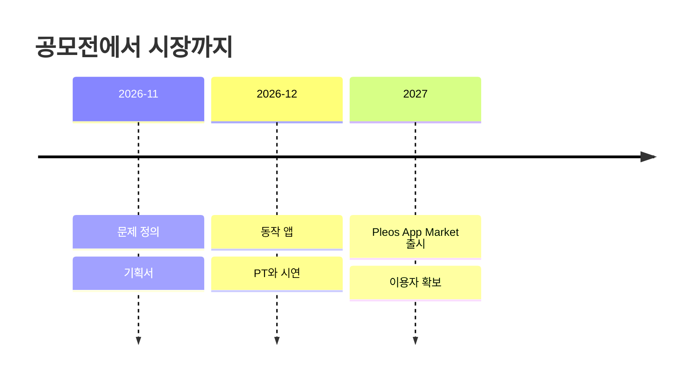

# 06 사업: NEXT
> 심사 항목: **사업성** (타깃 · 확보 · 지속)

| 질문 | 답 | 근거 |
|---|---|---|
| 누가 쓰나 (타깃) | 미정 | 미정 |
| 어떻게 만나나 (확보) | (작성 예정: Pleos App Market) | 미정 |
| 어떻게 이어지나 (지속) | 미정 | 미정 |

단계별 일정: [ROADMAP](../ROADMAP.md)
