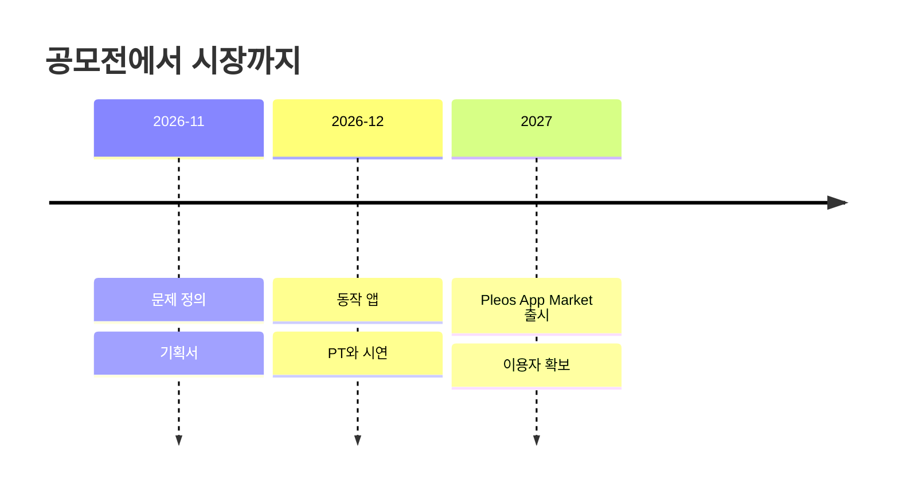

# 06 사업: NEXT
> 심사 항목: **사업성** (타깃 · 확보 · 지속)

| 질문 | 답 | 근거 |
|---|---|---|
| 누가 쓰나 (타깃) | 미정 | 미정 |
| 시장 | Pleos App Market은 2026년부터 현대·기아·제네시스에 점진 탑재 예정, 다운로드·사용량 통계와 초기 파트너십 마케팅 지원 | 2026-10-28 설명회 |
| 어떻게 만나나 (확보) | (작성 예정: Pleos App Market) | 미정 |
| 어떻게 이어지나 (지속) | 미정 | 미정 |

단계별 일정: [ROADMAP](../ROADMAP.md)

→ 다음: [07 만드는 방식](07-process.md)
