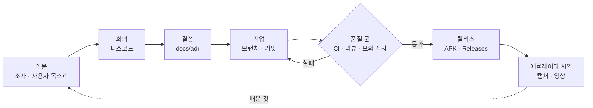

# 07 만드는 방식: 과정 · 프로젝트 관리 · 품질
> 두 사람이 3주 안에 동작하는 차량 앱을 내기 위해 일을 어떻게 굴렸나. AI와의 분업은 [ai/](../ai/README.md), 도구는 [ai/toolchain.md](../ai/toolchain.md).

## 한 바퀴

## 일정
마일스톤과 담당(사람/AI)은 [ROADMAP 간트](../ROADMAP.md). 공식 일정이 바뀌면 간트와 README "지금 어디까지"를 같이 고친다.

## 결정
| 무엇 | 어떻게 |
|---|---|
| 되돌리기 비싼 결정 | ADR 한 장: 맥락 · 선택지 표 · 결정(사람 이름) · 결과 → [adr/](adr/) |
| 회의 | 안건 → 토론 → 결정은 그날 ADR로 |
| AI의 제안 | 선택지와 근거까지만. 사람이 뒤집은 기록: [ai/overrides.md](../ai/overrides.md) |

## 작업 단위
| 무엇 | 규칙 |
|---|---|
| 브랜치 | `main`은 언제나 빌드된다. `feat/…` `fix/…` → PR → 다른 한 사람 확인 |
| 커밋 | Conventional Commits + `Prompt-Ref: P##`(AI) 또는 `Human-Only: true`(사람) → [CONTRIBUTING](../CONTRIBUTING.md) |
| 변경 기록 | [CHANGELOG](../CHANGELOG.md) (Keep a Changelog, SemVer) |
| 숫자 | [STATS](../STATS.md)는 스크립트가 만든다. README 숫자는 여기서만 |

## 품질 문
| 문 | 무엇을 잡나 | 언제 |
|---|---|---|
| pre-commit 훅 | 비밀키·토큰·연락처 커밋 | 커밋마다 |
| CI | 깨진 문서 링크, (앱 생성 후) 빌드·단위 테스트 | 푸시마다 |
| 단위 테스트 (`:core`) | 차량 신호 → 주행·정차·주차 판단 규칙 | 커밋마다 |
| 디자인·안전 리뷰 | 글랜스 2초, 주행 중 화면 규칙 ([SAFETY](../SAFETY.md)) | 화면이 바뀔 때 |
| 모의 심사 | 심사 4항목으로 채점, 약점 3개 | 제출 전마다 |
| 제출 점검 | 정보자산·연락처가 이력 전체에 없음, APK 이름·release 빌드, 링크, 공개 전환(11/16)·최종 커밋 번호 | 제출 직전 |

## 위험과 대응
| 위험 | 대응 | 상태 |
|---|---|---|
| 에뮬레이터에 차속 조작이 없음 | 이동은 GPX 위치로, 실차에선 차속 | 반영 (docs/04) |
| SDK 버전이 저장소에서 내려감 (Vehicle 2.3.1) | 2.3.2 고정, 버전 카탈로그 한 곳 | 반영 |
| 에뮬레이터 신호 값이 실제와 반대로 들어온 사례 (착좌) | 신호마다 에뮬레이터에서 실제 값 확인 후 사용 | 절차화 ([pleos-app-scaffold](../.agents/skills/pleos-app-scaffold/SKILL.md)) |
| PT 당일 에뮬레이터 장애 | 웹 시뮬과 녹화 영상으로 대체 시연 | 준비 ([web-sim](../.agents/skills/web-sim/SKILL.md)) |
| 2인 팀의 시간 | 결정·검증은 사람, 반복 작업은 AI로 분업 | [ai/](../ai/README.md) |

→ 처음으로: [docs](README.md)
