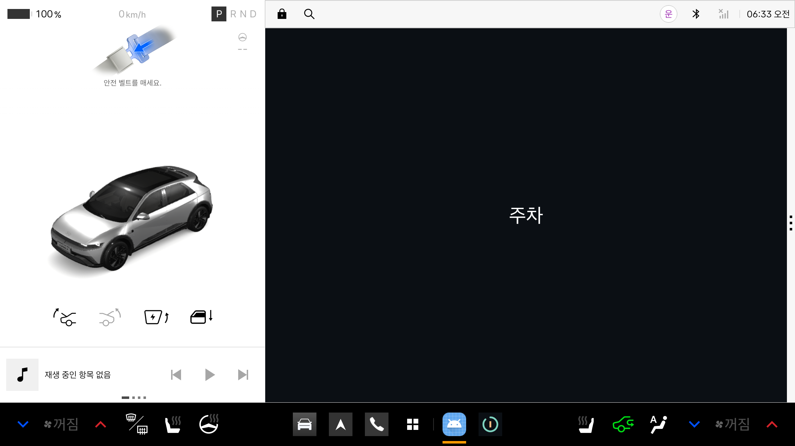
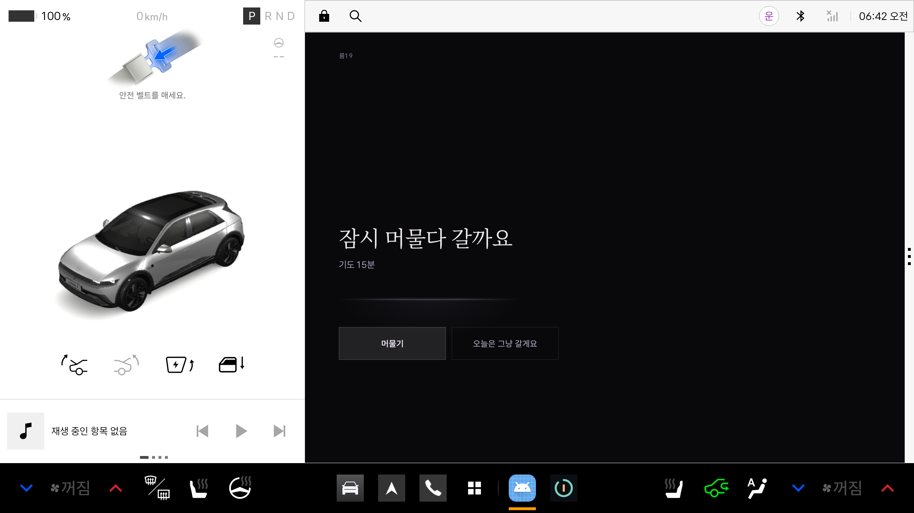

# 룸19 앱 MLP 점검

확인 날짜: 2026-11-15 (Pleos Connect 에뮬레이터, 2560x1440, Vehicle SDK 2.3.2, P단)
대상: `apk/망상궤도_룸19_release.apk` 0.2.0. 기준 문서는 팀 설계 정본의 MLP 정의(누르기 한 번, 7초 들어섬, 네 레버, 묻지 않는 끝, 멈췄다 이어가기)와 조명 통합설계 v2다.

## 한 줄 결론

고치기 전 APK(0.1.0)는 **"주차" 두 글자만 띄우는 골격**이었다. MLP 항목은 하나도 화면에 없었고, 마침 모델은 테스트만 통과한 채 앱과 이어져 있지 않았다. 0.2.0에서 머물기 한 번부터 복원까지 한 번의 기도가 에뮬레이터에서 실제로 돈다. 목소리, 낮은 실내 소리, 머묾의 서랍(말씀·기도문·기도 제목)은 아직 없다.

| 고치기 전 (0.1.0) | 고친 뒤 (0.2.0) |
|---|---|
|  |  |

## 사실과 추정을 나눠 읽는 법

- **됨**: 에뮬레이터에서 직접 돌려 화면이나 SDK 성공 응답으로 확인했다.
- **부분**: 돌지만 설계와 다르거나 확인이 덜 됐다.
- **예정**: 앱에 없다. 화면에서도 된다고 말하지 않는다.

## MLP 항목 점검

| # | 항목 | 고치기 전 | 지금 | 근거 |
|---|---|---|---|---|
| 1 | 머물기 한 번으로 시작. 가입, 권한 창, 안내 화면 없음 | 없음 | 됨 | [01 제안](../assets/app/01_제안.png) |
| 2 | 거절해도 되는 제안: 두 버튼이 같은 크기 | 없음 | 됨 | 〃 |
| 3 | 길이 한 줄을 누르면 5, 10, 15, 20분 | 없음 | 됨 (추천 학습은 예정, 늘 15분에서 시작) | 〃 |
| 4 | 7초 들어섬: 0~6초 레버, 6~7초 고요, 7초 종과 빛, 9초 첫 문장 | 없음 | 됨 | [02 문턱](../assets/app/02_문턱_레버.png) · [03 들어섬](../assets/app/03_들어섬_첫문장.png) |
| 5 | 첫 문장 아래 마태복음 6:6 한 줄 | 없음 | 됨 | [03 들어섬](../assets/app/03_들어섬_첫문장.png) |
| 6 | 레버 1: 문 잠금. 이미 잠겼으면 다시 잠그지 않음 | 없음 | 됨. 에뮬레이터가 잠긴 상태라 "잠김 그대로" 경로만 확인. 잠그는 호출은 11-15 실측과 같은 형태 | [02 문턱](../assets/app/02_문턱_레버.png) |
| 7 | 레버 2: 실내 빛 #FFB15C 20% | 점검용 코드만 | 됨 (SDK 성공 응답 뒤에 "호박색 20" 표시) | [03 들어섬](../assets/app/03_들어섬_첫문장.png) |
| 8 | 레버 3: 바람 1로 | 없음 | 부분. 에뮬레이터 공조가 꺼져 있어 쓰기가 거부됨. 앱은 "바람 그대로"라고 적고 건드리지 않는다. 공조가 켜진 상태의 낮춤은 11-15 실측으로만 확인 | [02 문턱](../assets/app/02_문턱_레버.png) |
| 9 | 레버 4: 운전석 등받이 뒤로 조금 (0.55 → 0.45) | 없음 | 부분. 이동과 정지는 성공 응답 확인. 각도를 읽을 수 없어 이동 시간(1.2초)으로 근사한다. 실차 보정 필요 | 〃 |
| 10 | 숨: 들숨 4초, 날숨 6초, 다섯 번. 빛 20↔15%. 구절 두 토막 | 없음 | 됨 | [04 들숨](../assets/app/04_숨_들숨.png) · [05 날숨](../assets/app/05_숨_날숨.png) |
| 11 | 머묾: 화면이 거의 검다. 시계 없음. 빛 #FF9A3C 15% 고정 | 없음 | 됨 | [06 머묾 구절](../assets/app/06_머묾_구절.png) · [07 머묾](../assets/app/07_머묾.png) |
| 12 | 두드리면 5초 깨어나고 마치기가 또렷해짐 | 없음 | 됨 | [08 두드림](../assets/app/08_머묾_두드림.png) |
| 13 | 끼어듦: 멈췄다가 그 자리에서 이어감. 처음으로 돌아가지 않음 | 없음 | 됨 (길게 누르기, 앱이 가려질 때). 전화 수신 신호와의 연결은 예정 | [09 멈춤](../assets/app/09_멈춤.png) |
| 14 | 묻지 않는 끝: 마침 모델이 빛, 한 문장 순서로 닫음. 확인 창 없음 | 테스트만 | 됨. 화면 터치를 약한 신호로 넣는다. 벨트, 브레이크 등 차량 신호 연결은 예정 | [10 돌아옴](../assets/app/10_돌아옴.png) |
| 15 | 돌아옴: #FFC489 30%로 25초, 사용자 밝기보다 밝게 하지 않음 | 없음 | 됨 (에뮬레이터 원래 밝기가 70이라 상한 동작은 코드로만 확인) | 〃 |
| 16 | 복원: 네 레버를 시작 전 값으로, 화면에 한 줄씩 | 없음 | 됨 (빛 원래 밝기 70, 등받이 운전 자세 성공 응답). 값은 바꾸기 전에 디스크에 적고, 앱이 중간에 죽어도 다음 실행에서 되돌린다 | [11 끝](../assets/app/11_끝.png) |
| 17 | 버튼 없는 끝. 다음 한 걸음은 맥락으로 짐작한 한 문장 이하 | 없음 | 부분. 밤이면 "천천히 올라가세요.", 낮이면 지금 시각 한 줄. 운행 여부와 지난 행동은 아직 보지 않는다 | 〃 |
| 18 | 일찍 마치기: 문장도 종도 없이 되돌림 | 없음 | 됨 | 〃 |
| 19 | 물러남: P를 벗어나면 그 순간 말없이 되돌리고 사라짐 | 주차 판정만 | 부분. 코드는 있으나 이번 점검에서 콘솔 연결이 준비되지 않아 화면으로 재현하지 못했다. D단에서는 등받이 복원이 거부되므로(50001) 화면에 "직접 세워 주세요"라고 적는다 | 재현 필요 |
| 20 | 가입, 기록, 결제, 마이크, 서버 없음 | 해당 | 됨. 권한은 차량 조회와 네 레버 제어뿐. 인터넷과 마이크 권한을 선언하지 않는다 | `app/src/main/AndroidManifest.xml` |
| 21 | 종: 들어섬과 돌아옴에 같은 한 음, 여운 약 2초 | 없음 | 부분. 녹음이 아니라 앱이 합성한 한 음이다. 소리는 화면 캡처로 확인할 수 없어 귀로 들어야 한다 | `app/src/main/java/com/mangsang/app/Bell.kt` |

## 예정 (앱에 없고, 화면에서도 말하지 않는 것)

| 기능 | 상태 |
|---|---|
| 목소리(첫 문장, 첫 숨, 말씀 낭독, 마침 문장) | 예정. 기기 안 합성 음성을 확인하지 못했다. 지금은 같은 문장이 글자로만 나온다 |
| 낮은 실내 소리 | 예정 |
| 머묾의 서랍: 말씀, 기도문, 기도 제목 | 예정 |
| 독서등, 사이드미러, 벨트·브레이크 신호, 좌석 열선·통풍 | 예정 (실측 전) |
| 함께 머묾, 추천 길이 학습, 조금 더 머물기, 끝 1분 전 종, 설정 화면 | 예정 |
| 마침 모델의 개인화 값 저장 | 예정. 지금은 매번 기본 사전분포로 시작한다 |

## 시각 품질: 스타일 프레임과 견주어

기준은 디자인 컨셉의 "문틈의 빛" 화면 일곱 장이다.

| 항목 | 고치기 전 | 지금 | 아직 모자란 것 |
|---|---|---|---|
| 바탕 | 푸른 검정 #0B0F14 | 따뜻한 검정 #09080B | 낮 테마(#121016) 없음 |
| 글자 | 흰 고딕 64pt 한 단어 | 목소리는 명조, 정보는 고딕. 위계 셋(#EDEAF2, #A7A2B4, #8A8599) | 명조는 기기 글꼴(Noto Serif CJK)에 기대므로 실차에 없으면 고딕으로 내려간다 |
| 문틈의 빛 | 없음 | 단계마다 폭과 색만 바뀌는 한 줄. 바닥에 번지는 빛 | 번짐이 프레임보다 단순하다 |
| 움직임 | 없음 | 문구 600ms 등장과 400ms 퇴장, 숨 원 4초와 6초, 문턱 좁아짐, 돌아옴 25초 | 모션 줄이기 설정을 따르지 않는다 |
| 절제 | 해당 없음 | 머묾 화면에 남는 것은 흐린 선 하나와 흐린 마치기 | 끝 화면 표의 줄 간격과 정렬은 더 다듬어야 한다 |
| 화면 분할 | 해당 없음 | 전체 화면 한 가지 | 지도와 나눠 쓰는 반쪽 배치 없음 |

## 정직한 평가

- 0.1.0은 심사위원이 설치했을 때 제품으로 읽히지 않는다. 문서와 시뮬레이션이 약속한 것이 APK에는 없었다.
- 0.2.0은 "누르면 방이 되고, 묻지 않고 닫히고, 원래대로 돌아온다"까지는 실제로 보여 준다. 다만 한 시간 안에 새로 쓴 코드라 실차 보정(등받이 시간, 공조가 꺼진 차, 잠금 소리)과 목소리가 빠져 있다.
- 사람 사용성 평가는 하지 않았다. 위 표의 "됨"은 동작 확인이지 좋다는 뜻이 아니다.
