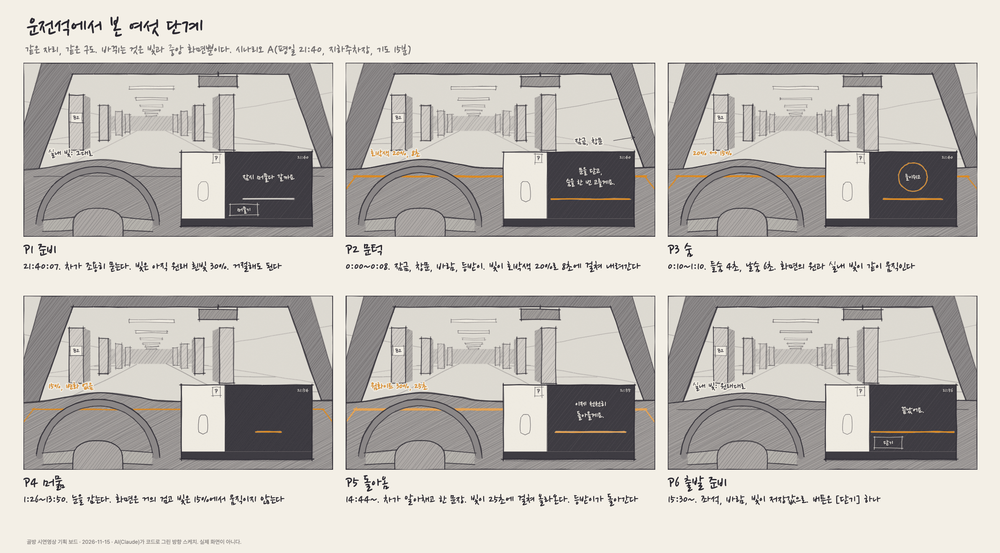
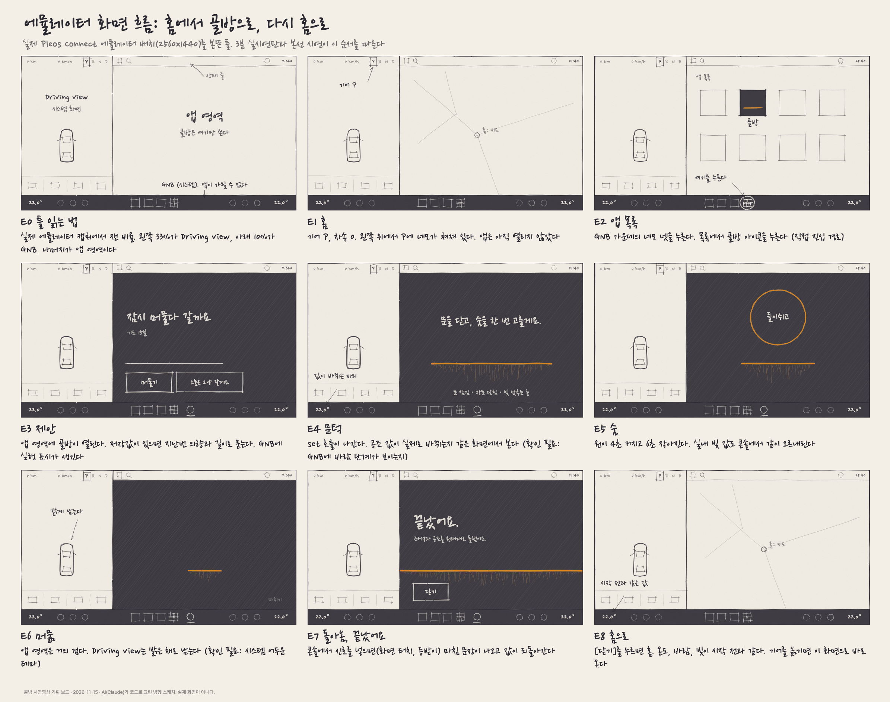
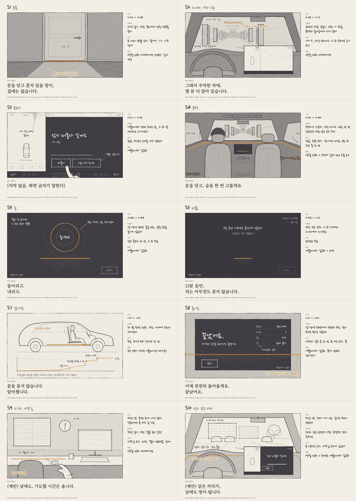

# 룸19 시연영상·랜딩 기획안

작성 날짜: 2026-11-15 / 작성: 크리에이티브 디렉터 역할(Claude) / 결정: PM / 미감 최종: 디자인 담당
전제 문서: [디자인 컨셉](디자인_컨셉.md), [화면 기능 명세](화면_기능_명세.md), 아트 디렉션, 조명 통합 설계 v2, `여정_초정밀.md`(제출 저장소), 하네스 01·02·06·13번 문서, 시연 영상 전문가 준비.
레퍼런스 볼트: 00_색인
콘티 샘플: [conti/00_콘티시트.png](conti/00_콘티시트.png) · 운전석 시점 보드: [conti/10_운전석시점_여섯단계.png](conti/10_운전석시점_여섯단계.png) · 에뮬레이터 흐름 보드: [conti/20_에뮬레이터_진입흐름.png](conti/20_에뮬레이터_진입흐름.png)

**이 문서는 계획이다.** 영상과 랜딩은 만들지 않았다. 만든 것은 방향을 고르기 위한 스케치 보드 3종과 레퍼런스 볼트뿐이다.

표시: [사실]은 저장소 문서나 직접 확인한 것, [가정]은 이 기획안이 정한 값, [확인 필요]는 PM이나 담당이 확인할 것.

---

## 0. 한 장 요약

**영상 컨셉: 연필과 빛.**

1. 영상에는 재질이 두 가지뿐이다. 우리가 상상한 장면은 **연필 선화**로, 실제로 도는 것은 **에뮬레이터 실녹화**로 보여 준다. 색은 호박색 빛 한 줄 하나다.
2. 첫 컷은 닫힌 방문 아래로 새는 빛 한 줄이다. 그 선이 지하주차장의 형광등, 차 안의 앰비언트, 화면의 문턱선으로 이어지고, 마지막에 화면 끝에서 끝까지 열린다.
3. 줄이지 않는 시간이 둘 있다. 빛이 내려가는 8초와 숨 한 번의 10초다. 머묾에서는 영상도 5초 동안 멈추고 소리를 끈다.
4. 내레이션과 배경 음악이 없다. 들리는 것은 차가 내는 소리, 앱의 목소리 두 문장, 시작과 끝의 같은 종 한 번이다.
5. 증거는 세 번 나온다. 앱이 보낸 값과 차가 받은 값의 일치, 마칠 준비 곡선, 저장값과 복원값의 일치. 모두 실제 로그에서 가져온다.

6. 실내 컷의 구도는 하나다. **운전석에서 앞유리 너머를 보는 시점.** 창밖 주차장, 대시보드의 빛 한 줄, 중앙 화면이 한 프레임에 들어와서 원인(화면)과 결과(빛)가 같이 보인다.

**묶음 추천:** 본편 90초 + 무편집 실시연 3분 + 랜딩 머리용 무음 루프 12초.

**랜딩 컨셉: 스크롤이 여정이다.** 문턱선이 페이지 내내 화면 높이 70% 자리에 붙어 있고, 내려갈수록 여섯 단계를 따라 길이와 색이 바뀐다. 맨 아래에는 버튼이 없다. "끝났어요." 한 문장으로 끝난다.

**가장 큰 위험:** 에뮬레이터 실녹화는 앱의 여섯 단계 통합이 끝나는 11/29 뒤에만 찍을 수 있다 [사실: 13번 개발 계획]. 그래서 실녹화가 필요 없는 재료(콘티, 애니매틱, 선화 컷, 랜딩 뼈대)를 먼저 만들고, 실녹화 컷은 자리만 비워 둔다.

---

## 1. 지금 가진 재료와 판정

직접 열어 본 것만 적었다.

| 재료 | 위치 | 상태 | 판정 |
|---|---|---|---|
| 차량 화면 시안 7장, 휴대폰 3장 (HTML과 PNG) | `30_design/concept/screens/` | 밤 기준 완성. 문턱선, 명조, 호박색이 일관된다 | **랜딩의 기준.** 랜딩 여섯 단계 섹션에 HTML 그대로 재사용. 영상에서는 실녹화가 대신한다 |
| 여정 시뮬레이션 (옆 단면 차, 레버 띠, 마침 곡선) | 제출 저장소 `sim/journey/` | 세 시나리오 재생. 2분 30초 초안 영상 있음 | **데이터 컷의 원천.** 단면 선화와 곡선만 떼어 다시 그린다. 화면 전체를 그대로 쓰지는 않는다(패널이 많아 관제 화면처럼 보인다. 아트 디렉션이 이미 지적) |
| 3D 디오라마 무대 (학원가, 운전석 시점) | 제출 저장소 `sim/` | 에뮬레이터 연동까지 동작 | **본편에 쓰지 않는다.** 낮은 폴리곤의 장난감 톤이 룸19의 고요와 부딪힌다. 주제도 이전 아이디어(학원가)다. PT의 "개발 도구" 한 장에만 |
| Blender 시험 렌더 3장, `render_scene.py` | `30_design/3d/`, `30_design/renders/` | 등각 거리 장면 | **본편에 쓰지 않는다.** 방향 B를 고르면 파이프라인만 재사용 |
| 아이디어 보드 스케치 | `30_design/sketches/` | 이전 단계 | 참고만 |
| 에뮬레이터 실측 (제어 10개 중 9개 반영, D단 거부 50001) | `10_research/android-pleos/2026-11-15_룸19모드_차량제어_가능성.md` | 로그 문자열까지 기록됨 | **증거 컷의 근거.** 본편에는 새로 찍은 로그를 쓴다 |
| 마침 모델과 주차 판정 테스트 17개 | 제출 저장소 `core/` | 통과 [사실: 13번] | 랜딩 기술 섹션, 3분판 자막 |
| 의례 엔진, 저장과 복원, 낭독 | 없음 | 11/16~11/29 개발 예정 | **실녹화의 선행 조건** |
| 종, 문, 주차장 소리 | 없음 | 자체 녹음 방침 [사실: 컨셉 5절] | 만든다 |
| 콘티 | `30_design/concept/conti/` | 이 기획안의 샘플 8컷 | 승인 뒤 디자인 담당이 16컷으로 다시 그린다 |

---

## 2. 방향 세 가지와 추천

| | A. 연필과 빛 (추천) | B. 어두운 방 | C. 진짜 주차장 |
|---|---|---|---|
| 한 문장 | 상상은 연필로, 사실은 실녹화로 | 어두운 3D 실내에 빛 한 줄 | 밤 지하주차장에서 실제로 찍는다 |
| 주인공 장면 | 뒷좌석에서 본 선화 실내에 호박색 선이 그어진다 | Blender로 만든 익명 실내에서 빛이 8초에 걸쳐 내려간다 | 실제 차 앞유리 너머 주차장, 실제 방문 |
| 색과 빛 | 종이색, 연필 회색, 호박색 하나 | 검정과 호박색 | 실제 조명 |
| 성격 | 망상궤도만 할 수 있는 안 | 안전한 안 | 과감한 안 |
| 이기는 항목 | 창의성, 기술 활용성(연출과 실측이 눈으로 구분된다) | 차량특화성(차가 바뀌는 모습이 직접 보인다) | 창의성(공감) |
| 위험 | 선화가 엉성하면 미완성처럼 보인다 | 18일 안에 실내 3D 품질을 내기 어렵다. 지금 보유한 3D는 장난감 톤이다 | 차 로고와 실내 디자인 권리, 연출 조명을 실제 기능으로 오해받을 위험, 촬영 실력 |
| 만드는 법 | SVG 선화를 코드로 그려 지고 Playwright로 녹화. 또는 디자이너 손그림을 스캔 | Blender Cycles, 익명 실내 모델링 | 휴대폰 카메라, 삼각대, LED 띠 |
| 비용 | 0원 | 0원, 시간 큼 | 0원, 장소와 차량 필요 |

**추천: A.** 이유는 셋이다.
- 정직하다. Google의 2023년 Gemini 시연 영상은 편집 사실이 알려져 신뢰를 잃었다(볼트 01_영상_사례). A는 연출과 실측의 재질이 달라서 고지 문구 없이도 구분된다.
- 권리 문제가 없다. 실차 형상, 로고, 남의 3D 모델, AI 생성 이미지가 한 컷도 필요 없다.
- 앱의 디자인 규칙과 같다. 앱은 화면을 비우고 선 하나만 남긴다. 영상도 같은 방식으로 덜어 낸다.

A를 고르되 첫 컷(방문 아래 빛)만 실사 한 컷으로 찍는 절충도 가능하다. 5절 결정 5번.

---

## 3. 시연 영상

### 3.1 심사 기준별 목표

| 심사 기준 | 심사위원이 영상에서 확인해야 할 것 | 그 장면 | 증거 |
|---|---|---|---|
| 차량특화성 | 휴대폰은 못 하고 차만 할 수 있는 일이다. 주차 맥락에서만 동작한다 | 7번 문턱(한 번 누르면 잠금, 창문, 빛, 바람, 등받이가 바뀐다), 14번 기어 이탈 | 8번 값 일치 컷, 14번 즉시 복원 |
| 창의성 | 끝을 버튼이나 타이머로 내지 않는다. 문제(혼자 있을 방이 없다)가 한 컷에 읽힌다 | 2번 문틈, 10번 머묾, 11번 알아챔 | 11번 마칠 준비 곡선 |
| 기술 활용성 | Pleos Vehicle SDK가 핵심 기능에 실제로 쓰인다. 실제로 돈다 | 7번 구석의 set 호출 로그, 8번, 13번 | 에뮬레이터 실녹화 라벨, 3분 실시연판 전체 |
| 사업성 | 누가 쓰는지, 얼마나 많은지 | 5번 숫자 카드, 15번 끝 카드 | 출처 표기. 수익 구조와 간이판 검증은 영상이 아니라 3분판 끝, 랜딩, PT에서 다룬다 |

본편 90초는 사업성을 한 컷만 다룬다. 90초에 네 기준을 같은 무게로 넣으면 아무것도 남지 않는다. 본편은 "이게 무엇이고 진짜로 돈다"를 맡고, 나머지는 PT가 맡는다.

### 3.2 길이와 형식 선택지

| 안 | 구성 | 좋은 점 | 나쁜 점 |
|---|---|---|---|
| 1 | 본편 90초만 | 만들 것이 하나 | 심사위원이 "정말 도나"를 확인할 긴 증거가 없다 |
| **2 (추천)** | **본편 90초 + 무편집 실시연 3분 + 무음 루프 12초** | 본편은 감정과 요점, 3분판은 증거, 루프는 랜딩 머리. 3분판은 본선 시연의 리허설이자 현장 사고 때 예비 영상 | 찍을 것이 둘. 다만 3분판은 편집이 없다 |
| 3 | 3분 통합 한 편 | 한 번에 다 본다 | 길다. 감정과 증거가 서로 리듬을 깬다 |

- 화면비 16:9, 1920x1080, 30fps. 실녹화 원본은 에뮬레이터 해상도 그대로 받아 축소한다.
- 본선 PT에서 영상을 트는 위치와 길이는 발표 시간 규정에 달려 있다 [확인 필요: PT 제한 시간]. 시간이 빠듯하면 본편에서 2, 7, 11, 13번만 남긴 30초 컷을 쓴다.

### 3.3 연출 원칙

1. **선 하나가 주인공.** 모든 컷에 수평선이 하나 있고, 화면 높이 70% 자리에 온다. 컷이 바뀌어도 눈이 갈 곳이 같다. 앱 화면의 문턱선 규칙과 같다.
2. **두 재질.** 연필 선화는 연출, 또렷한 화면은 실측. 실측 컷에는 왼쪽 아래에 작은 라벨 "Pleos Connect 에뮬레이터 실녹화"를 붙인다.
3. **줄이지 않는 시간.** 빛 8초, 숨 10초. 줄인 구간에는 "실제 13분", "실제 25초"를 작게 적는다.
4. **목소리는 차의 것만.** 영상의 자막은 합니다체 명조, 차의 말은 앱 문구 그대로("~할게요"). 둘을 섞지 않는다.
5. **얼굴이 없다.** 사람은 손, 어깨, 뒷모습만. 기도하는 모습을 연기시키지 않는다.
6. **종교 상징이 없다.** 십자, 촛불, 모은 손 그림, 교회 건물이 없다. 앱의 금지 목록(컨셉 8절)을 그대로 따른다.
7. **장면 전환은 검은 화면을 거친다.** 눈을 감았다 뜨는 리듬(아트 디렉션).

### 3.4 본편 90초 샷 목록

재료 표기: [선화] 연필 선화 애니메이션, [실녹화] 에뮬레이터 화면 녹화, [카드] 검은 바탕 글자, [코드] 실제 로그와 값을 읽어 코드로 그린 도표.

| # | 시간 | 장면 | 카메라와 움직임 | 자막 (명조, 정확한 문장) | 화면 위 정보 | 소리 | 재료 | 지금 |
|---|---|---|---|---|---|---|---|---|
| 1 | 0:00~0:02 | 검은 화면 | 없음 | 없음 | 없음 | 문 너머 생활 소리(설거지, 멀리 TV). 아주 낮게 | [카드] | 만든다 |
| 2 | 0:02~0:08 | **문틈.** 복도에서 본 닫힌 방문. 문 아래로 빛 한 줄 | 바닥 높이, 고정. 선이 먼저 그어지고 문이 나중에 그려진다 | 문을 닫고 혼자 있을 방이, / 집에는 없습니다. | 없음 | 같은 소리 | [선화] 콘티 S1 | 샘플 있음 |
| 3 | 0:08~0:13 | **지하주차장.** 앞유리 너머 기둥과 형광등. 2번의 선이 형광등 줄로 이어진다 | **운전석 시점**, 눈높이, 고정. 이 구도를 7, 10, 12번에서 그대로 다시 쓴다 | 없음 | 왼쪽 위 작게 "21:40 지하 2층" (Pretendard) | 기어 P, 파킹 브레이크. 그 뒤 주차장 공기 소리 | [선화] 콘티 S2 | 샘플 있음 |
| 4 | 0:13~0:17 | 시동 버튼으로 가던 손이 멈춘다 | 손 클로즈업, 고정 | 그래서 주차한 차에, / 몇 분 더 앉아 있습니다. | 없음 | 공기 소리 | [선화] | 만든다 |
| 5 | 0:17~0:21 | 숫자 카드 | 없음 | 한국인 넷 중 한 명은 / 매일 기도합니다. | 아래 작게 "Pew Research Center, 2025" | 무음 | [카드] | 만든다 |
| 6 | 0:21~0:26 | **묻는다.** 에뮬레이터 전체 화면에서 시작한다(왼쪽 Driving view에 기어 P, 아래 GNB). 앱 영역에 "잠시 머물다 갈까요"가 뜨고 손가락이 [머물기]를 누른다 | 화면 정면. 전체 화면을 1초 보여 준 뒤 앱 영역으로 다가간다 | 없음. 화면 글자가 말한다 | 라벨 "에뮬레이터 실녹화" | 무음. 제안은 소리를 내지 않는다 | [실녹화] 콘티 S3 | 앱 통합 뒤 |
| 7 | 0:26~0:40 | **문턱.** 실내에 호박색 선이 그어지고 8초에 걸쳐 가라앉는다. 창문 닫힘, 등받이가 조금 뒤로 기운다 | **운전석 시점**, 3번과 같은 구도. 14초 한 컷. (대안: 뒷좌석 가운데 와이드, 콘티 S4) | 문을 닫고, 숨을 한 번 고를게요. (차의 말, 앱 문구 그대로) | 왼쪽 아래 모노 글자로 set 호출 로그가 한 줄씩 뜬다. 실제 로그 | 잠금, 창문 모터, 낮아지는 바람. 앱의 낭독. 8초째 작은 종 한 번 | [선화] + [코드] 보드 P2, 콘티 S4 | 샘플 있음, 로그는 통합 뒤 |
| 8 | 0:40~0:44 | **값 일치.** 왼쪽 "앱이 보낸 값", 오른쪽 "차가 받은 값", 다섯 줄 | 없음 | 한 번 눌렀고, / 나머지는 차가 했습니다. | 잠금, 창문, 빛, 바람, 열선. 라벨 "Pleos Connect 에뮬레이터 실측 · Vehicle SDK" | 무음 | [코드] | 통합 뒤 |
| 9 | 0:44~0:54 | **숨.** 원이 4초 커지고 6초 작아진다 | 화면 정면. 줄이지 않는다 | 없음 | 라벨 "에뮬레이터 실녹화" | 앱의 "들이쉬고", "내쉬고" 한 번씩 | [실녹화] 콘티 S5 | 통합 뒤 |
| 10 | 0:54~1:01 | **머묾.** 거의 검은 화면, 짧은 선 하나. 5초 동안 아무것도 움직이지 않는다. 그 뒤 시계만 21:41에서 21:54로 | 고정 | 13분 동안, / 차는 아무것도 묻지 않습니다. (5초 뒤에 뜬다) | 작게 "실제 13분" | 완전한 무음 | [실녹화] 콘티 S6 | 통합 뒤 |
| 11 | 1:01~1:10 | **알아챔.** 차 옆 단면 선화. 등받이가 선다. 아래에 곡선이 오른다 | 고정 | 끝을 묻지 않습니다. / 알아챕니다. | 곡선 위 점 세 개: "12분 0.21", "화면을 두드림 0.74", "등받이 0.96". 아래 작게 "마칠 준비 추정값. 기기 안에서만 계산하고 앱 화면에는 표시하지 않습니다" | 좌석 모터 한 번 | [선화] + [코드] 콘티 S7 | 샘플 있음 |
| 12 | 1:10~1:17 | **돌아옴.** 문턱선이 넓어지고 빛이 올라온다 | 화면 정면에서 아주 천천히 뒤로 | 이제 천천히 돌아올게요. (차의 말) | 작게 "실제 25초" | 앱의 낭독. 시작과 같은 종 한 번 | [실녹화] | 통합 뒤 |
| 13 | 1:17~1:22 | **끝났어요.** 되돌린 값 네 줄 | 화면 정면 | 바꾼 것은 모두, / 원래대로 돌려놓습니다. | 화면 안: 등받이 운전 자세, 바람 3, 온도 22℃, 빛 원래 밝기. 옆에 "저장값과 일치" | 무음 | [실녹화] + [코드] 콘티 S8 | 통합 뒤 |
| 14 | 1:22~1:25 | **안전.** 머무는 중 기어를 옮긴다. 화면이 바로 물러난다 | 화면 정면 | 기어를 옮기면, 바로 물러납니다. | 기어 P → D, 1.5초 안에 값 복원 | 무음 | [실녹화] | 통합 뒤 |
| 15 | 1:25~1:30 | **끝 카드.** 선이 화면 끝에서 끝까지 열린다. 그 위에 이름 | 없음 | 룸19 / 주차한 차가 몇 분 동안, 문 닫힌 방이 됩니다. | 고지 세 줄(3.8절) | 문 여는 소리 한 번. 끝 | [선화] + [카드] | 만든다 |

대표 프레임(썸네일): 7번의 8초째. 선화 실내에 호박색 선 하나, 아래에 "문을 닫고, 숨을 한 번 고를게요."

30초 컷: 2번(5초), 7번(10초), 11번(7초), 13번(4초), 15번(4초).

### 3.5 자막 전체 (검수용)

영상의 목소리(합니다체, Noto Serif KR 400, 한 화면 최대 2줄, 한 줄 16자 안팎, 최소 2.5초):
1. 문을 닫고 혼자 있을 방이, / 집에는 없습니다.
2. 그래서 주차한 차에, / 몇 분 더 앉아 있습니다.
3. 한국인 넷 중 한 명은 / 매일 기도합니다.
4. 한 번 눌렀고, / 나머지는 차가 했습니다.
5. 13분 동안, / 차는 아무것도 묻지 않습니다.
6. 끝을 묻지 않습니다. / 알아챕니다.
7. 바꾼 것은 모두, / 원래대로 돌려놓습니다.
8. 기어를 옮기면, 바로 물러납니다.
9. 주차한 차가 몇 분 동안, / 문 닫힌 방이 됩니다.

차의 목소리(앱 문구 그대로, 화면 기능 명세 3절이 정본):
- 잠시 머물다 갈까요
- 문을 닫고, 숨을 한 번 고를게요.
- 들이쉬고. 내쉬고.
- 이제 천천히 돌아올게요.
- 끝났어요. 좌석과 공조를 원래대로 돌렸어요.

검수할 것: 자막 1번의 "집에는 없습니다"는 타깃의 상황을 단정한다. 간이판 인터뷰에서 같은 말이 나오면 그 말로 바꾼다 [가정]. 자막 3번의 숫자는 `00_source-log.md` S7과 대조한다. 자막 4번은 "다섯 가지" 같은 숫자를 일부러 넣지 않았다. 실제로 반영되는 레버 수가 통합 뒤에 정해지기 때문이다.

### 3.6 소리 설계

| 소리 | 어디서 | 만드는 법 | 비고 |
|---|---|---|---|
| 문 너머 생활 소리 | 1~2번 | 자체 녹음(집) | 말소리가 알아들리지 않게 |
| 기어 P, 파킹 브레이크 | 3번 | 자체 녹음(자가 차량) | |
| 주차장 공기 소리 | 3~4번 | 자체 녹음(지하주차장 30초) | |
| 잠금, 창문 모터, 좌석 모터, 바람 | 7, 11번 | 자체 녹음 | 실제 차 소리를 쓰되 "연출"임을 끝 카드에 밝힌다 |
| 작은 종 | 7번 8초째, 12번 | 자체 녹음. 앱에 넣는 음원과 같은 파일 | 시작과 끝이 같은 소리여야 한다(컨셉 5절) |
| 차의 목소리 | 6~13번 | 에뮬레이터에서 앱의 낭독을 그대로 녹음 | 따로 성우나 다른 TTS를 쓰지 않는다. 앱에서 실제로 나는 소리가 증거다 |
| 무음 | 5, 8, 10, 13, 14번 | | 무음이 다섯 번이다. 배경 음악을 깔면 이 무음이 사라진다 |

- 배경 음악 없음을 추천한다. 이전 준비 문서는 "배경음 한 곡"을 권했지만, 컨셉이 "침묵이 기본"으로 정해진 뒤라 바꾼다. 결정 4번.
- 소리 없이 틀어도 이해되어야 한다. 모든 정보는 자막과 화면 글자에 있다.
- 자체 녹음이 어려운 소리의 대안과 라이선스는 볼트 04_에셋_소스와_라이선스.

### 3.7 증거 순간

| 증거 | 무엇을 보여 주나 | 원본 | 조건 |
|---|---|---|---|
| set 호출 로그 (7번) | 앱이 Vehicle SDK를 직접 부른다 | 본편용으로 새로 찍은 logcat | 글자를 고치지 않는다. 줄 수만 줄인다 |
| 보낸 값과 받은 값 (8번) | 차가 실제로 반응했다 | 같은 촬영의 Virtual Console 값 | 일치하지 않는 항목이 있으면 그 항목을 빼지 않고 "미반영"으로 적는다 |
| 마칠 준비 곡선 (11번) | 끝이 추정으로 정해진다 | `EndingPolicy`에 시나리오 A 신호를 넣어 얻은 값 | "설계 시나리오 재생"이라고 적는다. 실사용자 데이터처럼 보이게 하지 않는다 |
| 복원 일치 (13번) | 전부 원래대로 돌아왔다 | 세션 전후 값 비교 | 통합 뒤 실측 |
| 기어 이탈 (14번) | 안전이 의례보다 먼저다 | 실녹화 | D단에서 좌석과 잠금이 거부되는 것(50001)은 3분판에서 로그로 보여 준다 |

### 3.8 고지 문구 (끝 카드, 작은 글자)

- P단에서만 동작합니다.
- 연필 그림은 연출이고, 화면과 값은 Pleos Connect 에뮬레이터 실측입니다.
- 실차 적용은 Pleos App Market 승인 뒤입니다.

### 3.9 무편집 실시연 3분판

화면 구성: 왼쪽 60%에 에뮬레이터 화면, 오른쪽 위에 Virtual Console 값, 오른쪽 아래에 앱 로그. 자르지 않고 한 번에 찍는다. 위쪽에 얇은 장 제목만 붙인다.

| 시간 | 장 | 보여 주는 것 | 심사 기준 |
|---|---|---|---|
| 0:00~0:20 | 주행 중에는 침묵 | 기어 D, 차속 있음. 앱은 아무것도 띄우지 않는다 | 차량특화성(안전) |
| 0:20~0:35 | 주차하면 묻는다 | 기어 P, 차속 0, 착좌. 7초 뒤 반쪽 카드 | 차량특화성 |
| 0:35~1:05 | 문턱 | [머물기]. 저장 기록이 먼저, 그다음 set 호출. 콘솔 값이 따라 바뀐다 | 기술 활용성 |
| 1:05~1:20 | 숨 | 빛이 숨과 함께 오르내린다 | 창의성 |
| 1:20~1:50 | 머묾 | 시연용 단축(화면에 "시연용: 15분을 40초로" 표시) | 창의성 |
| 1:50~2:20 | 알아챔 | 콘솔에서 신호를 넣는다(화면 터치, 등받이). 로그에 추정값이 오르고 마침 문장이 나온다 | 기술 활용성, 창의성 |
| 2:20~2:35 | 복원 | 저장값과 지금 값 비교 | 차량특화성 |
| 2:35~2:55 | 예외 | 다시 시작한 뒤 기어 D. 즉시 복원. D단에서 좌석 제어가 거부되는 로그(50001) | 기술 활용성(안전) |
| 2:55~3:00 | 끝 | 저장소 주소, 테스트 수, 권한 목록(마이크 없음, 인터넷 없음) | 기술 활용성, 사업성 |

이 순서는 본선 현장 시연의 순서와 같게 맞춘다. 현장에서 에뮬레이터가 멈추면 이 영상을 튼다.

### 3.10 재료를 만드는 방법

| 재료 | 방법 | 도구 | 품질 기준 |
|---|---|---|---|
| 연필 선화 컷 (2, 3, 4, 7, 11, 15번) | 두 길 중 하나. (가) 디자인 담당이 종이나 태블릿에 그린 그림을 받아 선이 그어지는 순서로 움직인다. (나) `conti/build.py`처럼 코드로 흔들린 선을 만들고 그어지는 애니메이션을 붙인다 | SVG, CSS, Playwright 녹화 | 2초 안에 무엇인지 읽힌다. 선이 매끈하지 않다. 색은 호박색 하나 |
| 에뮬레이터 실녹화 (6, 9, 10, 12, 13, 14번, 3분판) | 앱이 도는 에뮬레이터 화면을 원본 해상도로 받는다 | scrcpy 또는 Android Studio 녹화, ffmpeg | 화면을 다시 그리거나 합성하지 않는다 |
| 도표 (8, 11, 13번) | 실제 로그와 값 파일을 읽어 그린다 | HTML과 SVG, Playwright 녹화 | 숫자를 손으로 치지 않는다 |
| 글자 카드 (1, 5, 15번) | HTML로 그려 녹화 | 위와 같음 | Noto Serif KR, Pretendard만 |
| 편집 | 컷 붙이기, 자막, 소리 | 볼트 05_도구의 추천 조합 | 이 맥의 ffmpeg에는 자막 필터가 없다 [사실: 이전 준비 문서]. 자막은 HTML로 그려 함께 녹화한다 |
| AI 생성 이미지와 영상 | **본편에 쓰지 않는 것을 추천한다.** 쓰더라도 선화 컷의 밑그림 참고까지만 | Gemini 등 | 쓰면 끝 카드에 표기. 실측 컷과 증거 컷에는 어떤 경우에도 쓰지 않는다 |

### 3.11 운전석 시점, 전체 흐름, 에뮬레이터 화면 흐름을 어떻게 보여 주나

세 가지를 각각 한 장의 보드로 먼저 그렸다. 영상, 랜딩, PT가 이 세 장을 공통 밑그림으로 쓴다.

**(1) 운전석 시점 여섯 단계**

- 구도: 운전자 눈높이에서 정면. 위 60%는 앞유리 너머 지하주차장(기둥 B2, 형광등 두 줄), 아래 40%는 대시보드, 핸들 윗부분, 오른쪽에 중앙 화면. 좌핸들 기준 [가정].
- 여섯 장이 같은 구도다. 바뀌는 것은 셋뿐이다: 대시보드를 가로지르는 실내 빛(색과 밝기), 실내의 어둠(빗금 간격), 중앙 화면의 한 문장과 문턱선.
- 쓰는 곳: 본편 3, 7, 10, 12번 컷의 구도. 랜딩 3번 섹션의 단계별 그림. PT의 여정 한 장.
- 만드는 법: 한 장의 선화를 층으로 나눠(창밖, 실내, 빛, 화면) 빛과 화면 층만 단계별로 바꾼다. 중앙 화면 자리에는 에뮬레이터 실녹화를 원근에 맞춰 넣되, 넣었다는 사실을 라벨로 적는다.
- 값의 출처: 조명 통합 설계 v2의 단계별 사양, `여정_초정밀.md` 시나리오 A의 시각.
- 주의: 주행 중 장면은 그리지 않는다. 첫 장부터 기어 P다.

**(2) 전체 흐름**

- 시간 흐름의 정본은 `여정_초정밀.md` 시나리오 A(21:39 진입부터 21:56 하차까지)다.
- 한 장으로 볼 때: 운전석 시점 보드 여섯 장(위)이 "사람이 보는 것", 여정 시뮬레이션의 레버 띠와 마침 곡선(제출 저장소 `sim/journey/`)이 "차가 하는 것"이다. PT와 랜딩에서는 이 둘을 위아래로 맞붙여 한 장으로 만든다: 위에 시점 그림 여섯 칸, 아래에 같은 시간축의 빛, 바람, 등받이, 잠금, 마칠 준비 곡선.
- 영상에서는 콘티 시트 8컷이 흐름이다(5절).

**(3) 에뮬레이터 화면 흐름: 홈에서 룸19로, 다시 홈으로**

실제 에뮬레이터 화면(제출 저장소 `sim/public/emu.png`, 2560x1440, 팀이 직접 캡처)을 열어 보고 배치를 본떴다. 여기서 알게 된 것이 있다.

| 본 것 [사실] | 계획에 주는 영향 |
|---|---|
| 화면 왼쪽 약 3분의 1은 Driving view(기어, 속도, 차 모형)이고 아래에는 GNB(공조, 앱 라이브러리)가 있다. 앱은 오른쪽 영역에서 열린다. Driving view는 앱이 가릴 수 없다(`01_Pleos_API_카탈로그.md`) | 화면 시안은 2560x1440 전체를 쓴다고 가정했다. 실제 앱 영역 크기에 맞춰 시안을 다시 확인해야 한다 [확인 필요: 디자인, 개발] |
| 홈과 Driving view의 바탕이 밝은 흰색이다 | "밤 차 안에서 가장 센 광원은 화면"이라는 조명 설계의 걱정이 앱 밖에서 생긴다. 머묾 중에도 왼쪽이 밝게 남을 수 있다. 시스템 어두운 테마나 야간 모드가 있는지 확인한다 [확인 필요]. 영상은 이것을 숨기지 않는다 |
| GNB에 공조 온도와 바람 값이 항상 보인다 | 좋은 소식이다. 문턱에서 바람이 3에서 1로 바뀌는 것이 **우리 앱 밖의 시스템 화면에** 찍힌다. 별도 합성 없이 한 화면에서 원인과 결과가 보인다. 3분판의 핵심 증거 |
| 앱에 들어가는 길은 GNB의 앱 라이브러리(네모 넷) | 진입 경로가 둘이다. (가) 앱 라이브러리에서 룸19 아이콘을 누른다. (나) 주차하면 제안 카드가 스스로 뜬다. (나)는 앱이 꺼진 상태에서 화면을 띄울 수 있어야 한다 [확인 필요: 개발]. 안 되면 영상과 시연은 (가)로 간다 |

화면 흐름 여덟 장(E1~E8)의 쓰임:
- 3분 실시연판과 본선 현장 시연의 순서표. 3.9절의 장 구성과 같다.
- 본편 6번 컷은 E1에서 E3까지를 5초에 보여 준다. 그 뒤 컷은 앱 영역만 크게 보여 주되, 6번에서 전체 화면을 먼저 보였으므로 잘라 낸 것이 아님을 알 수 있다.
- 실제 화면으로 바꾸는 시점: 11/30 실녹화 때 E1~E8과 같은 자리에서 화면을 한 장씩 캡처해 이 보드의 그림을 실제 캡처로 교체한다. 그 전에는 앱 아이콘과 첫 화면만 있어도 E1~E3은 지금 빌드로 찍을 수 있다 [가정: 현재 빌드가 설치돼 있다].

### 3.12 피할 것

- 드론 샷, 도시 야경, 달리는 차. 룸19는 서 있는 차다.
- 실제 현대차 실내 사진, 로고, Pleos 콘솔의 3D 차 모델. 약관상 복제할 수 없다 [사실: `sim/THIRD-PARTY.md`].
- 화면을 다시 그린 가짜 UI, 손으로 친 로그, 일치하지 않는 값을 숨기는 편집.
- 얼굴 클로즈업, 눈물, 모은 손. 기도를 연기시키지 않는다.
- 십자, 촛불, 교회, 찬송.
- 배경 음악, 효과음 팡파르, 빠른 컷, 글자 날아오기, 보라색 빛, 그라데이션, 유리 효과.
- 기능 나열. 본편은 순간 하나(문턱)와 차이 하나(버튼 없는 끝)만 남긴다.
- 낮은 폴리곤 디오라마. 본편에 넣지 않는다.

---

## 4. 랜딩 페이지

### 4.1 한 문장과 원칙

**스크롤이 여정이다.** 문턱선 하나가 화면 높이 70%에 붙어 있고, 방문자가 내려갈수록 준비에서 출발 준비까지 길이와 색이 바뀐다. 페이지 자체가 앱의 여섯 단계다.

- 읽는 사람: 심사위원(현대자동차 UX, 개발), 그다음 간이판 참가 후보.
- 한 화면에 한 문장. 제목은 명조, 설명은 Pretendard.
- 바탕은 처음부터 끝까지 `#09080B`. 흰 면이 없다.
- 움직이는 것은 한 번에 하나. 모션 줄이기 설정이면 선이 중간 길이로 멈추고 글만 바뀐다.
- 사진이 없다. 그림은 앱 화면(HTML 그대로), 연필 선화, 실제 값으로 그린 도표 세 가지뿐이다.

### 4.2 섹션별 계획

| # | 섹션 | 제목 문구 (초안) | 본문 문구 (초안) | 그림 | 상호작용 |
|---|---|---|---|---|---|
| 1 | 머리 | 주차한 차가 몇 분 동안, 문 닫힌 방이 됩니다. | 룸19는 Pleos Connect 차량용 기도 앱입니다. 문을 닫고, 빛을 낮추고, 끝나면 원래대로 돌려놓습니다. | 검은 화면에 문턱선 하나. 뒤에 12초 무음 루프(선화 실내에 빛이 내려가는 장면) | 열리면 선이 8초에 걸쳐 좁아진다. 한 번만. 링크 둘: "90초 영상", "에뮬레이터 시연" |
| 2 | 문제 | 차는 이미 혼자 머무는 곳입니다. 다만 닫히지 않습니다. | 밝은 실내등, 켜진 화면, 잠기지 않은 문. / 시작은 매번 결심이 필요하고, / 끝은 타이머가 자르고, / 바꿔 놓은 좌석은 손으로 되돌려야 합니다. | 콘티 S1, S2 선화. 숫자 둘: "매일 기도하는 한국인 25%", "명상 앱 30일 유지율 4.7%" (출처 표기) | 숫자는 움직이지 않는다 |
| 3 | 여섯 단계 | 한 번 누르면, 여섯 단계가 지나갑니다. | 단계마다 네 줄: 사람, 차, 화면, 소리. `여정_초정밀.md` 시나리오 A에서 가져온다 | 왼쪽에 운전석 시점 선화(보드 P1~P6). 그 안의 중앙 화면 자리에 차량 화면 시안(HTML 그대로). 오른쪽에 네 줄 | 화면이 붙어 있고 스크롤에 따라 단계가 바뀐다. 문턱선이 단계에 맞춰 변한다. 머묾에서는 스크롤을 한 화면만큼 더 내려도 아무것도 변하지 않는다 |
| 4 | 차가 대신 합니다 | 손을 내려놓으세요. 차가 합니다. | 잠금, 창문, 빛, 바람, 열선, 등받이. 시작 전 값을 저장하고, 끝나면 그 값으로 돌려놓습니다. | 차 옆 단면 선화. 레버 여섯 개 표: 시작 전, 머무는 동안, 끝난 뒤 | 표의 줄에 손을 대면 선화의 그 부분에 호박색이 든다 |
| 5 | 버튼 없는 끝 | 끝을 묻지 않습니다. 알아챕니다. | 화면을 두드리는 손, 세워지는 등받이, 벨트로 가는 손. 차는 이 약한 신호를 모아 마칠 준비를 추정하고, 빛과 소리와 한 문장으로 닫습니다. 일찍 닫는 것보다 늦게 닫는 쪽을 택합니다. | 마칠 준비 곡선 | 방문자가 신호 세 개를 눌러 볼 수 있다: "화면을 두드림", "등받이를 세움", "다시 기댐". 곡선이 오르내린다. 아래에 "설계값 재생"이라고 적는다. 여정 시뮬레이션의 계산을 재사용 |
| 6 | 사생활 | 기도는 차 밖으로 나가지 않습니다. | 마이크를 쓰지 않습니다. 서버가 없습니다. 기록은 기기 안에만 있고, 한 번에 지울 수 있습니다. | 앱 권한 목록을 글자 그대로(매니페스트 발췌). 저장소 링크 | 없음 |
| 7 | 안전 | P단에서만. 기어를 옮기면 바로 물러납니다. | 주행 중에는 화면도 소리도 없습니다. 전화가 오면 멈추고, 문이 열리면 빛을 돌려놓습니다. | 예외 네 가지 표(전화, 문 열림, 기어 이탈, 시동 끔) | 없음 |
| 8 | 기술 증거 | 에뮬레이터에서 실제로 돕니다. | Pleos Vehicle SDK 제어 10개 중 9개 반영. D단에서는 좌석과 잠금이 거부됩니다(50001). 판단 로직 테스트 17개. | 3분 실시연 영상, 호출 표, 로그 발췌 | 표의 줄마다 저장소의 해당 코드와 문서로 가는 링크 |
| 9 | 사업 | 먼저 현대자동차가, 그다음 사용자가. | 기본 탑재 라이선스가 첫 수익, 심화 의례 팩 구독이 둘째입니다. 서버가 없어 사용자가 늘어도 비용이 거의 늘지 않습니다. Pleos가 없는 차에서는 휴대폰 간이판으로 수요를 먼저 확인합니다. | 수익 두 줄 도식. 간이판 화면 3장. 검증 결과 칸(결과가 나오면 채우고, 없으면 "진행 중"이라고 적는다) | 없음 |
| 10 | 팀과 공모전 | 망상궤도 | 2026 Pleos Code your App 출품작. 역할, 저장소, 사용한 공개 자료와 라이선스, AI 사용 고지 | 글자만 | 없음 |
| 11 | 끝 | 끝났어요. | 없음 | 문턱선이 화면 끝에서 끝까지 | **버튼이 없다.** 앱이 끝을 버튼으로 내지 않듯 페이지도 권유 없이 끝난다 |

문구 주의:
- 2번과 8번의 숫자는 `00_source-log.md`의 번호와 대조한 뒤 싣는다. 이전 준비 문서의 "26.8%"와 02 CPS의 "16.9%(2018)"가 서로 다르다. 확인 전에는 둘 다 싣지 않는다 [확인 필요].
- 5번 "늦게 닫는 쪽을 택합니다"는 마침 모델의 비용 비율 설명과 대조한다 [확인 필요].
- 9번에 가격, 전환율, 예상 매출은 싣지 않는다. 01번 문서에서 모두 [가정]이다.
- 종교 낱말은 "기도" 하나만 쓴다. 이름의 뜻(마태복음 6장 6절)을 실을지는 결정 9번.

### 4.3 기술과 배포

| 항목 | 선택 | 이유 |
|---|---|---|
| 구조 | 정적 페이지 하나. HTML, CSS, 작은 JS | 섹션 11개에 프레임워크가 필요 없다. 화면 시안이 이미 자체 완결 HTML이다 |
| 스크롤 연출 | CSS `position: sticky` + IntersectionObserver. 지원 브라우저에서는 CSS 스크롤 연동 애니메이션 | 라이브러리 없이 된다. 심사위원 브라우저를 모르므로 기본 동작이 먼저 |
| 글꼴 | Noto Serif KR, Pretendard. 쓰는 글자만 추려 자체 호스팅 | 둘 다 SIL OFL. 한글 글꼴 전체는 무겁다 |
| 영상 | 12초 루프는 페이지에 직접(무음, 자동 재생). 90초와 3분은 외부 영상 서비스에 올려 누를 때만 불러온다 | 페이지가 가벼워야 한다. 세부 한도는 볼트 05 |
| 배포 | GitHub Pages. 제출 저장소 `codeyourapp-submission`의 `/docs` 또는 별도 브랜치 | 제출 저장소는 이미 공개다 [사실: 2026-11-15 확인]. 비용 0원. 주소는 결정 6번 |
| 접근성 | 대비 4.5:1 이상, 키보드로 전부 이동, 모션 줄이기 대응, 영상 자막 내장 | 앱의 접근성 규칙(컨셉 7절)과 같은 수준 |
| 점검 | 배포 전에 휴대폰 폭 390과 1440에서 캡처해 눈으로 확인. 링크 전수 검사 | |

만들지 않는 것: 다국어, 문의 양식, 방문 분석, 블로그, 관리 화면. 간이판 참가 신청을 받을지는 결정 8번.

---

## 5. 콘티 샘플

방향 A의 느낌을 보여 주려고 8컷을 코드로 그렸다. 연필 선, 빗금으로 만든 어둠, 호박색 하나. 오른쪽에 시간, 카메라, 소리, 재료를 손글씨로 적는 배치는 출판된 영화 스토리보드의 관습을 따랐다(볼트 03_콘티_스케치).

| 컷 | 파일 | 샷 목록 번호 |
|---|---|---|
| S1 문틈 | [S1_문틈.png](conti/S1_문틈.png) | 2 |
| S2 21:40, 지하 2층 | [S2_2140_지하2층.png](conti/S2_2140_지하2층.png) | 3 |
| S3 묻는다 | [S3_묻는다.png](conti/S3_묻는다.png) | 6 |
| S4 문턱 | [S4_문턱.png](conti/S4_문턱.png) | 7 (대안 구도) |
| S5 숨 | [S5_숨.png](conti/S5_숨.png) | 9 |
| S6 머묾 | [S6_머묾.png](conti/S6_머묾.png) | 10 |
| S7 알아챔 | [S7_알아챔.png](conti/S7_알아챔.png) | 11 |
| S8 돌아옴 | [S8_돌아옴.png](conti/S8_돌아옴.png) | 12, 13 |

보드 두 장(운전석 시점 여섯 단계, 에뮬레이터 진입 흐름)은 3.11절에 있다.

다시 만들기: `python3 30_design/concept/conti/build.py` (Chrome 필요, 글꼴은 Nanum Pen Script를 웹에서 받는다).

스스로 본 한계: 코드로 그린 선이라 손그림보다 고르다. S2의 주차장은 깊이감이 약하고, S4의 사람은 머리 윤곽뿐이다. 방향을 고르는 데는 충분하지만 최종 콘티로 쓰기에는 모자란다. 승인되면 디자인 담당이 16컷으로 다시 그린다.

---

## 6. 제작 계획과 일정

오늘은 11/15(일), 본선은 12/3(목)~12/4(금)이다. 1차 발표가 11/23(월)이므로 그 전에는 돈과 시간이 적게 드는 일만 한다.

| 날짜 | 할 일 | 담당 역할 | 끝났다는 기준 |
|---|---|---|---|
| 11/16(월)~11/17(화) | 이 기획안 승인. 7절 결정 항목 확정 | PM | 결정 기록 |
| 11/17(화)~11/20(금) | 최종 콘티 16컷. 자막 문장 사실 대조 | 디자인, 리서치 | 콘티 시트, 대조 표 |
| 11/17(화)~11/19(목) | 에뮬레이터 확인 세 가지: 앱 영역 크기, 시스템 어두운 테마, 꺼진 앱이 제안 카드를 띄울 수 있는지. 지금 빌드로 E1~E3 캡처 | Pleos 개발 | 3.11절 표의 [확인 필요]가 지워진다 |
| 11/18(수)~11/20(금) | 소리 녹음(종, 문, 주차장, 차 소리) | 디자인 | 음원 파일, 종은 앱에도 같은 파일 |
| 11/20(금) | **애니매틱**: 콘티 정지 그림에 자막과 소리만 붙인 90초 | 디자인, AI | PM 검토 1차. 여기서 길이와 순서를 잠근다 |
| 11/18(수)~11/22(일) | 랜딩 뼈대: 글자와 문턱선 스크롤만. 비공개 주소에서 확인 | 개발, AI | 휴대폰과 데스크톱에서 끝까지 읽힌다 |
| 11/23(월) | 1차 발표 | | 통과하면 아래 진행. 아니면 중단하고 기록만 남긴다 |
| 11/23(월)~11/27(금) | 선화 컷 여섯 개 애니메이션. 랜딩 3, 4, 5번 섹션 상호작용 | 디자인, 개발, AI | 컷별 mp4, 랜딩 미리보기 |
| 11/29(일) | 앱 여섯 단계 통합 끝 (13번 개발 계획 2단계) | Pleos 개발 | 문턱에서 복원까지 한 번에 돈다 |
| 11/30(월) | 에뮬레이터 실녹화: 본편 삽입 컷, 3분 원테이크. 로그와 값 파일 보관 | Pleos 개발, 디자인 | 원본 파일, 3분판은 세 번 찍어 하나 고른다 |
| 12/1(화) | 본편 편집 잠금. 증거 컷 숫자 대조. 소리 맞추기. 랜딩 8번 섹션에 실녹화 반영 | 디자인, 리서치 | PM 검토 2차 |
| 12/2(수) | 30초 컷. 랜딩 공개. 예비 파일(오프라인 mp4, USB). 발표 자리에서 재생 시험 | PM, 전원 | 리허설 세 번 |
| 12/3(목)~12/4(금) | 본선 | | |

**밀릴 때의 순서.** 앱 통합이 11/30까지 안 되면: 그날 실제로 도는 범위만 찍는다. 돌지 않는 단계는 본편에서 빼고 길이를 60초로 줄인다. 시안 화면을 실녹화처럼 넣지 않는다. 버리는 순서는 랜딩 5번 상호작용, 12초 루프, 30초 컷, 선화 4번 컷 순이다. 3분 실시연판은 마지막까지 지킨다.

**품질 문.** 애니매틱(11/20)과 편집 잠금(12/1)에서 다음을 본다: 2초 안에 컨셉이 읽히나, 소리 없이 이해되나, 연출과 실측이 구분되나, 숫자가 원본과 같은가, 주행 중 화면을 보게 하는 것처럼 보이는 컷이 없나.

---

## 7. PM이 결정할 것

| # | 결정 | 추천 | 언제까지 |
|---|---|---|---|
| 1 | 영상 방향 A(연필과 빛), B(어두운 3D 실내), C(실사) | A | 11/17 |
| 2 | 묶음: 90초 본편 + 3분 실시연 + 12초 루프 | 셋 다. 줄여야 하면 루프부터 | 11/17 |
| 3 | PT에서 영상을 어디에 얼마나 트나 | PT 제한 시간을 확인한 뒤. 여유가 있으면 본편을 맨 앞에, 없으면 30초 컷 | 11/20 |
| 4 | 배경 음악 없음 | 없음. 종과 차 소리만 | 11/17 |
| 5 | 첫 컷(방문 아래 빛)을 실사로 찍을지 | 선화로 통일. 실사는 애니매틱을 본 뒤 다시 판단 | 11/20 |
| 6 | 랜딩 주소와 공개 시점 | 제출 저장소의 GitHub Pages, 12/2 공개. 공모전 규정상 본선 전 외부 공개가 괜찮은지 먼저 확인 | 11/20 |
| 7 | 팀 표기: 실명 또는 역할만 | PM 판단. 초안은 역할만 | 12/1 |
| 8 | 랜딩에서 간이판 참가 신청을 받을지 | 받지 않는다. 모집은 PM이 직접 | 11/20 |
| 9 | 이름의 뜻(마태복음 6장 6절)을 영상이나 랜딩에 실을지 | 영상에는 싣지 않고 랜딩 10번 섹션에 한 줄 | 11/20 |
| 10 | 앱 이름 "룸19" 확정 | 애니매틱 전까지. 이름이 바뀌면 끝 카드와 랜딩 머리만 고치면 된다 | 11/20 |
| 11 | AI 생성 이미지와 영상 | 본편에 쓰지 않는다. 쓰면 표기 | 11/17 |
| 12 | 최종 콘티를 누가 그리나: 디자인 담당 손그림 또는 코드 선화 유지 | 손그림. 시간이 없으면 코드 선화를 다듬는다 | 11/17 |
| 13 | 예산 | 0원. 유료 도구 없이 가능하다 | 11/17 |
| 14 | 실내 컷의 구도: 운전석 시점으로 통일할지, 뒷좌석 와이드(S4)를 섞을지 | 운전석 시점으로 통일 | 11/17 |
| 15 | 에뮬레이터의 밝은 Driving view가 머묾 화면 옆에 남으면 영상에서 어떻게 할지 | 숨기지 않는다. 전체 화면을 한 번 보여 주고, 그 뒤는 앱 영역을 크게. 실차 화면 구성은 다를 수 있다고 끝 카드에 적는다 | 11/20 |
| 16 | 레퍼런스 이미지 사본을 비공개 저장소에 커밋할지 | 지금은 로컬에만 두고 `capture.py`로 다시 받게 했다. 저장소 규칙(`30_design/references/README.md`: 남의 이미지는 링크만)과 부딪혀서다. 커밋을 원하면 볼트 폴더의 `.gitignore` 한 줄을 지우면 된다 | 11/17 |

---

## 8. 확인하지 못한 것

- 본선 PT 제한 시간과 영상 재생 환경(화면 크기, 소리 출력) [확인 필요].
- 본선 전에 랜딩을 외부에 공개해도 되는지 [확인 필요: 공모전 규정].
- 앱 영역의 실제 크기, 시스템 어두운 테마 유무, 꺼진 앱이 주차 시점에 화면을 띄울 수 있는지 [확인 필요: 3.11절].
- 에뮬레이터 화면 녹화에 앱의 낭독 소리가 함께 담기는지 [확인 필요: 통합 뒤 시험].
- 실제로 반영되는 레버 수와 로그 형식. 통합 뒤에 정해진다.
- 선화 애니메이션의 제작 시간. 샘플 8컷의 정지 그림은 한 시간 안에 나왔지만 움직임은 재지 않았다 [가정: 컷당 반나절].
- 레퍼런스 가운데 직접 열어 보지 못한 것은 볼트 각 노트의 "못 본 것"에 적었다.
