# 05 도메인 모델: 룸19

> 상태: 2관문 검토 요청(`../GATE2_검토요청.md`). 9절이 2관문 보강이고 1~8절과 다르면 9절이 이긴다. 9.4는 기도 내용 층(말씀, 기도문, 기도 제목, 독서등)이다.

## 문서 정보
- 작성 날짜: 2026-11-15
- 담당: 제품 설계 (역할 기준)
- 전제: `../../../40_app/harness/00_결정_브리프.md`
- 근거 코드: `codeyourapp-submission/core` (`MomentDetector`, `EndingPolicy`, 테스트 17개 통과), `docs/journey/여정_초정밀.md`, `docs/journey/마침_모델.md`
- 표기: [실측] 에뮬레이터에서 직접 확인, [문서] SDK 문서로만 확인, [모름] 문서에도 없음, [가정] 우리가 정한 초깃값
- 에디션: (A) Pleos판, (B) 휴대폰 간이판. 별도 표기가 없으면 둘 다에 해당한다.

## 1. 행위자

| 행위자 | 설명 | 할 수 있는 일 | 할 수 없는 일 |
|---|---|---|---|
| 운전자 | 유일한 사용자. 첫 타깃은 매일 기도하는 한국 개신교 성인 운전자 | 세션 시작, 마치기, 팩과 길이 선택, 기록 삭제 | 주행 중 세션 시작 |
| 동승자 | 사용자가 아니지만 빛과 공조의 영향을 받는다 | 없음 (MVP는 운전석 구역만 바꾼다) | 세션 조작 |
| 의례 엔진 | 앱 안의 상태 기계. 단계 진행과 출력 지시 | 저장된 범위 안에서 차량 값 set, 소리와 문장 출력 | 저장하지 못한 값을 바꾸는 일, 묻지 않고 세션 시작 |
| 차량 플랫폼 (A) | Pleos Connect, Vehicle SDK, AAOS | 권한 부여, set 수락 또는 거부(50001) | |
| 휴대폰 OS (B) | Android, iOS | 블루투스 연결 상태, 활동 인식, 알림 권한 부여 | 차량 제어 |
| 콘텐츠 파트너 | 의례 팩의 문구와 소리를 검수하거나 제공. 미정 | 팩 초안 검수 [가정] | 사용자 기록 열람 |
| 현대자동차 | 기본 탑재 라이선스의 구매자이자 App Market 승인자 | 탑재 승인, 차종별 기능 범위 결정 | 개인 세션 기록 열람 (기기 밖으로 나가지 않는다) |

## 2. 개체

| 개체 | 설명 | 주요 필드 | 관계 | 저장 위치 |
|---|---|---|---|---|
| Session | 의례 한 번 | id, edition, packId, intendedSec, startedAt, state, endReason(정상, 버튼, 안전 이탈, 방치, 상한), readySec | RitualPack 1개, LeverSnapshot 0~1개, EndingBelief 1개 | 기기 안 |
| RitualPack | 의례의 내용 묶음 | id, 이름, 문턱 문장, 숨 안내, 머묾 낭독(본문과 출처), 마침 문장, 시작과 끝 소리, 단계별 빛 값(D14 조명 통합설계 v2: 문턱 `#FFB15C` 밤 20% 낮 25%, 머묾 `#FF9A3C` 밤 15% 낮 20%, 돌아옴 `#FFC489` 30%. 실차 측정 전까지 가설), 권장 길이 | Session이 참조 | 앱에 내장 |
| LeverSnapshot (A) | 세션 시작 전 차량 값의 사진 | 항목별 원래 값(앰비언트 밝기와 색, 풍량, 온도, 내외기, 열선, 창문, 도어 잠금, 등받이 이동량), capability 구역, get 성공 여부, savedAt | Session 1개 | 기기 디스크. set보다 먼저 쓴다 |
| LeverChange (A) | 앱이 실제로 바꾼 것의 기록 | lever, from, to, at, result(성공, 거부 코드) | LeverSnapshot에 딸림 | 기기 디스크 |
| Signal | 마침 판단에 쓰는 약한 증거 | type, at, source(차량, 화면, 휴대폰), likelihoodRatio, appCaused(앱이 set한 직후면 버림) | EndingBelief가 소비 | 세션 메모리, 세션 끝에 요약만 남김 |
| SafetyEvent | 확률 갱신 없이 바로 처리하는 사건 | type(기어 이탈, 차속, 도어 열림, 착좌 해제, 오디오 포커스 상실, 시동 꺼짐, 주행 감지(B)), at | Session 상태 전이를 일으킴 | 세션 메모리 |
| EndingBelief | "끝날 준비가 된 정도" p와 단계 | p, stage(STAY, LIGHT_RISE, SOUND_FADE, CLOSING_WORDS), lastT, clockPaused | Session 1개, EndingPrior 참조 | 세션 메모리 |
| EndingPrior | 개인화 사전분포 (정규 역감마 m, κ, α, β) | m, kappa, alpha, beta | 운전자 1명 | 기기 안. 밖으로 나가지 않는다 |
| MomentState | 주차, 정차, 주행 판정 | gear, moving, moment | 진입 관문 | 메모리 |
| RestoreTask (A) | 끝내지 못한 복원 | snapshotId, 남은 항목, 사유 | LeverSnapshot | 기기 디스크. 다음 P단에서 실행 |
| PrayerSchedule [가정] | 사용자가 직접 정해 둔 기도 시간. 일과 중 차로 가는 장면에 쓴다(DEC-016) | 요일, 시각, packId, intendedSec, 알림 켬 여부 | 운전자 1명, RitualPack 참조 | 기기 안. 밖으로 나가지 않는다. 기록 지우기에 포함 |
| Entitlement | 기본 기능과 구독 기능 구분 [가정] | tier(기본, 구독) | 운전자 | MVP 범위 밖 |

## 3. 상태

여섯 단계와 세 가지 보조 상태로 이루어진다.

```mermaid
stateDiagram-v2
    [*] --> 대기
    대기 --> 준비: P단 + 정지 + 착좌 + 문 닫힘, 6초 뒤 제안 카드
    준비 --> 대기: 10초 무응답 또는 그냥 갈게요 탭
    준비 --> 문턱: 머물기 탭
    문턱 --> 숨: 저장 완료, 환경 set, 첫 문장
    숨 --> 머묾: 숨 안내 끝
    머묾 --> 돌아옴: 마침 단계 도달, 마치기 탭, 30분 상한
    돌아옴 --> 출발준비: 빛과 소리 닫음, 복원 시작
    출발준비 --> 대기: 복원 확인, 닫기 탭
    문턱 --> 일시정지: 전화, 문 열림, 자리 비움
    숨 --> 일시정지: 전화, 문 열림, 자리 비움
    머묾 --> 일시정지: 전화, 문 열림, 자리 비움
    일시정지 --> 머묾: 돌아와 이어서 머물기 탭
    일시정지 --> 출발준비: 120초 넘게 비움 또는 마치기 탭
    문턱 --> 안전이탈: 기어 P 이탈, 차속 발생
    숨 --> 안전이탈: 기어 P 이탈, 차속 발생
    머묾 --> 안전이탈: 기어 P 이탈, 차속 발생
    돌아옴 --> 안전이탈: 기어 P 이탈, 차속 발생
    일시정지 --> 안전이탈: 기어 P 이탈, 차속 발생
    안전이탈 --> 복원보류: 거부된 항목이 남음
    안전이탈 --> 대기: 전부 복원됨
    복원보류 --> 대기: 다음 P단에서 복원 또는 사용자가 그대로 둠
```

| 상태 | 하는 일 | 허용 전이 | 막힌 전이 | 기록 필요 |
|---|---|---|---|---|
| 대기 | 아무것도 띄우지 않는다. 주행 중 침묵 | 준비 | 문턱 (제안 없이 시작 금지) | 아니오 |
| 준비 | 제안 카드 한 장. 소리 없음 | 문턱, 대기 | 머묾 | 아니오 |
| 문턱 | LeverSnapshot 저장 뒤 환경을 닫는다 | 숨, 일시정지, 안전 이탈 | 저장 전에 set | 예 (LeverChange) |
| 숨 | 들숨 4초, 날숨 6초. 빛이 따라 움직인다 | 머묾, 일시정지, 안전 이탈 | 돌아옴 건너뛰고 종료 | 아니오 |
| 머묾 | 낭독 1회 뒤 어둠과 침묵. 마침 모델 가동 | 돌아옴, 일시정지, 안전 이탈 | 묻는 팝업 띄우기 | 요약만 |
| 돌아옴 | 마침 문장 1회, 시작과 같은 소리, 빛을 올린다 | 출발 준비, 안전 이탈 | 머묾으로 되돌아감 (말은 한 번만) | 아니오 |
| 출발 준비 | 좌석과 공조를 원래대로. "끝났어요" | 대기 | | 예 (복원 결과) |
| 일시정지 | 소리 0, 모델 시계 멈춤. 좌석은 움직이지 않는다 | 머묾, 출발 준비, 안전 이탈 | 숨 안내 다시 하기 | 예 (사유) |
| 안전 이탈 | 소리는 즉시 0, 빛은 1.5초에 걸쳐 저장값으로, 나머지 레버는 바로 복원, 화면 비움 | 대기, 복원 보류 | 일시정지, 머묾 | 예 |
| 복원 보류 | 거부된 항목을 다음 P단까지 들고 있는다 | 대기 | | 예 |

(B) 간이판에는 LeverSnapshot, 복원 보류가 없다. 문턱은 문구와 화면 어둡게, 방해금지 안내로 대신한다.

## 4. 사건

| 사건 | 일으키는 것 | 담는 값 | 받는 쪽 | 보존 |
|---|---|---|---|---|
| ParkDetected | 기어 P + 차속 0 (A) / 차량 블루투스 끊김 또는 "차량 안에서 정지" (B) | at, 근거 신호 | 의례 엔진 | 없음 |
| PrayerTimeReached [가정] | PrayerSchedule의 시각이 됨 (B는 휴대폰 알림 한 번. A는 차 밖의 사람에게 알릴 길이 없어, 그 시각 앞뒤로 차에 타 ParkDetected가 났을 때 제안 카드에 그 시간의 팩과 길이를 채운다) | at, packId, intendedSec | 알림(B), 의례 엔진 | 없음 |
| OfferShown / OfferAccepted / OfferDismissed | 제안 카드와 사용자 탭 | packId, intendedSec | 의례 엔진 | 수락 여부 횟수만 |
| SnapshotSaved | 문턱 진입 | 항목별 원래 값, get 실패 목록 | 차량 제어기 | 세션 끝까지 |
| LeverSet / LeverRejected | set 콜백 | lever, to, 코드 | 세션 기록 | 세션 끝까지 |
| SignalObserved | 차량 구독, 화면 터치, 휴대폰 센서 | type, at, LR | EndingBelief | 요약 통계 |
| EndingStageChanged | p가 문턱을 넘거나 내려옴 | from, to, p | 출력 계층 | 없음 |
| ClosingSpoken | 마침 단계 + 4초 침묵 | at | 세션 | 없음 |
| FinishTapped | "마치기" 버튼 | at | 세션, EndingPrior | readySec |
| SessionPaused / SessionResumed | 오디오 포커스, 문, 착좌 | 사유, at | 세션, 모델 시계 | 사유 횟수 |
| SafetyExitTriggered | 기어 이탈, 차속, 주행 감지 | 사유, at | 차량 제어기, 출력 | 사유 횟수 |
| IgnitionTurnedOff | 시동 꺼짐 [모름: 실차 동작] | at | 복원 보류 | 예 |
| RestoreCompleted / RestoreDeferred | 복원 끝 | 남은 항목 | 세션 | 다음 P단까지 |
| PriorUpdated | 정상 종료한 세션 | readySec, 새 (m, κ, α, β) | EndingPrior | 계속 |
| SessionAbandoned | 120초 넘게 자리 비움 | at | 세션 | 횟수만. 개인화에는 넣지 않는다 |

## 5. 권한

| 역할 | 볼 수 있는 것 | 시작할 수 있는 것 | 바꿀 수 있는 것 | 뒤집을 수 있는 것 | 내보낼 수 있는 것 |
|---|---|---|---|---|---|
| 운전자 | 자기 세션 요약, 설정 | 세션 (주차 상태에서만) | 팩, 길이, 바꿀 레버의 범위 | 언제든 "마치기", 복원 "그대로" | 없음 (MVP). 검증 참가자는 요약 숫자를 직접 내보냄 [가정] |
| 의례 엔진 | 차량 신호, 저장값 | 출력과 set | 저장에 성공한 레버만, 운전석 구역만 | 없음. 안전 사건이 항상 엔진보다 먼저다 | 없음 |
| 차량 플랫폼 | 앱의 권한 선언 | | set 거부 | 모든 set | |
| 콘텐츠 파트너 | 팩 초안 | | 팩 문구 (검수 뒤 앱 배포로만 반영) | | |
| 현대자동차 | 앱 심사 자료 | | 탑재 차종과 허용 기능 | 출시 | |

Pleos 권한 선언 (A): 조회 `CAR_DRIVE`, `CAR_SPEED`, `CAR_SEATS`, `CAR_DOORS`, `CAR_LIGHTS`, `CAR_CLIMATE`, `CAR_WINDOWS`. 제어 `CONTROL_CAR_CLIMATE`, `CONTROL_CAR_SEATS`, `CONTROL_CAR_LIGHTS`, `CONTROL_CAR_WINDOWS`, `CONTROL_CAR_DOORS`. 에뮬레이터에서는 선언만으로 부여됐다 [실측]. 양산 승인은 별개다 [모름]. 마이크 권한은 선언하지 않는다.

## 6. 상태 전이 상세

| 현재 | 다음 | 일으키는 것 | 확인할 것 | 실패하면 | 기록 |
|---|---|---|---|---|---|
| 대기 | 준비 | 시스템 | 기어 P, 차속 0, 운전석 착좌, 운전석 문 닫힘이 모두 참. 하나라도 못 받으면 주행으로 간주 | 제안하지 않음 | 없음 |
| 준비 | 문턱 | 운전자 탭 | 관문 조건이 여전히 참 | 카드 접음 | OfferAccepted |
| 문턱 | (환경 set) | 엔진 | 항목마다 capability 확인, get 성공, 디스크 기록 완료 | 그 항목만 건너뜀. 문구는 그대로 | SnapshotSaved, LeverSet 또는 LeverRejected |
| 머묾 | 돌아옴 | 엔진 (p > 0.85 [가정]) 또는 운전자 | 마지막 신호 뒤 4초 조용함, 마침 문장은 세션당 1회 | 말없이 끝 소리만 | ClosingSpoken |
| 어느 단계든 | 일시정지 | 시스템 | 오디오 포커스 상실, 운전석 문 열림, 착좌 해제 | 포커스 신호가 안 오면 화면 터치로 대체 | SessionPaused |
| 일시정지 | 머묾 | 운전자 탭 | 문 닫힘 + 착좌 | 120초 넘으면 출발 준비로 | SessionResumed |
| 어느 단계든 | 안전 이탈 | 시스템 | 기어가 P가 아님, 또는 차속 > 0.5 m/s, 또는 신호 끊김 | 없음. 항상 실행 | SafetyExitTriggered |
| 안전 이탈 | 복원 보류 | 시스템 | 등받이, 도어 잠금 set이 50001로 거부됨 [실측: D단] | 다음 P단에서 "등받이를 운전 자세로 돌릴까요?" | RestoreDeferred |
| 출발 준비 | 대기 | 운전자 "닫기" 또는 시동 꺼짐 | 복원 결과가 저장값과 같음 | 남은 항목은 복원 보류 | RestoreCompleted, PriorUpdated |

## 7. 실패 상태

| 실패 | 알아채는 법 | 상태 | 대응 |
|---|---|---|---|
| 신호를 못 받음 (기어, 차속) | 값이 null | 대기 유지 | 주행으로 간주한다 (`MomentDetector`, 테스트 통과) |
| get 실패 | 콜백 실패 | 문턱 | 그 레버는 바꾸지 않는다. 되돌릴 수 없는 것은 건드리지 않는다 |
| set 거부 (50001 등) | 콜백 예외 | 문턱, 출발 준비 | 건너뛰고 진행. 복원 때면 복원 보류 |
| 등받이 위치 조회가 0만 돌려줌 [실측: 에뮬레이터] | get 값 고정 | 머묾 | 등받이 신호를 마침 모델에서 뺀다. 복원은 이동 시간으로 계산 |
| 앱 강제 종료, 전원 차단 | 다음 실행 때 미완료 LeverSnapshot 발견 | 복원 보류 | P단이면 복원을 묻는다 |
| 마침 모델이 너무 일찍 닫음 | 마침 문장 뒤 60초 안에 머묾 쪽 신호 | 돌아옴 | 빛만 20초에 걸쳐 되돌린다. 말은 다시 하지 않는다 |
| 사용자가 잠듦 | 30분 상한 | 머묾 | p = 1, 돌아옴. 내기 순환이면 10분마다 외기로 |
| 주행 감지 (B) | 활동 인식 "차량 이동" | 안전 이탈 | 소리 0, 화면 닫음. 다시 정지해도 자동으로 이어 가지 않는다 |
| 시동 꺼짐 중 복원 불가 [모름] | set 실패 또는 앱 정지 | 복원 보류 | 다음 시동 P단에서 실행 |

## 8. 열린 질문

| 질문 | 왜 중요한가 | 담당 역할 |
|---|---|---|
| 기어를 Vehicle SDK(폐기 예정)와 AAOS `GEAR_SELECTION` 중 어느 쪽으로 읽나 | 관문의 근거 신호다 | Pleos 개발 |
| 벨트, 브레이크, 방향지시등 구독이 에뮬레이터에서 오나 [문서] | 마침 모델의 강한 신호 넷 중 셋 | Pleos 개발 |
| 시동 OFF, ACC에서 앱과 set이 살아 있나 [모름] | 복원 보증의 범위 | Pleos 개발, 실차 필요 |
| 구독 기능의 경계 | Entitlement 개체의 필요 여부 | PM |

## 9. 2관문 보강 (이 절이 3절, 4절, 6절보다 먼저다)

그림 정본: `../models/05_세션_상태.png`(상태), `../models/08_도메인_모델.png`(개체). 3절의 mermaid 그림은 이전 판이다.

### 9.1 상태에서 바뀐 것

| 무엇 | 이전 | 지금 |
|---|---|---|
| 일시정지 | 하나 | **방을 지킨 멈춤**(전화, 창문을 손으로 내림, 화면을 길게 누름: 소리 0, 빛 조금 올림, 잠금·바람·등받이 유지)과 **문이 열린 멈춤**(운전석 문 열림, 자리 비움: 빛을 원래 밝기로, 좌석 고정)으로 나눈다 |
| 멈춤에서 돌아오는 길 | 탭해서 머묾으로 | 언제나 멈춘 자리에서 잇는다(처음부터 다시 하지 않는다). 방을 지킨 멈춤은 3분 안이면 묻지 않고 잇고, 넘으면 [이어서 머물기] 하나만 20초 보인다. 문이 열린 멈춤은 120초 안에 돌아오면 같은 한 가지를 보인다. 누르지 않거나 돌아오지 않으면 말없이 복원하고 대기로 간다. 그 세션은 개인 값에 넣지 않는다 |
| 문턱 → 숨 | 저장, 환경 set, 첫 문장 | 저장, 네 가지 바꾸기(잠금, 빛, 바람, 등받이 뒤로 조금), 고요 1초, 들어섬 신호(종과 빛), 첫 문장 |
| 돌아옴 → 출발 준비 | 빛과 소리 닫음, 복원 시작 | 등받이 운전 자세와 바람과 잠금의 복원이 끝난 뒤에만 넘어간다 |
| 출발 준비 → 대기 | 복원 확인, 닫기 탭 | 문 열림, 기어 이동, 시동 끔, 90초 무응답 중 먼저 오는 것. 닫기 버튼은 없다 |
| 출발 준비 → 머묾 | 없음(막힌 전이) | 사용자가 [조금 더 머물기]를 누를 때만. 5분, 문턱과 숨 없이. 마침 문장은 다시 하지 않는다. 한 세션 합계 30분 상한 |
| 일찍 마침 | 돌아옴과 출발 준비를 거침 | 60초 안의 마치기는 문장, 종, 출발 준비 화면 없이 복원하고 대기로 간다. 개인 값에 넣지 않는다 |
| 출발 준비에서의 기어 이동 | 안전 이탈 | 안전 이탈이 아니다. 이미 복원이 끝나 있으므로 건넴의 한 가지로 본다 |

### 9.2 더한 사건과 값

| 사건 | 일으키는 것 | 담는 값 | 보존 |
|---|---|---|---|
| EntryCuePlayed [가정] | 문턱의 바꾸기가 모두 돌아온 뒤 고요 1초가 지남 | at | 없음 |
| CompanionDetected [가정] | 조수석 또는 뒷좌석 착좌 [문서] | 자리 | 세션 동안만. 요약에는 "함께" 여부만 |
| HoldStarted / HoldEnded [가정] | 전화, 창문, 길게 누름, 문, 착좌 | 종류(방을 지킴, 문이 열림), 사유, 길이 | 사유별 횟수 |
| HandoffObserved [가정] | 출발 준비에서 문 열림, 기어 이동, 시동 끔, 무응답 | 종류, 시간대 | 요약(다음 한 줄을 고르는 데 쓴다) |
| StayLongerTapped [가정] | [조금 더 머물기] | at | 요약(추천 길이와 개인 값에 반영) |

Session에 더한 필드 [가정]: companion(혼자, 옆자리, 뒷좌석), daypart(아침, 낮, 밤), handoff(내림, 출발, 머묾, 시간 지남), stayedLonger. 모두 기기 안 요약이고 기록 지우기에 포함된다. 위치는 담지 않는다.

LeverSnapshot의 MLP 범위: 도어 잠금, 앰비언트 밝기와 색, 풍량, 운전석 등받이. 창문, 온도, 열선, 내외기는 MLP에서 바꾸지 않으므로 저장하지 않는다(내기 순환일 때 10분마다 외기로 바꾸는 규칙을 쓰는 경우에만 내외기를 저장한다).

### 9.3 더한 실패 상태

| 실패 | 알아채는 법 | 대응 |
|---|---|---|
| 준비가 늦어 들어섬 신호를 못 울림 | 바꾸기 콜백이 12초 안에 다 오지 않음 [가정] | 안 온 레버를 버리고 신호와 문장으로 진행. 버린 레버는 차 상태 줄과 복원 목록에서 뺀다 |
| 동승자 착좌 신호를 못 읽음 | 값이 null | 혼자로 본다. 단 뒷좌석을 모르면 등받이는 가장 짧게만 움직인다 [가정] |
| 등받이를 뒤로 보낸 채 안전 이탈 | D단에서 set 거부(50001) [실측] | 복원 보류. 다음 주차 때 묻는다. 뒤로 가는 양을 작게 두는 이유다 |
| 낭독 실패 | TTS 콜백 실패 | 같은 문장을 화면에. 세션은 이어진다 |

### 9.4 기도 내용 층 (2관문 보완, 06 17절)

상태는 늘지 않는다. 읽을 것을 여는 일은 머묾 안의 화면 방식이고 세션 상태 전이가 아니다. 그래서 안전 이탈, 멈춤, 마침의 규칙이 그대로 적용된다.

| 개체 | 설명 | 주요 필드 | 저장 위치 |
|---|---|---|---|
| RitualPack (더한 칸) | 기도 내용의 고정 데이터 | entryVerse(한 줄, 장절), breathPhrases(들숨 토막, 날숨 토막), stayReading(낭독 본문), prayers(기도문 목록), dailyVerses(날짜별 장절과 본문), roomTone(낮은 실내 소리 음원), translation(번역본 이름), source(출처), reviewed(감수 전, 후) | 앱에 내장. 사용자가 고칠 수 없다 |
| PrayerMode | 머묾의 화면 방식 | 자유(기본), 기도문, 말씀 묵상, 기도 제목 | 세션 메모리. 요약에는 "말씀을 열었나"만 |
| PrayerRequest | 사용자가 적어 둔 기도 제목 한 줄 | 글(30자까지 [가정]), 순서 | 기기 안. 일곱 줄까지 [가정]. 기록 지우기에 포함. 함께일 때 표시하지 않는다 |
| LeverSnapshot (더한 항목) [예정] | 독서등의 원래 값 | 운전석 독서등 켬 여부와 밝기 | 기기 디스크. 실측 뒤에만 |
| ChurchPack [예정] | 교회나 단체가 낸 RitualPack | RitualPack과 같은 칸에 제공자, 감수자, 번역본 허가 근거 | 앱 판에 실어 낸다. 받는 다른 길은 [모름] |

| 사건 | 일으키는 것 | 담는 값 | 보존 |
|---|---|---|---|
| ReadingOpened / ReadingClosed [가정] | 머묾에서 낱말을 누름, 어두워짐 | 방식. 기도 제목의 글은 담지 않는다 | 요약: 말씀을 연 세션인지 여부만(다음 제안 한 줄에 쓴다) |
| ReadingLightSet [예정] | 말씀이나 기도문을 엶, 닫음 | to, result | 세션 끝까지 |
| PreEndBellPlayed [가정] | 사람이 정한 끝 시각 1분 전 | at, 사유(돌아갈 시각, 상한, 조금 더) | 없음 |
| BreathSkipped [가정] | 숨 화면을 두드림 | at | 요약: 이어 건너뛴 횟수 |

지킬 것 셋. 읽을 것을 여닫는 터치는 Signal로 만들지 않는다(appCaused와 같은 취급). 기도 제목의 글은 로그, 요약, 검증용 내보내기 어디에도 들어가지 않는다. 사용자가 소리 내어 한 기도와 "한 문장 기도"는 어떤 개체로도 받지 않는다.

## 완료 기준
- [x] 모든 전이에 일으키는 주체가 있다.
- [x] 차량 값을 바꾸는 전이에는 저장과 기록이 붙어 있다.
- [x] 안전 사건은 어느 단계에서든 엔진보다 먼저 처리된다.
- [x] 모르는 것은 열린 질문에 담당 역할과 함께 적었다.
