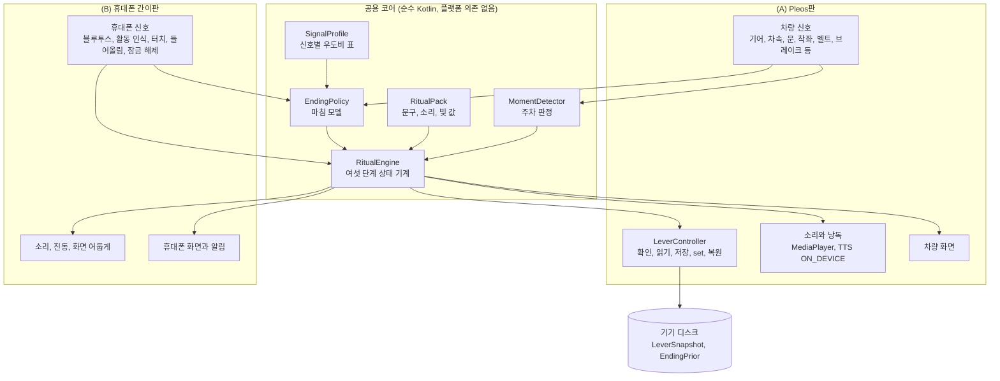
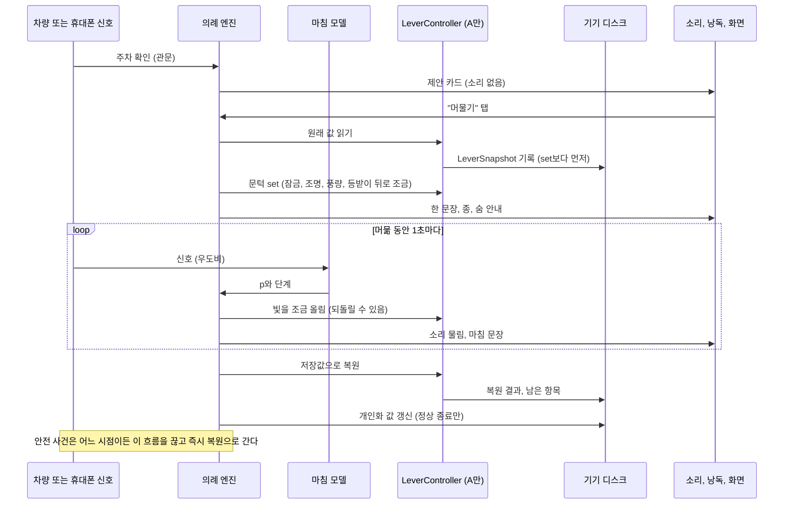

# 07 아키텍처: 룸19

> 상태: 3관문 대기. 본문은 아직 검토·병합하지 않았다. 11절의 모델 그림만 2관문에서 먼저 그렸다.

## 문서 정보
- 작성 날짜: 2026-11-15
- 담당: 제품 설계 (역할 기준)
- 전제: `../../../40_app/harness/00_결정_브리프.md`, `05_domain-model.md`, `06_prd.md`
- 근거: `codeyourapp-submission` 저장소(`core`, `app`, `docs/04-vehicle-integration.md`), `10_research/android-pleos/2026-11-15_룸19모드_차량제어_가능성.md`, `2026-11-15_마침신호_SDK가용성.md`
- 표기: [실측] 에뮬레이터 직접 확인, [문서] 문서로만 확인, [모름] 문서에도 없음, [가정] 우리 판단, [계획] 아직 만들지 않음

## 1. 한 장 요약

신호를 읽고, 의례 엔진이 단계를 정하고, 출력(차량 set, 소리, 문장)을 내보내고, 끝나면 저장해 둔 값으로 되돌린다. 모든 판단은 기기 안에서 끝난다. 신호가 끊기면 닫는 쪽으로 넘어간다.

핵심 로직(주차 판정, 마침 모델, 의례 상태 기계, 의례 팩)은 플랫폼을 모르는 공용 코어에 둔다. 그 위에 두 제품이 선다.

## 2. 구성 요소

| 구성 요소 | 책임 | 입력 | 출력 | 위치 | 상태 |
|---|---|---|---|---|---|
| MomentDetector | 주차, 정차, 주행 판정. 신호가 없으면 주행 | 기어, 움직임 | Moment | 코어 | 있음, 테스트 7개 통과 |
| EndingPolicy | 끝날 준비 p 추정, 네 단계 문턱, 히스테리시스, 개인화 갱신 | 경과 시간, 신호 | p, 단계 | 코어 | 있음, 테스트 10개 통과 |
| RitualEngine | 여섯 단계와 일시정지, 안전 이탈 전이. 출력 지시 | Moment, 사용자 탭, 안전 사건, 마침 단계 | 단계, 출력 명령 | 코어 | [계획] |
| RitualPack | 문구, 낭독 본문, 소리 이름, 빛 값을 담는 데이터 | 없음 | 팩 | 코어 | [계획] 값은 여정 문서에 있음 |
| SignalProfile | 에디션별 신호와 우도비 표 | 없음 | 표 | 코어 | 차량 신호 표는 있음. 휴대폰 표는 [계획] |
| GearSource, SpeedSource | 기어와 차속 구독 | Vehicle SDK, AAOS | 상태 흐름 | A 앱 | 있음 |
| VehicleSignalSources | 문, 착좌, 벨트, 브레이크, 방향지시등, 전조등, 공조, 창문 구독 | Vehicle SDK | Signal, SafetyEvent | A 앱 | [계획] API는 [문서] |
| LeverController | capability 확인, get, 디스크 저장, set, 복원. 앱이 set한 직후의 값 변화를 신호에서 거른다 | 출력 명령 | LeverChange | A 앱 | 탐침(`ControlProbe`)으로 호출 확인 [실측], 제품 코드는 [계획] |
| SnapshotStore | LeverSnapshot, RestoreTask, EndingPrior 저장 | 값 | 파일 | A, B 앱 | [계획] |
| AudioOutput | 종, 낭독, 배경음. 오디오 포커스 처리 | 출력 명령 | 소리 | A, B 앱 | [계획] |
| PhoneSignalSources | 차량 블루투스 연결 상태, 활동 인식, 터치, 들어올림, 잠금 해제 | 휴대폰 OS | Signal, SafetyEvent | B 앱 | [계획] |

## 3. 데이터 흐름

## 4. 두 제품

### 4.1 (A) Pleos판: 차량 제어 전체

| 항목 | 내용 | 확인 상태 |
|---|---|---|
| 플랫폼 | Pleos Connect (Android Automotive 기반), Vehicle SDK 2.3.2 | 에뮬레이터 Pleos_Connect v2.1.0 (API 34) [실측] |
| 계기 | 기어 P + 차속 0 + 운전석 착좌 + 문 닫힘, 6초 뒤 제안 카드 | 기어와 차속 구독은 앱에 있음. 착좌와 문 [문서] |
| 제어 | 앰비언트 밝기와 색, 풍량, 온도, 내외기, 열선, 창문, 도어 잠금, 등받이 이동 | 10개 호출 중 9개 반영 [실측]. 통풍은 SDK 성공이나 반영 미확인 |
| 제어 제한 | 등받이와 도어 잠금은 D단에서 50001로 거부. 공조, 조명, 창문은 D단에서도 됨 | [실측] |
| 권한 | 매니페스트 선언만으로 부여됨 | 에뮬레이터 [실측]. 양산 App Market 승인 [모름] |
| 마침 신호 | 화면 터치, 벨트, 브레이크, 방향지시등, 전조등, 공조와 창문 수동 조작, 등받이 | 화면 터치만 확실. 나머지 [문서]. 등받이 위치 조회는 0만 돌려줌 [실측] |
| 소리 | 앱이 직접 재생. 시스템 볼륨과 소음 제거는 SDK 없음 | [문서] |
| 낭독 | TTS ON_DEVICE | [문서], 에뮬레이터 동작 미확인 |
| 시동 OFF 동작 | 앱과 set이 살아 있는지 | [모름], 실차 필요 |

### 4.2 (B) 휴대폰 간이판: 일반 차용

차량 제어가 없다. 휴대폰이 "주차했다"를 짐작하고, 문턱은 문구와 화면, 소리로 대신한다. 아래 OS 기능은 공개된 표준 기능이지만 **팀이 실측한 것은 없다.** 전부 [가정]으로 두고 프로토타입에서 확인한다.

| 항목 | 안드로이드 | iOS | 확인 상태 |
|---|---|---|---|
| 계기 1: 차량 블루투스 끊김과 연결 | 블루투스 연결 상태 알림 수신 (근처 기기 권한 필요) | 앱이 직접 받기 어렵다. 단축어 자동화("CarPlay 또는 블루투스 연결이 끊기면 앱 열기")나 오디오 경로 변경으로 대신 | [가정] 팀 실측 없음 |
| 계기 2: "차량 안"에서 "정지"로 | 활동 인식 전환 API (신체 활동 권한) | Core Motion 활동 (동작 권한) | [가정] 지연과 정확도 미확인 |
| 계기 3: 주차 상태 | Android Auto 연결 여부 조회. 앱 화면을 차량에 띄우는 것은 허용 범주가 제한적 | CarPlay는 범주별 자격이 필요 | [가정] 허용되는 범위에서만. MVP에서는 쓰지 않는다 |
| 문턱 | 문구 한 문장, 화면 어둡게, 방해금지 켜기 안내(사용자가 직접) | 같음 | [계획] |
| 숨과 머묾 | 화면의 원, 낭독, 진동 | 같음 | [계획] |
| 마침 신호 | 화면 터치, 휴대폰 들어올림(가속도), 잠금 해제, 차량 블루투스 재연결 | 같음. 백그라운드 제약이 더 크다 | [가정] |
| 안전 관문 | "차량 이동"이 감지되면 소리 0, 화면 닫음. 자동으로 이어 가지 않는다 | 같음 | [계획] |
| 권한이 없을 때 | 알림 없음. 사용자가 직접 여는 수동 시작만 | 같음 | [계획] |

간이판의 초기 우도비 [가정]: 화면 터치 3 (차량판과 같음), 들어올림 4, 잠금 해제 5, 차량 블루투스 재연결 10. 차량판과 마찬가지로 실사용 기록으로 다시 맞춘다.

### 4.3 공용 코어: 무엇을 어떻게 나누나

| 나누는 것 | 방법 | 근거 |
|---|---|---|
| 마침 모델 | `core`의 `EndingPolicy`를 그대로 쓴다. 지금 import가 `kotlin.math`뿐이라 Kotlin Multiplatform 공용 모듈로 옮길 수 있다 | 코드 확인 [실측] |
| 신호 표 | 지금은 `EndingSignal` enum에 우도비가 박혀 있다. `observe`가 우도비 값을 받도록 넓히고, 표는 에디션별 SignalProfile로 둔다 | [계획] 작은 변경 |
| 주차 판정 | `MomentDetector`를 쓴다. 간이판은 기어 대신 "차량 블루투스 끊김, 정지"를 입력으로 넣는다 | [계획] |
| 의례 팩 | 문구, 낭독, 소리, 빛 값을 데이터로 두고 두 앱이 같은 파일을 읽는다. 간이판은 빛 값을 화면 밝기로 해석한다 | [계획] |
| 적합성 시험 | `sim/journey/scenarios.json`의 시각별 p 값을 골든 벡터로 삼아 두 에디션이 같은 값을 내는지 본다 | 파일 있음 |

안드로이드 간이판은 코어를 그대로 붙인다. iOS는 두 길이 있다. (1) Kotlin Multiplatform으로 코어를 iOS 프레임워크로 내보낸다. (2) 같은 명세를 Swift로 다시 쓰고 골든 벡터로 맞춘다. 어느 쪽이든 골든 벡터가 기준이다. 선택은 본선 뒤로 미룬다 [가정].

## 5. 기기 안 경계

| 경계 | 넘는 데이터 | 통제 | 기록 |
|---|---|---|---|
| 앱과 차량 버스 | 차량 값 읽기, set 명령 | capability 확인, 저장 먼저, 운전석 구역만, P단에서만 시작 | LeverChange |
| 앱과 디스크 | LeverSnapshot, 세션 요약, 개인화 값 | 앱 전용 저장소. 사용자가 지울 수 있다 | 없음 |
| 앱과 네트워크 | **없음** | 네트워크 호출을 하지 않는다. 빌드 뒤 매니페스트와 트래픽으로 확인한다 [계획] | |
| 앱과 마이크 | **없음** | 권한을 선언하지 않는다 | |
| 앱과 휴대폰 센서 (B) | 블루투스 연결 상태, 활동 종류, 터치 | 권한을 거절해도 수동 시작으로 쓸 수 있다. 위치는 읽지 않는다 | 없음 |
| 검증 참가자와 팀 | 세션 수, 길이, 버튼 여부 같은 요약 숫자 | 참가자가 화면에서 보고 직접 내보낸다. 자동 전송 없음 [가정] | 동의서 |

기도 내용은 어디에도 없다. 마이크가 없으니 수집할 길이 없다. 남는 것은 "몇 분 머물렀나"와 개인화 값 네 개뿐이다.

## 6. 외부 서비스

| 서비스 | 목적 | 보내는 것 | 받는 것 | 제약 | 대체 |
|---|---|---|---|---|---|
| Pleos Vehicle SDK | 차량 신호와 제어 | set 명령 | 값, 콜백 | 차종별 지원, 양산 승인 | 레버 건너뛰기 |
| Pleos TTS (ON_DEVICE) | 낭독 | 문장 텍스트 (기기 안) | 음성 | 에뮬레이터 동작 미확인 | 녹음 음원 |
| 클라우드, 분석, 광고 SDK | 쓰지 않는다 | | | | |

구독이 들어오면 스토어 결제 확인이라는 네트워크 경계가 하나 생긴다. 그때도 세션 기록은 보내지 않는다 [가정, PM 결정 필요].

## 7. 저장과 삭제

| 데이터 | 저장소 | 보존 | 삭제 |
|---|---|---|---|
| LeverSnapshot, RestoreTask | 앱 전용 디스크 | 복원이 끝날 때까지 | 복원 뒤 자동 삭제 |
| 세션 요약 (길이, 종료 사유, 버튼 여부) | 앱 전용 디스크 | 사용자가 지울 때까지 | 설정의 "기록 지우기" |
| EndingPrior (m, κ, α, β) | 앱 전용 디스크 | 같음 | 같음. 지우면 초깃값으로 |
| 신호 원본 | 메모리 | 세션 동안 | 세션 끝에 버림 |

## 8. 닫는 쪽으로 실패한다

| 실패 | 알아채는 법 | 대응 | 심각도 |
|---|---|---|---|
| 기어나 차속 신호 없음 | null | 주행으로 간주. 제안도 세션도 없음 | 높음 |
| 세션 중 기어 P 이탈, 차속 발생 | 구독 | 소리 즉시 0, 빛은 1.5초에 걸쳐 저장값으로, 나머지 레버 바로 복원, 화면 비움. 모델 갱신 없음 | 높음 |
| 세션 중 신호 끊김 | 구독 실패 콜백 | 안전 이탈과 같게 처리 | 높음 |
| get 실패 | 콜백 | 그 레버는 바꾸지 않는다 | 중간 |
| set 거부 | 예외 50001 | 건너뛴다. 복원 때면 다음 P단으로 미룬다 | 중간 |
| 좌석 이동 중 문 열림 | 문 구독 | 이동 즉시 정지 | 높음 |
| 앱 강제 종료 | 다음 실행 때 남은 LeverSnapshot | P단이면 복원을 묻는다 | 중간 |
| 낭독 실패 | TTS 오류 | 화면에 같은 문장만 | 낮음 |
| 마침 신호가 하나도 안 옴 | 구독 없음 | p는 시간만으로 오른다 (로그정규 누적분포와 같음, 테스트 통과). 30분 상한 | 낮음 |
| 휴대폰 이동 감지 (B) | 활동 인식 | 소리 0, 화면 닫음 | 높음 |

원칙은 셋이다. 모르면 주행으로 본다. 되돌릴 수 없으면 바꾸지 않는다. 안전 사건은 마침 모델과 의례 엔진보다 먼저 처리한다.

## 9. 확인한 것과 가정한 것

| 주장 | 상태 | 근거 |
|---|---|---|
| 서드파티 앱이 권한 선언만으로 차량을 제어한다 | [실측] 에뮬레이터 | 차량제어 가능성 문서, 탐침 로그 |
| 조명, 공조, 열선, 창문, 잠금, 등받이 set이 된다 | [실측] 10개 중 9개 반영 | 같은 문서 |
| 좌석과 잠금은 P단에서만 된다 | [실측] D단 50001 | 같은 문서 |
| 주차 판정이 신호 없을 때 주행으로 떨어진다 | [실측] 단위 테스트 | `MomentDetectorTest` |
| 마침 모델의 수식과 문턱이 설계대로 동작한다 | [실측] 단위 테스트 10개 | `EndingPolicyTest` |
| 벨트, 브레이크, 방향지시등, 전조등, 문 구독이 된다 | [문서] | 마침신호 SDK 가용성 문서 |
| 등받이 위치를 읽어 신호로 쓴다 | 위험. 에뮬레이터 get이 0 고정 [실측] | 같은 문서 |
| TTS ON_DEVICE, 주차 중 오디오 재생 | [문서] | 같은 문서 |
| 시동 OFF에서 앱과 복원이 동작한다 | [모름] | 같은 문서 |
| 실차에서 같은 결과가 난다 | [모름] | 실차 시험 없음 |
| 우도비, 비용 비율 | [가정] | 마침 모델 문서 |
| 단계별 빛 값 (문턱 `#FFB15C` 20%, 머묾 `#FF9A3C` 15%, 돌아옴 `#FFC489` 30%, 닫을 때 1.5초에 저장값으로) | 결정됨. 값은 실차 측정 전까지 가설 | `D14_조명/02_조명_통합설계_v2.md` |
| 간이판의 블루투스, 활동 인식 계기 | [가정] | 팀 실측 없음 |
| 코어를 Kotlin Multiplatform으로 옮길 수 있다 | 코드상 가능 [실측: 플랫폼 import 없음], 빌드는 [계획] | `EndingPolicy.kt`, `DriveMoment.kt` |

## 10. 시연과 실제의 차이

| 영역 | 시연 | 실제에 필요한 것 | 위험 |
|---|---|---|---|
| 차량 | 에뮬레이터와 Virtual Console | 실차, 차종별 capability | 값의 범위와 속도가 다를 수 있다 |
| 마침 신호 | 화면 터치와 콘솔에서 넣을 수 있는 신호 | 벨트, 브레이크의 실제 구독 | 콘솔에 주입 카드가 없으면 시연에서 재현 못 함 |
| 마침 모델 재생 | `sim/journey`는 설계값 재생이라고 화면에 표기 | 실사용 기록으로 다시 맞춘 값 | 가정값을 측정값처럼 보이게 하지 않는다 |
| 권한 | 선언만으로 부여 | App Market 심사 | 일부 제어가 막힐 수 있다 |
| 간이판 | 안드로이드 프로토타입 | iOS, 스토어 심사 | 백그라운드 제약 |

## 11. 모델 그림 (2관문에서 먼저 그렸다)

아키텍처 본문의 검토와 병합은 3관문 몫이다. 다만 PM이 제품 정의와 함께 볼 수 있게 그림을 먼저 그렸다. 원본은 `../models/src/`, 다시 그리려면 `python3 ../models/build.py`.

| 그림 | 파일 | 무엇을 보이나 |
|---|---|---|
| 사용자 여정 지도 | `../models/01_사용자_여정_지도.png` | 귀가 직전 15분의 단계별 행동, 속마음, 감정, 차, 화면, 우리가 정한 것 |
| 시스템 컨텍스트 | `../models/02_시스템_컨텍스트.png` | 운전자, 차량판, 간이판, 현대자동차, 감수 자문. 서버와 마이크가 없다는 것 |
| 구성 요소 | `../models/03_구성_요소.png` | 공용 코어 하나와 두 판 |
| 데이터 흐름 | `../models/04_데이터_흐름.png` | 기기 안 경계와 경계를 넘지 않는 것 |
| 세션 상태 기계 | `../models/05_세션_상태.png` | 여섯 단계, 두 가지 멈춤, 안전 이탈, 건넴 |
| 시퀀스: 문턱 | `../models/06_시퀀스_문턱.png` | 저장, 바꾸기, 확인, 들어섬 신호, 첫 문장 |
| 시퀀스: 마침과 건넴 | `../models/07_시퀀스_마침.png` | 신호, 확률, 빛·소리·문장, 복원, 다음 걸음 |
| 도메인 모델 | `../models/08_도메인_모델.png` | 개체와 관계 |
| 시퀀스: 끼어듦 | `../models/09_시퀀스_멈춤.png` | 붙잡아 두기, 이어 가기, 조용히 마치기 |
| 화면 흐름 | `../models/10_화면_흐름_에뮬레이터.png` | 에뮬레이터 앱 영역 기준 화면 상태와 문구 |

이 문서 본문과 그림이 다른 곳: 레버 제어기의 "확인"(바꾼 값을 다시 읽어 대조) 단계와 안전 가드를 구성 요소로 드러낸 것, MLP가 바꾸는 레버를 넷(잠금, 빛, 바람, 등받이)으로 줄인 것, 등받이 방향(뒤로 조금). 3관문에서 본문을 그림에 맞춘다.

