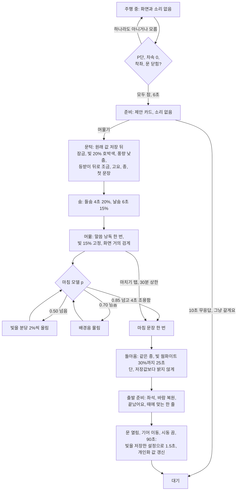
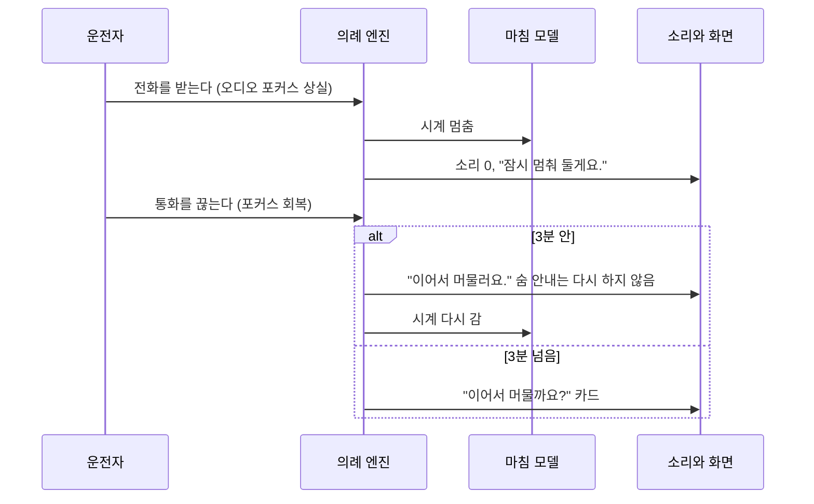
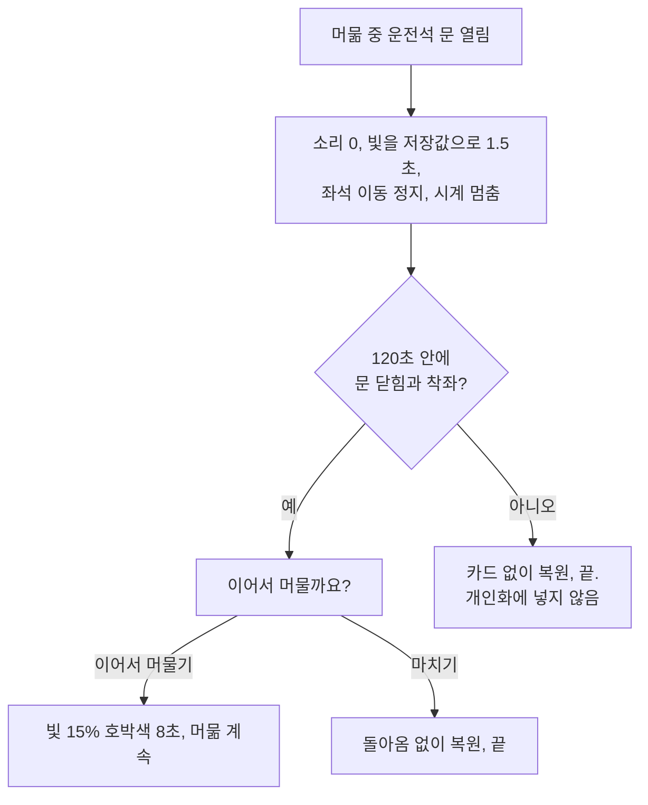
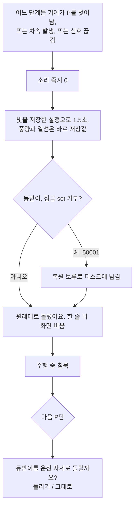
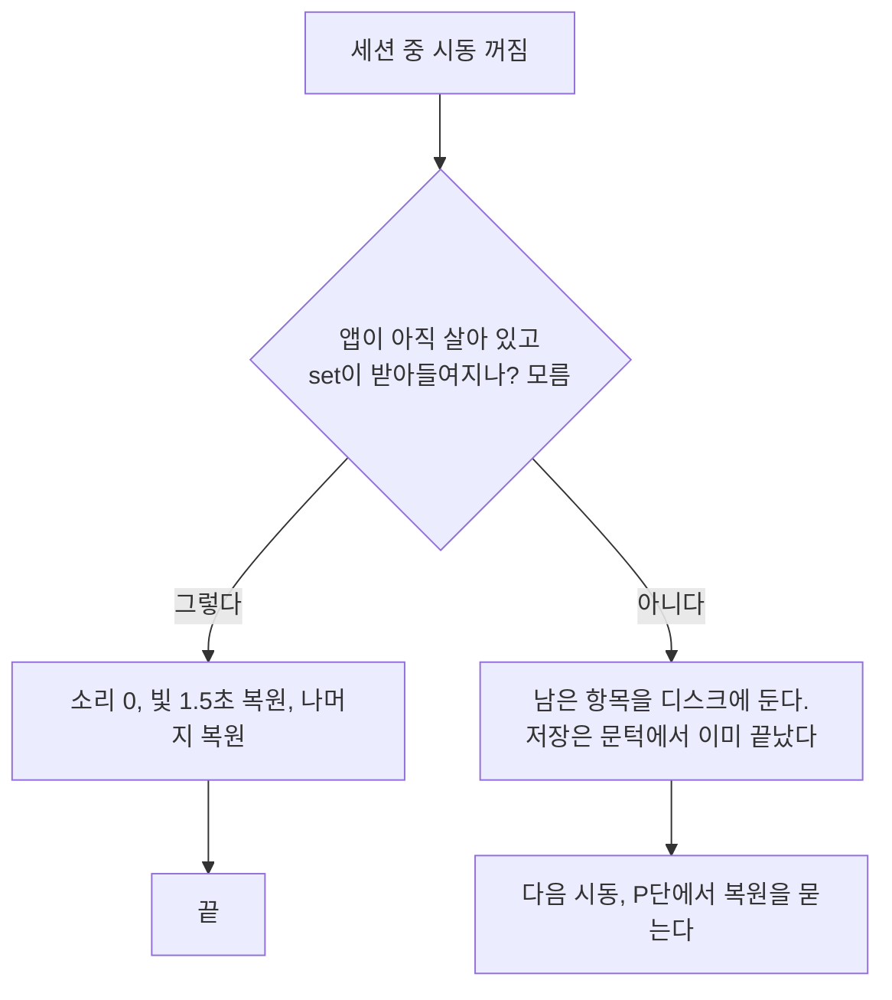

# 09 흐름: 룸19

> 상태: 3관문 대기. 다만 5절(들어섬, 멈춤, 건넴)과 6절(에뮬레이터 MLP 화면 흐름)은 2관문에서 새로 썼고, 7절(기도 내용의 흐름)을 보완으로 더했다(`../GATE2_검토요청.md`).

## 문서 정보
- 작성 날짜: 2026-11-15
- 담당: 제품 설계 (역할 기준)
- 전제: `05_domain-model.md`, `08_feature-spec.md`
- 근거: `codeyourapp-submission/docs/journey/여정_초정밀.md` (시나리오 A와 C), 빛 값은 `D14_조명/02_조명_통합설계_v2.md` (실차 측정 전까지 가설)
- 시각은 15분 기도, 밤, Pleos판 기준이다.

## 1. 주 흐름

## 2. 흐름 표

| 단계 | 경과 | 사람 | 시스템 | 출력 | 실패 대응 | 보이는 증거 |
|---|---|---|---|---|---|---|
| 준비 | P단 뒤 6~7초 | 화면을 본다 | 관문 확인, 카드 표시 | "잠시 머물다 갈까요" | 신호 없으면 표시 안 함 | 카드, 로그 |
| 문턱 | 0:00~0:08 | [머물기] | 저장 뒤 set | 문장, 빛 20% `#FFB15C`, 종 한 번 | get 실패 레버는 안 바꿈. set 거부는 건너뜀 | 콘솔의 조명, 풍량, 창문 값 |
| 숨 | 0:10~1:10 | 숨 여섯 번 | 빛을 숨에 맞춤 | 원, 첫 한 번만 낭독 | 빛 지연이 크면 15% 고정 | 조명 값의 오르내림 |
| 머묾 | 1:10~ | 기도 | 마침 모델 가동, 1초마다 관문 확인 | 낭독 한 번, 검은 화면 | 낭독 실패 시 화면 문구 | p 로그 |
| 마침 | 약 14~17분 | 눈을 뜬다, 몸을 세운다 | 신호로 p 갱신 | 빛 올림, 소리 물림, 한 문장 | 머묾 쪽 신호면 20초에 되돌림 | 단계 로그 |
| 돌아옴 | 마침 뒤 약 45~90초 | 고개를 든다 | 빛, 좌석, 바람 순서로 복원 | 종 한 번, `#FFC489` 30% | 좌석 이동 중 문 열림이면 정지 | 콘솔 값 |
| 출발 준비 | 복원 뒤 | 화면을 보고 내리거나 출발한다 (닫기 버튼 없음) | 저장값과 대조, 개인화 갱신 | "끝났어요." | 남은 항목은 복원 보류 | 저장값과 현재 값 비교 |

간이판(B)은 문턱에서 저장과 set이 빠지고, 빛 대신 화면 밝기를 쓴다. 준비의 계기는 차량 블루투스 끊김 또는 정지 감지 알림이다 [가정].

들어오는 길은 둘이다(DEC-016). 하나는 운전을 마치고 주차한 직후(출근 전 회사 주차장, 귀가 직전 집 주차장)이고, 다른 하나는 일과 중 정한 기도 시간에 세워 둔 차로 가서 탄 뒤다. 뒤의 경우에도 위 그림의 같은 관문(P단, 차속 0, 착좌, 문 닫힘)을 지나 준비로 들어가고, 끝나면 복원한 뒤 일하러 돌아간다. 낮이면 빛은 낮 값(문턱 25%, 머묾 20%)을 쓴다. 간이판은 정한 시각의 휴대폰 알림이 계기다 [가정: 08 F-17]. 앱은 시동을 걸지 못하고, 차 안 앱은 차 밖의 사람에게 알리지 못한다.

## 3. 예외 흐름

### 3.1 전화

포커스 신호가 실제로 오는지는 [문서] 단계다. 오지 않으면 화면을 한 번 두드리는 것으로 일시정지한다.

### 3.2 문 열림

### 3.3 기어 이탈

등받이는 문턱에서 운전 자세보다 뒤로 조금만 기울인 상태다. 복원이 미뤄져도 운전에 지장이 없도록 기울이는 양을 작게 잡는다 [가정: 실차 이동량 확인 필요].

### 3.4 시동 꺼짐

시동 OFF와 ACC에서 앱, 화면, 오디오, set이 어떻게 되는지는 문서에 없다 [모름]. 그래서 이 흐름은 "문턱에서 저장을 먼저 끝낸다"는 한 가지에만 기대도록 짰다. 실차 시험 전에는 시연에서 보여 주지 않는다.

### 3.5 예외 요약

| 상황 | 계기 | 기대 동작 | 사건 |
|---|---|---|---|
| 전화 | 오디오 포커스 상실 | 일시정지, 시계 멈춤 | SessionPaused |
| 문 열림 | 운전석 문 | 소리 0, 빛 1.5초 복원, 좌석 정지 | SessionPaused |
| 자리 비움 120초 | 착좌 해제 | 복원하고 끝 | SessionAbandoned |
| 기어 이탈 | 기어, 차속 | 즉시 복원, 화면 비움 | SafetyExitTriggered |
| 시동 꺼짐 | 시동 상태 [모름] | 가능한 만큼 복원, 나머지 보류 | IgnitionTurnedOff, RestoreDeferred |
| set 거부 | 50001 | 건너뜀 | LeverRejected |
| 잠듦 | 30분 | 반드시 닫음 | EndingStageChanged |
| 더 머물고 싶음 | 머묾 쪽 신호 | 빛과 소리를 20초에 되돌림 | SignalObserved |
| 휴대폰 이동 감지 (B) | 활동 인식 | 소리 0, 화면 닫음, 자동 재개 없음 | SafetyExitTriggered |

## 4. 시연 순서 (본선, 에뮬레이터)

| 시간 | 화면과 조작 | 말할 것 | 보이는 증거 | 보이는 안전 장치 | 예비 |
|---|---|---|---|---|---|
| 0:00 | 콘솔에서 D단, 주행 | 주행 중에는 아무것도 없다 | 빈 화면 | 주차 관문 | 녹화 영상 |
| 0:15 | P단으로 | 6초 뒤 조용한 카드 | 카드 | 자동 시작 없음 | |
| 0:30 | [머물기] | 저장하고 나서 바꾼다. 준비가 끝나면 종이 한 번 울린다 | 콘솔의 조명 20%, 풍량, 잠금 | 저장 먼저 | 탐침 로그 캡처 |
| 0:50 | 숨, 머묾 (빨리 감기) | 빛이 숨을 따라 내려앉는다 | 조명 15% 고정 | | |
| 1:20 | 화면 터치 | 묻지 않고 알아챈다 | p와 단계 표시 (시연용 겹쳐 보기) | 비대칭 문턱 | `sim/journey` 재생 (설계값 재생이라고 표기) |
| 1:50 | 마침 문장, 복원 | 차가 원래대로 돌아온다 | 콘솔 값이 저장값과 같음 | 저장값보다 밝지 않게 | |
| 2:20 | 다시 시작한 뒤 D단으로 | 운전이 시작되면 물러난다 | 소리 0, 값 복원, 화면 비움 | 안전 이탈 | |

시연의 빨리 감기와 p 겹쳐 보기는 시연용이다. 제품 화면에는 p가 보이지 않는다.

## 5. 들어섬, 멈춤, 건넴 (2관문 보강)

1절 그림과 2절 표는 이전 판이다. 다른 곳은 아래가 이긴다. 그림: `../models/06_시퀀스_문턱.png`, `../models/07_시퀀스_마침.png`, `../models/09_시퀀스_멈춤.png`, `../models/05_세션_상태.png`.

- **문턱은 12초다.** 0초 머물기, 0.6초까지 저장, 6초까지 말없이 잠금·빛·바람·등받이 뒤로 조금, 6~7초 고요, 7초 종과 빛 한 줄의 움직임, 9초 첫 문장 "문을 닫았어요. 숨을 한 번 고를게요.", 12초 숨. 창문은 닫지 않는다. 값은 [가정]이고 08 F-18이 정본이다.
- **멈춤은 둘이다.** 방을 지킨 멈춤(전화, 창문, 길게 누름)과 문이 열린 멈춤(문, 자리 비움). 3.1과 3.2의 그림은 그대로 맞고, 창문을 내린 경우가 3.1과 같은 길로 더해진다. 08 F-10.
- **멈춘 뒤에는 처음부터 다시 하지 않는다.** 멈춘 자리에서 잇거나, 정한 시간 안에 돌아오지 않으면 말없이 되돌리고 닫는다. 이어 가라고 조르지 않는다. 두 버튼으로 묻던 화면은 [이어서 머물기] 하나로 줄였다. 3.1과 3.2 그림의 "이어서 머물까요?" 카드는 이 규칙으로 읽는다.
- **끝은 메뉴가 아니다.** 때와 지난 행동과 차의 신호로 뜻을 짐작해(집에 가는 길, 일하다 잠깐, 곧 출발, 오늘은 마음이 아님) 맞는 상태를 준비하고 말은 많아야 한 문장이다. 권하는 것은 많아야 하나다.
- **끝은 버튼 없이 닫힌다.** 묻지 않고 끝나고, 먼저 멈추고 싶을 때만 마치기 한 번이다. 출발 준비에서 문을 열거나 기어를 옮기거나 90초가 지나면 빛을 원래 설정으로 돌리고 물러난다. 등받이는 돌아옴에서 이미 운전 자세다. 08 F-21.

## 6. 에뮬레이터 MLP 화면 흐름 (2관문 신규)

그림: `../models/10_화면_흐름_에뮬레이터.png`. 에뮬레이터 화면은 왼쪽 3분의 1이 시스템의 주행 화면, 아래가 시스템 메뉴 줄이고 룸19는 오른쪽 앱 영역만 쓴다(팀이 캡처에서 잰 비율: 왼쪽 33%, 아래 10% [실측, 콘티 E0]). 문구는 디자인 컨셉 "문틈의 빛"과 화면 기능 명세를 따르고, 2관문에서 바꾼 곳은 "바뀜"으로 표시했다.

| # | 화면 상태 | 들어오는 길 | 목소리 줄 (큰 글자) | 보조와 차 상태 줄 | 버튼 | 소리 | 나가는 길 |
|---|---|---|---|---|---|---|---|
| 0 | 홈(시스템) | 기어 P | 없음 | 없음 | 메뉴 줄의 앱 목록 | 없음 | 앱 목록 |
| 1 | 앱 목록(시스템) | 메뉴 줄 | 없음 | 룸19 아이콘(검은 바탕에 빛 한 줄) | 아이콘 | 없음 | 2 |
| 2 | 준비 · 제안 | 아이콘을 누름. 또는 주차 뒤 6초에 스스로 [확인 필요] | 잠시 머물다 갈까요 | 기도 15분 (누르면 5, 10, 15, 20분. 낮에 정한 시간이면 "기도 12시 40분까지". 바뀜) | 머물기 / 오늘은 그냥 갈게요 | 없음 | 머물기 → 3. 거절 또는 10초 → 홈 |
| 2a | 준비 · 함께 | 조수석 착좌 [문서] | 같이 머물다 갈까요 (바뀜) | 기도 15분 | 같음 | 없음 | 같음 |
| 2b | 준비 · 조건이 안 맞음 | P가 아니거나 신호를 모름 | 차를 세운 뒤에 열어 주세요. | 없음 | 없음 | 없음 | 조건이 맞으면 2 |
| 3 | 문턱 · 차가 준비함 | 머물기 | 없음 (바뀜: 이때는 말이 없다) | 문 잠김 · 빛 낮추는 중 · 바람 2 · 등받이 뒤로 (실제로 바뀐 것만. 창문이 열려 있으면 "창문 열림") | 마치기 | 차의 잠금 소리뿐 | 6초 뒤 고요 1초 → 4 |
| 4 | 문턱 · 들어섬 | 준비 끝 | 문을 닫았어요. 숨을 한 번 고를게요. (바뀜) | 구절 한 줄: 네 룸19에 들어가 문을 닫고 · 마태복음 6:6 (글자만) | 마치기 | 종 한 번, 2초 뒤 같은 문장 낭독 | 12초 → 5 |
| 5 | 숨 | 4 | 원 안에 들이쉬고 → 내쉬고 (첫 숨만) | 둘째 숨부터 구절 두 토막. 두드리면 건너뜀 | 마치기 | 첫 숨만 낭독 | 숨 여섯 번 → 6 |
| 6 | 머묾 | 5 | 없음 | 점 셋 ● ○ ○ (16초 뒤 사라짐) | 마치기 (아주 흐리게) | 말씀 낭독 한 번 | 마침 모델 → 8. 마치기 → 8 |
| 6a | 머묾 · 깨어남 | 화면을 한 번 두드림 | 없음 | 점 셋 ● ● ○ (지금 깊이). 시계 없음. 돌아갈 시각을 정한 사람만 "12:27". 아래에 낱말 셋: 말씀 · 기도문 · 기도 제목 (7절) | 마치기 (또렷하게) | 없음 | 5초 뒤 6 |
| 6b | 머묾 · 낭독 실패 | 낭독 오류 | 말씀 구절 2~3줄 | 없음 | 마치기 | 없음 | 16초 뒤 6 |
| 6c | 머묾 · 말씀 | 6a에서 `말씀` | 본문 2~6절 (명조, 낮은 밝기) | 읽고, 머물고, 한 문장으로 기도합니다. | 마치기 (흐리게) | 원하면 본문 낭독 한 번. 독서등 [예정] | 90초 또는 두드림 → 6d |
| 6d | 머묾 · 말씀에 머물기 | 6c | 본문에서 고른 한 줄만 흐리게 | 없음 | 마치기 (아주 흐리게) | 없음 | 두드리면 6a. 마침 모델 → 8 |
| 6e | 머묾 · 기도문 | 6a에서 `기도문` | 기도문 한 편 | 쪽 표시 점 | 마치기 (흐리게) | 원하면 낭독 한 번 | 끝 쪽에서 두드림 또는 60초 → 6 |
| 6f | 머묾 · 기도 제목 | 6a에서 `기도 제목` (혼자일 때만) | 한 줄 | 없음 | 마치기 (흐리게) | 없음 | 두드리면 다음 줄, 마지막 뒤 6 |
| 7a | 방을 지킨 멈춤 | 전화, 창문을 내림, 길게 누름 | 잠시 멈춰 둘게요. | 없음 | 마치기 | 소리를 물림 | 3분 안에 끝남 → 7b. 넘겨 끝남 → 7c. 10분 넘김 → 말없이 복원, 홈 |
| 7b | 이어 가기 | 통화 끝, 창문 닫힘 | 이어서 머물러요. (글자만) | 없음 | 마치기 | 없음. 배경음만 천천히 돌아옴 | 8초 → 6 (멈춘 자리에서. 문턱, 숨, 낭독은 다시 하지 않음) |
| 7c | 돌아왔을 때 한 가지 | 3분 넘은 통화가 끝남. 문이 열렸다가 120초 안에 다시 앉음 | 없음 | 없음 | 이어서 머물기 (하나뿐) | 없음 | 누르면 6. 20초 안에 누르지 않으면 말없이 복원, 홈 |
| 7d | 문이 열린 멈춤 | 운전석 문 열림, 자리 비움 | 화면 비움 | 없음 | 없음 | 소리를 물림 | 120초 안 → 7c. 넘김 → 말없이 복원, 홈 |
| 8 | 돌아옴 | 마침, 마치기, 30분 | 이제 천천히 돌아올게요. | 빛 올리는 중 · 등받이 곧 운전 자세로 · 바람 1. 좌석이 움직이는 동안 "좌석을 원래대로 돌리고 있어요." | 없음 | 문장 낭독 한 번, 5초 뒤 시작과 같은 종 | 복원 끝 → 9 |
| 9 | 출발 준비 · 건넴 | 8 | 끝났어요. | 좌석과 공조를 원래대로 돌렸어요. / 등받이 운전 자세 · 바람 3 · 빛 원래 밝기 / 때에 맞는 한 줄: 천천히 올라가세요. · 12시 38분이에요. · 출발해도 좋아요. (바뀜) | 없음 (바뀜: 닫기 없음). 끝이 일렀을 법할 때만 조금 더 머물기 하나 | 없음 | 문 열림, 기어 이동, 시동 끔, 90초 → 홈. 조금 더(버튼 또는 길게 누름) → 6 |
| 9a | 출발 준비 · 못 되돌린 것이 있음 | 복원 거부 | 끝났어요. | 그 줄만 "등받이 다음 주차 때 돌릴게요" | 같음 | 없음 | 같음 |
| 9b | 출발 준비 · 30분 상한 | 상한으로 끝남 | 끝났어요. | 출발하기 전 2분만 더 앉아 있어요. | 없음 | 없음 | 같음 |
| 9c | 일찍 마침 | 60초 안에 마치기 | 화면 없음 | 없음 | 없음 | 종도 문장도 없음 | 복원 뒤 바로 홈 |
| 9d | 곧 출발 | 출발 준비에서 벨트, 브레이크, 기어 | 화면을 바로 치움 | 없음 | 없음 | 없음 | 홈 |
| 10 | 안전 이탈 | 기어 P 이탈, 차속, 신호 끊김 | 원래대로 돌렸어요. (차가 움직이면 화면 비움) | 없음 | 없음 | 0.3초에 물림 | 홈 |
| 11 | 다음 주차 때 | 10에서 등받이를 못 돌림 | 등받이를 운전 자세로 돌릴까요? | 없음 | 돌리기 / 그대로 | 없음 | 10초 → 홈 |
| 12 | 설정 | 주차 중 앱 안에서만. 세션 중에는 없음 | 없음 | 길이, 말씀 낭독 켬·끔, 목소리 끔, 제안 끔, 기도 시간(간이판), 기기 안 기록 지우기 | | | |

확인이 필요한 것: 주차 뒤 다른 앱 위에 제안이 스스로 뜰 수 있는지, 머묾 동안 왼쪽 주행 화면이 밝게 남는지, 기존 시안 7장(전체 화면과 반쪽 기준)을 앱 영역 비율에 다시 앉히는 일, 시동을 켜지 않은 차에서의 동작.

## 7. 기도 내용의 흐름 (2관문 보완)

06 17절과 08 F-23~F-27이 정본이다. 그림: `../models/05_세션_상태.png` 아래 표, `../models/01_사용자_여정_지도.png`의 "기도 내용" 줄, `../models/10_화면_흐름_에뮬레이터.png`의 "말씀과 기도문" 묶음.

| 때 | 사람 | 화면 | 소리 | 차 | 실패하면 |
|---|---|---|---|---|---|
| 7초 | 손을 내려놓고 있다 | 빛 한 줄이 가운데로 모인다 | 종 한 번 | 준비가 끝나 있다 | 준비가 늦으면 종도 늦춘다 |
| 9초 | 읽는다 | 문을 닫았어요. 숨을 한 번 고를게요. / 작은 글자: 네 룸19에 들어가 문을 닫고 · 마태복음 6:6 | 첫 문장 낭독 | | 낭독 실패 시 글자만 |
| 12초~ | 숨 여섯 번. 두드리면 건너뛴다 | 원. 둘째 숨부터 들숨에 "네 룸19에 들어가", 날숨에 "문을 닫고" | 첫 숨만 "들이쉬고, 내쉬고" | 빛이 20%와 15%를 오간다 | 구절을 끈 사람은 원만 |
| 머묾에 들어갈 때 | 손을 모은다 | 점 셋, 16초 뒤 검게 | 구절 낭독 한 번, 그 뒤 20초 이상 침묵 | 빛 15% 고정 | 낭독 실패 시 구절 2~3줄을 16초 |
| 머묾 (기본) | 자유롭게 기도한다 | 거의 검다 | 침묵. 낮은 실내 소리는 켠 사람만 | 지킨다 | |
| 머묾에서 두드림 | 읽을 것을 찾는다 | 5초 동안 낱말 셋: 말씀 · 기도문 · 기도 제목 | 없음 | | 누르지 않으면 사라진다 |
| 말씀을 엶 | 읽고, 머물고, 한 문장으로 기도한다 | 본문 2~6절. 90초 뒤 한 줄만 흐리게 | 원하면 한 번 읽어 줌 | 독서등 2~3초에 켬 [예정] | 독서등이 없거나 거부되면 화면 글자만 |
| 기도문을 엶 | 따라 읽는다 | 한 편을 큰 글자로 | 원하면 한 번 읽어 줌 | 독서등 [예정] | 같음 |
| 기도 제목을 엶 | 이름을 떠올린다 | 한 화면에 한 줄, 두드리면 다음 | 없음 | 독서등 켜지 않음 | 함께일 때는 여는 길이 없다 |
| 끝 1분 전 (사람이 정한 끝만) | 맺는다 | 변화 없음 | 작은 종 한 번 | | 멈춤 중이면 울리지 않는다 |
| 마침과 돌아옴 | 눈을 뜬다 | 이제 천천히 돌아올게요. | 문장 한 번, 5초 뒤 시작과 같은 종 | 독서등이 켜져 있으면 먼저 끈다 [예정] | |

읽을 것이 열려 있을 때 끼어드는 일은 머묾과 같다. 전화가 오면 글자를 그대로 둔 채 "잠시 멈춰 둘게요."를 띄우고, 기어가 P를 벗어나면 글자와 독서등을 포함해 전부 되돌린다. 문이 열리면 화면을 비우므로 기도 제목도 함께 사라진다.
