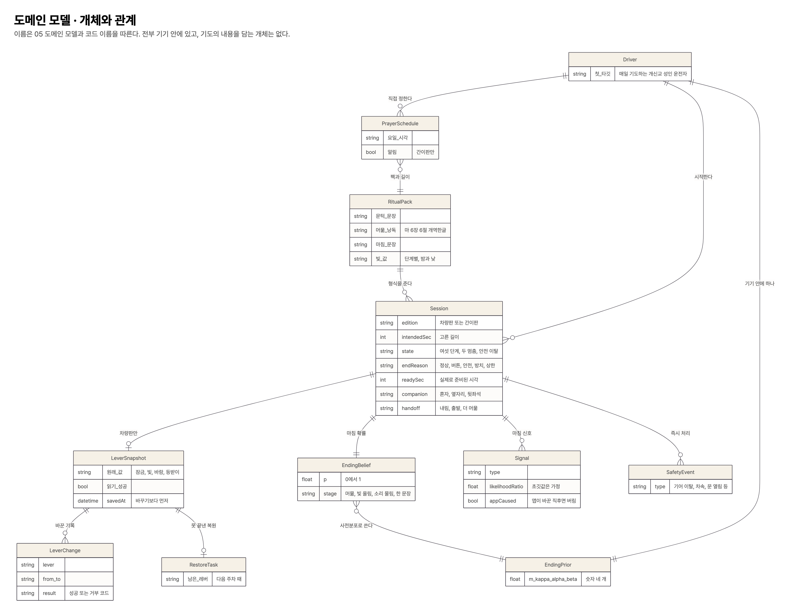
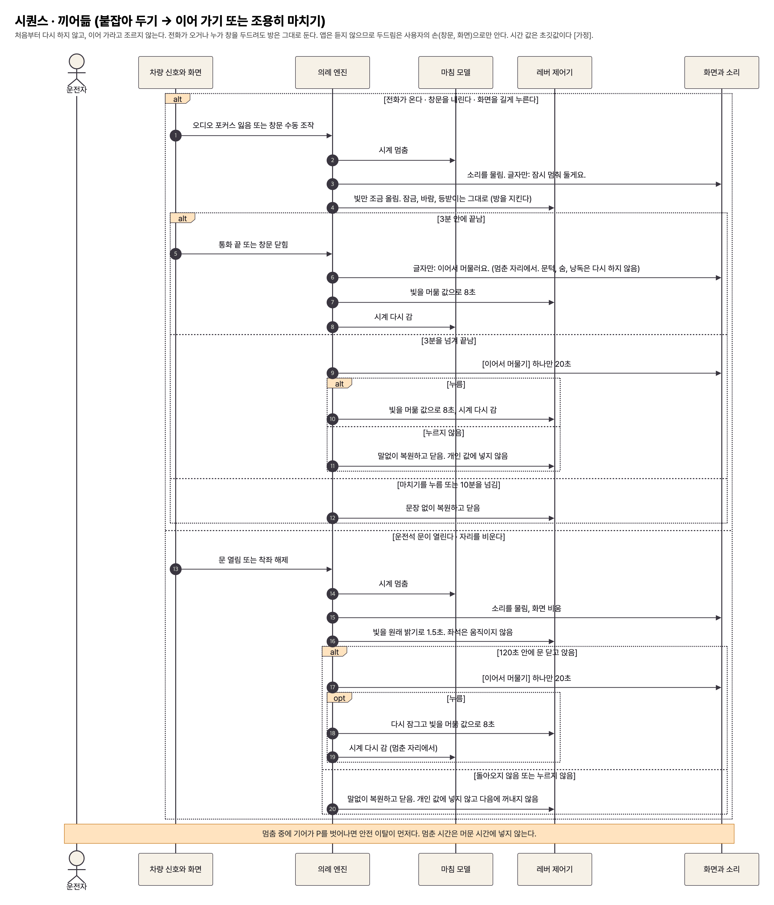
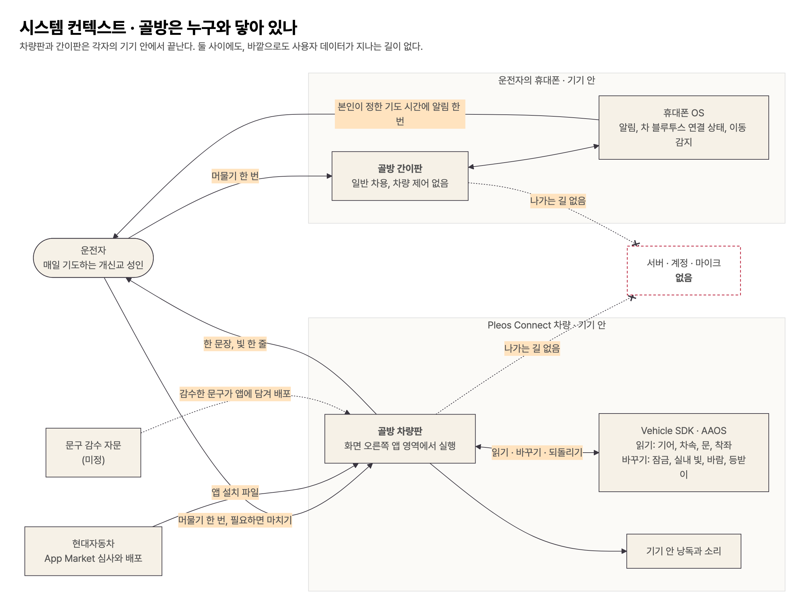
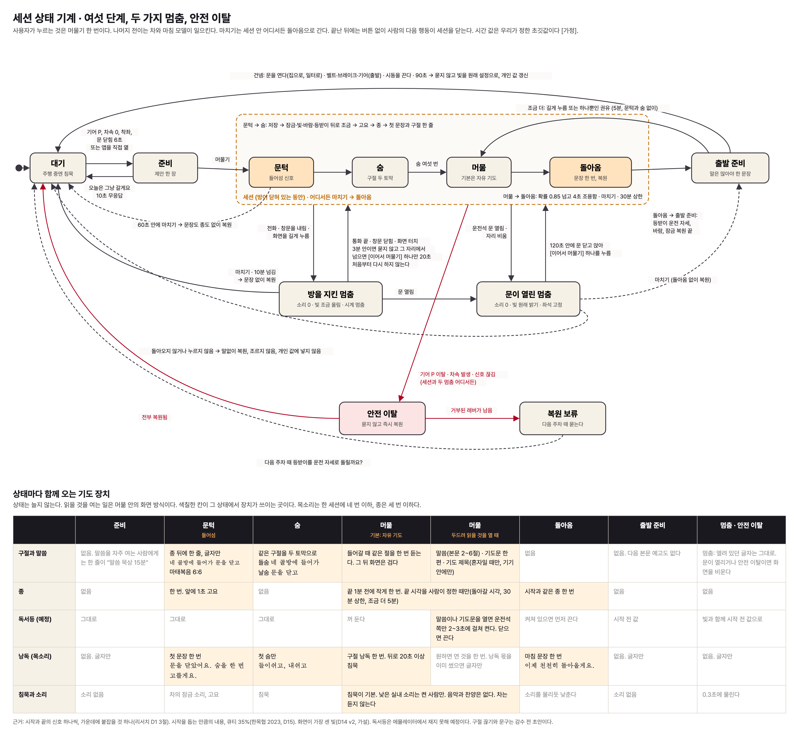

# 하네스 (Harness)
> 확인 날짜: 2026-11-15. 팀 비공개 저장소의 하네스를 공개용으로 옮겼다. 앱 이름은 룸19로 통일했다.

사업 모델(DDBM)에서 시작해 관문을 거쳐 명세(SDD)와 코드로 내려가는 설계 문서 묶음이다. 설정은 [harness.yaml](harness.yaml).

| 순서 | 문서 | 무엇 |
|---|---|---|
| 00 | [출처 기록](00_source-log.md) | 모든 근거의 번호와 원문 위치 |
| 01 | [사업 모델](01_business-model.md) · [회의 기록](01_meeting-log.md) · [캔버스 데이터](01_ddbm_canvas.json) | DDBM 11블록 |
| 관문 1 | [검토 요청](GATE1_검토요청.md) | 사업 모델 통과 여부 |
| 02 | [CPS](02_cps.md) | 맥락, 문제, 해법 |
| 03 | [원칙](03_principles.md) | 어겨지면 안 되는 규칙 |
| 04 | [정의](04_definitions.md) | 용어 |
| 05 | [도메인 모델](05_domain-model.md) | 개체와 상태 |
| 06 | [PRD](06_prd.md) | 요구사항과 장면 |
| 관문 2 | [검토 요청](GATE2_검토요청.md) | 명세로 내려가도 되는가 |
| 07 | [구조](07_architecture.md) | 구성 요소와 SDK 경계 |
| 08 | [기능 명세](08_feature-spec.md) | 기능별 수용 기준 |
| 09 | [흐름](09_flow.md) | 화면과 세션 흐름 |
| 10 | [평가 계획](10_eval-plan.md) | 테스트와 검증 항목 |
| 11 | [변경 기록](11_change-log.md) | 결정이 바뀐 이력 |
| 12 | [인계](12_handoff.md) | 다음 작업자에게 |

모델 그림 10장: [models/](models/)

| | |
|---|---|
|  |  |
| 도메인 모델 | 멈춤과 이어가기 시퀀스 |
|  |  |
| 시스템 컨텍스트 | 세션 상태 |
